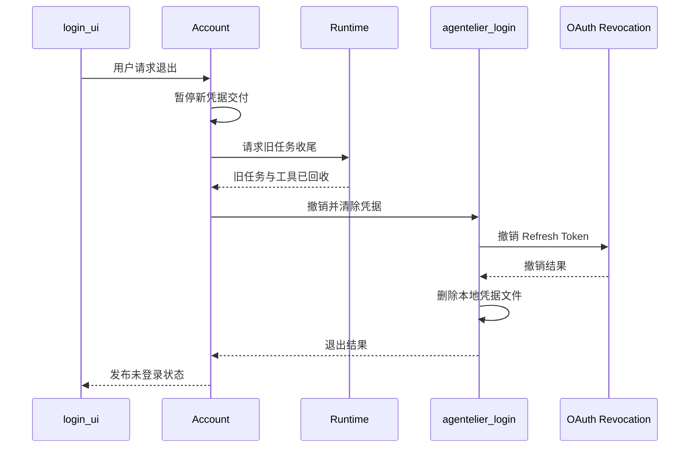

# 退出登录与授权失效收尾

## 目标

提供用户主动退出 ChatGPT 账号的完整生命周期：停止旧凭据交付，尝试撤销远端 Refresh Token，清除 Agentelier 本地 OAuth 凭据，并使绑定旧授权的执行身份失效。

## 退出流程

退出登录与普通应用关闭不同。普通关闭保留凭据以便下次启动恢复；只有用户明确执行退出操作才清除本地 OAuth 凭据。

## 旧执行身份失效

退出开始时，Account 暂停新的凭据分发并使当前授权生命周期失效。Runtime 按现有机制停止旧模型任务、回收工具与进程，并等待已接纳结果及必要的会话终态记录完成。旧任务未收尾前不能把账号状态直接切换成未登录，也不能让排队任务继续使用旧 Token。

旧会话及历史内容仍可查看。退出登录不删除会话、记忆、附件、提示词或整个数据目录。重新登录后，已有会话是否可执行仍由会话冻结的主体和 Workspace 与当前账号是否匹配决定。

## 远端撤销与本地清理

使用当前 Refresh Token 调用 OpenAI OAuth Revocation Endpoint：`https://auth.openai.com/oauth/revoke`。远端撤销属于尽力操作；即使网络不可用或撤销失败，也应继续清除本地凭据，避免用户无法退出本地账号。界面或日志应区分远端撤销失败与本地凭据清理失败。

本地凭据清理成功后，Account 发布未登录状态。若本地清理失败，不能谎报已经完全退出；应保留明确错误，并避免继续向新请求交付旧凭据。

## 完成条件

- 用户主动退出时，Account 立即停止接纳新的旧账号凭据请求。
- Runtime 完成旧任务、工具及进程收尾后，旧执行身份不能再取得凭据。
- 尝试撤销 Refresh Token；远端撤销失败不阻止本地清理。
- 本地凭据文件清除成功后显示未登录。
- 本地清理失败时明确报告，不显示为完全退出成功。
- 普通应用关闭不清除凭据。
- 退出登录不删除会话、记忆、附件或其他数据目录内容。

## 参考实现

- [Codex OAuth Token Revocation](https://github.com/openai/codex/blob/main/codex-rs/login/src/auth/revoke.rs)：撤销 Refresh Token 的请求格式和尽力撤销行为。
