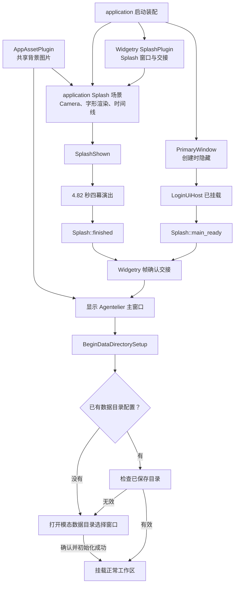

# Agentelier Splash 接入整体方案

Splash 是 Agentelier 的启动阶段演出。它在主窗口正式显示前运行，结束后把显示权交给已经准备好的主窗口。实现沿用现有 application、assets、login_ui、chat_ui 和 bevy_widgetry 分层，不增加 Agent/Bridge 业务状态，也不自行实现原生窗口管理。

## 整体结构



主窗口与 Splash 共用同一张背景图片。Splash 的字符场景使用这张图片作为人物成像目标，并在演出末尾回到原图；主窗口也使用同一资源作为窗口背景。Widgetry 负责显示时机和帧确认，application 负责场景内容、动画完成信号以及资源清理。

## 启动顺序

```text
进程启动
    ↓
创建隐藏的 PrimaryWindow，并启动 Splash
    ↓
主窗口基础 UI 挂载，提交 MainWindowReady
    ↓
Splash 首帧呈现后开始 4.82 秒演出
    ↓
Splash 演出完成，等待主窗口就绪条件
    ↓
Widgetry 完成主窗口帧确认并显示主窗口
    ↓
SplashCompleted
    ↓
application 通知 login_ui 开始数据目录初始化
    ├── 已保存目录：检查并恢复
    └── 没有可用目录：打开模态目录选择窗口
    ↓
DataDirectoryReady
    ↓
挂载正常工作区
```

Splash 每次启动 Agentelier 时都会播放，不因是否保存过数据目录而跳过。数据目录选择与恢复延后到主窗口交接完成后执行。

## 实施顺序

```text
01 主窗口共享背景与浅色主题
        ↓
02 Widgetry Splash 启动生命周期与目录选择模态化
        ↓
03 Bevy 原生字符渲染场景
        ↓
04 四幕时间线与最终窗口交接
```

这一顺序对应真实依赖：

- 共享背景资源和主窗口尺寸先确定，Splash 与主窗口才能使用相同的画面坐标。
- Splash 生命周期和主窗口启动顺序先接入，后续场景才能获得独立的渲染窗口和稳定的交接时机。
- 字符渲染建立后，再加入四幕时间线。
- 最终演出依赖前面的背景资源、窗口会话和字符渲染能力。

Splash 与 System Tray 都属于 application 层的窗口生命周期能力，但两者没有直接调用依赖。Splash 只在进程启动时播放一次；主窗口之后被托盘隐藏和恢复时，不重新播放 Splash。

## 方案导航

1. [主窗口共享背景与浅色主题](01-main-window-background-and-light-theme.md)
2. [接入 Widgetry Splash 启动生命周期](02-widgetry-splash-lifecycle.md)
3. [构建 Bevy 原生字符渲染场景](03-bevy-native-glyph-renderer.md)
4. [实现四幕时间线与最终窗口交接](04-four-act-timeline-and-handoff.md)
