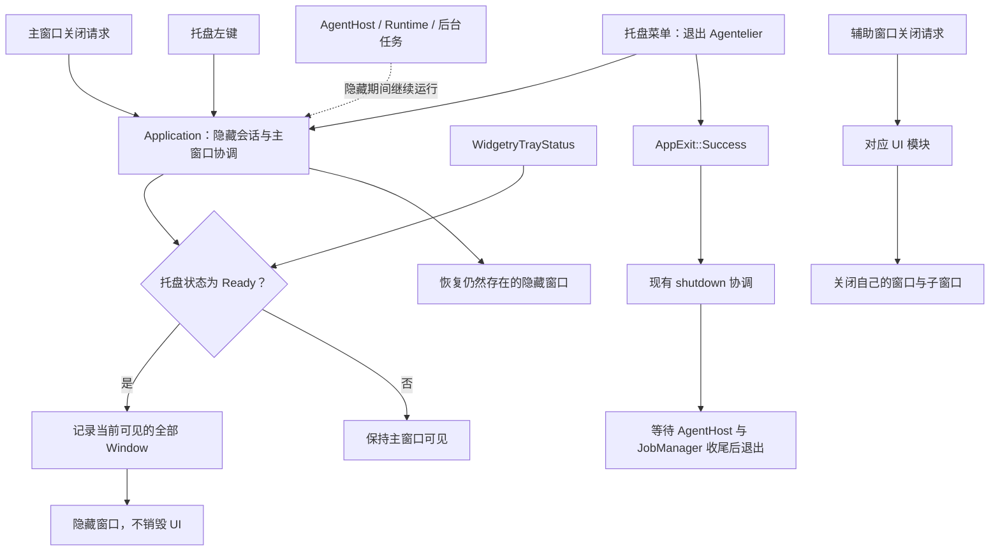
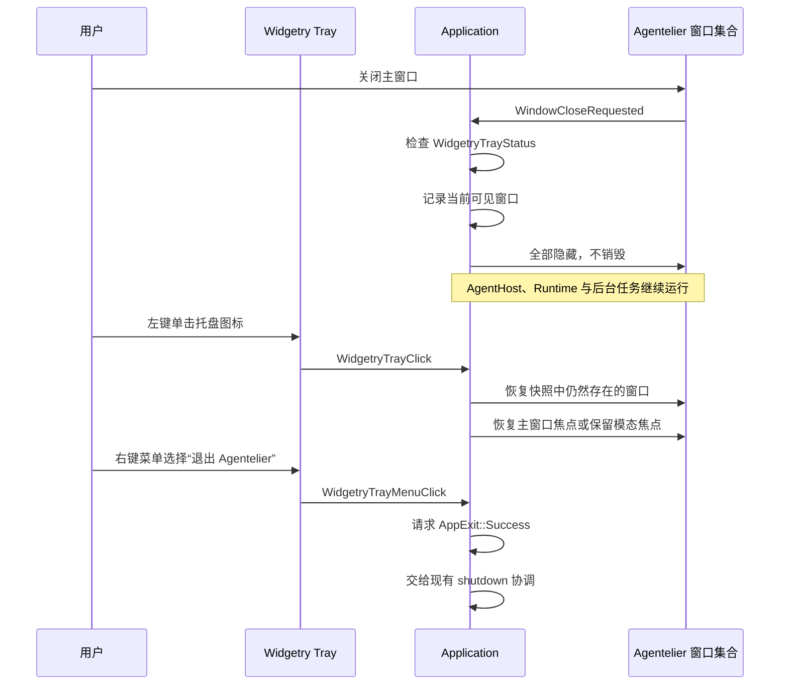

# 接入 System Tray 并实现应用级隐藏与恢复

System Tray 由 `bevy_widgetry` 提供原生托盘能力，Agentelier 的 `application` 层负责应用级窗口隐藏会话、主窗口关闭请求和恢复焦点。各 UI 模块继续拥有自己创建的辅助窗口，并负责处理这些窗口自身的关闭请求。这样既能让主窗口关闭时隐藏整个应用，也不会让 `agent_host`、聊天 Session 或每个辅助窗口分别维护一套托盘状态。

整体职责关系如下：



主窗口关闭和辅助窗口关闭需要区分：前者隐藏整个 Agentelier；后者只关闭发出请求的那个窗口。隐藏会话只改变窗口可见性，不改变窗口内容和 Agent 运行状态。

## 托盘图标与菜单

使用 `bevy_widgetry` 已有的 `tray` Feature，不自行创建 Win32 托盘图标、原生菜单或事件桥接。

`WidgetryTrayPlugin::new` 接收编译期嵌入的 ICO 字节和悬停提示文字。插件在 Bevy `Startup` 阶段创建原生托盘图标；图标实例独立于任何窗口，因此主窗口和所有辅助窗口都隐藏后，托盘仍然可以接收点击。

应用在启动阶段提供一个 `WidgetryTrayMenu` Resource，菜单只有一个项目：

```text
退出 Agentelier
```

该项目使用 `TrayMenuEntry::item` 创建。菜单中不添加图标、分隔线、显示窗口、隐藏窗口或其他操作，也不增加退出确认。

托盘交互固定为：

- **左键单击：**恢复当前隐藏会话中的窗口，并按恢复规则处理主窗口焦点。
- **右键单击：**显示 Widgetry 提供的原生菜单。
- **菜单选择「退出 Agentelier」：**提交正常退出请求，交给现有 Shutdown 流程。

左键恢复由 `WidgetryTrayClick` 消息驱动；菜单动作由 `WidgetryTrayMenuClick` 消息驱动。Widgetry 只提供原生图标、菜单和消息，不替 Agentelier 决定点击后是否隐藏、恢复或退出。

### 托盘初始化状态与隐藏门控

Widgetry 已公开 `WidgetryTrayStatus` Resource，Agentelier 通过 `bevy_widgetry::tray::WidgetryTrayStatus` 读取托盘初始化状态。

状态分为三个阶段：

| 状态 | 含义 | Agentelier 行为 |
|---|---|---|
| `Initializing` | 插件已安装，原生托盘初始化尚未完成 | 保持主窗口可见，不允许隐藏 |
| `Ready` | 原生图标已创建，Windows Shell 注册已确认，事件桥接已就绪 | 允许执行关闭即隐藏 |
| `Failed` | Startup 初始化失败，原始诊断已交给宿主错误处理器 | 保持主窗口可见，不允许隐藏 |

Application 的主窗口关闭请求处理必须读取该 Resource。只有状态为 `Ready` 时，才创建隐藏会话并隐藏整个应用。

如果状态仍为 `Initializing` 或已经变为 `Failed`，关闭请求不能进入隐藏流程，主窗口保持可见。托盘初始化失败的原因继续通过 Widgetry 现有 Diagnostics 和 Bevy 错误处理机制报告，不额外增加一套错误传递机制。

Widgetry 的状态发布时机如下：

1. `WidgetryTrayPlugin` 安装时插入 `Initializing`。
2. Startup 完成原生图标创建。
3. 通过 `set_tooltip` 确认 Windows Shell 注册成功。
4. 建立事件桥接、实例路由和所需的菜单交互监听。
5. 将完整托盘实例交给内部 `TrayOwner` 持有，并提交事件 Inbox。
6. 完成上述步骤后，状态变为 `Ready`。

如果初始化过程中任一步骤失败，状态变为 `Failed`，同时保留原始 `TrayFailure` 并交给宿主错误处理器。

`WidgetryTrayPlugin::new` 在插件安装前就会解码 ICO。无效 ICO 会直接返回 `TrayFailure`，此时尚未创建 `WidgetryTrayStatus` Resource。Agentelier 在安装托盘插件时应处理这一构造错误，不能把它当作一个已经安装、等待初始化的托盘。

`Ready` 只表示 Startup 阶段的初始化结果，不是运行期间的永久健康保证。后续菜单同步、事件桥接等故障仍由 Widgetry Diagnostics 报告，不修改这个状态，也不在本次增量中增加自动重试或运行时健康监控。

## 三种应用图标资源

应用图标采用已经选定的倾斜头像版本：角色位于画面左下方，朝右上方张望，深绿色方形背景保留。EXE、运行时主窗口/任务栏和托盘使用同一视觉素材，但分别准备对应的资源格式：

| 资源 | 格式与尺寸 | 用途 |
|---|---|---|
| [`application-icon-master.png`](../../crates/ui/assets/src/assets/system-tray/application-icon-master.png) | 1254 × 1254 PNG | 应用图标母版 |
| [`application-icon.ico`](../../crates/ui/assets/src/assets/system-tray/application-icon.ico) | 多尺寸 ICO：16、20、24、32、48、64、128、256 px | EXE 内嵌图标 |
| [`tray-icon.ico`](../../crates/ui/assets/src/assets/system-tray/tray-icon.ico) | 单尺寸 32 × 32 ICO | Widgetry 托盘图标输入 |
| [`window-taskbar-icon.png`](../../crates/ui/assets/src/assets/system-tray/window-taskbar-icon.png) | 256 × 256 PNG | 运行时主窗口图标与任务栏图标 |

三种入口彼此独立：

- **EXE 图标**在构建阶段通过 `bevy_widgetry_app_icon_build::set_exe_icon` 嵌入可执行文件。
- **运行时主窗口和任务栏图标**通过 Widgetry `taskbar_icon!` 宏加载 PNG。该宏设置主窗口图标与任务栏图标，不替代 EXE 资源，也不自动为每个辅助窗口设置图标。
- **托盘图标**通过 `WidgetryTrayPlugin::new` 加载 ICO。插件从 ICO 解码 RGBA 图像，因此托盘素材使用单尺寸 ICO，避免依赖多尺寸 ICO 的选择行为。

### 图标资源与接入位置

```text
app/
└── Cargo.toml

crates/ui/application/
├── src/
│   └── tray.rs
└── Cargo.toml

crates/ui/assets/
├── embed_exe_icon.rs
└── src/assets/system-tray/
    ├── application-icon-master.png
    ├── application-icon.ico
    ├── tray-icon.ico
    └── window-taskbar-icon.png
```

图标文件统一保存在 Assets crate。EXE 构建脚本由 `app/Cargo.toml` 指定，以 `app` 包的 `CARGO_MANIFEST_DIR` 为基准读取 ICO。`taskbar_icon!` 的路径以 Application 包的 `CARGO_MANIFEST_DIR` 为基准。托盘 ICO 由 `crates/ui/application/src/tray.rs` 通过 `include_bytes!` 嵌入。

### 助手头像配套素材

配套素材位于 [`crates/ui/assets/src/assets/avatars/assistant-avatar.svg`](../../crates/ui/assets/src/assets/avatars/assistant-avatar.svg)，这是已经确定的正脸薄荷绿助手头像。它与应用图标分开：应用图标使用朝右上张望的版本，聊天助手头像使用正脸版本。

该 SVG 是本次交付的配套素材，不作为 System Tray 的运行时依赖，也不在本增量中接入头像控件。当前远端 `AppAssetPlugin` 仍加载 `crates/ui/assets/src/assets/avatars/assistant.png`，`AgentelierAvatar` 仍通过 Bevy `Image` / `ImageNode` 显示头像。若要替换当前运行时头像资源，需要另行处理资源注册和控件兼容，不把这项改动混入托盘实现。

## 主窗口关闭时隐藏整个应用

当前 Application 的 `WindowPlugin` 使用默认 `close_when_requested` 行为，并设置 `ExitCondition::OnPrimaryClosed`。这意味着默认关闭请求会关闭对应窗口，而主窗口关闭还会触发应用退出。接入托盘后，主窗口关闭不能再走这条默认路径。

窗口配置需要改为：

- `close_when_requested: false`：由 Agentelier 接管所有 `WindowCloseRequested`。
- `exit_condition: ExitCondition::DontExit`：主窗口不可见或收到关闭请求时，不自动结束应用。

Application 收到主窗口的 `WindowCloseRequested` 后，首先读取 `WidgetryTrayStatus`。只有状态为 `Ready` 时才创建隐藏会话：

1. 收集当前所有 `Window` 实体中 `visible == true` 的窗口，记录为本次隐藏会话快照。
2. 将快照中的窗口统一设为不可见。
3. 保留窗口实体、Widgetry Window Root、Camera、Modal 关系和窗口内部 UI 状态，不销毁、不重建。
4. 不发送 `AppExit`，不调用 AgentHost 停止流程，也不取消后台任务。

如果托盘状态不是 `Ready`，不创建隐藏会话，也不修改窗口可见性，主窗口继续保持显示。托盘初始化失败的诊断仍由 Widgetry 交给宿主错误处理器。

快照以实际存在的 `Window` 实体为准，而不是维护一份固定窗口名单。这样当前已有的独立窗口、模态窗口以及后续新增的 Widgetry 窗口都会纳入同一套隐藏规则。

当前 UI 中需要覆盖的窗口包括：

- 主窗口：启动时的数据目录选择界面，以及数据目录就绪后的 A–F 工作区。
- `AuthorizationWindow`：登录授权窗口。
- `SettingsWindow`：设置窗口，包含常规设置、布局比例和用户头像设置。
- `DirectoryPicker`：设置窗口中的数据目录选择窗口。
- `AvatarPicker`：设置窗口中的头像图片选择窗口。
- `SkillsWindow` 与 `ImportPicker`：Skill 管理窗口及其导入窗口。
- `McpManagerWindow` 与 `McpPathWindow`：MCP 管理窗口及其路径选择窗口。
- `ProjectPickerWindow`：项目目录选择窗口。
- `MemoryManagementWindow`：记忆摘要和专用聊天共用的窗口；记忆聊天不是另一个独立原生窗口。
- `TaskToast`：后台任务终态通知窗口。
- 运行时创建的 Widgetry 模态窗口或其他独立窗口。

窗口原本处于最小化状态时，隐藏与恢复应保留其最小化状态。修改 `Window.visible` 前同步原生窗口的最小化状态，避免原生窗口状态与 Bevy 窗口状态不一致。

### 隐藏期间创建的新窗口

隐藏会话有效期间，任何新创建且原本准备显示的 Agentelier 窗口都不能直接出现在桌面上。Application 的窗口协调逻辑需要在新窗口交给原生窗口系统显示前，将其设为不可见并加入当前隐藏会话。

如果新窗口在恢复前已经按自身生命周期销毁，恢复时跳过失效实体。重复收到主窗口隐藏请求时，不得覆盖或重新采集已有快照。

### TaskToast 与隐藏会话

当前 `TaskToast` 在收到主窗口 `WindowCloseRequested` 时会把 `ToastQueue` 标记为 closing、清空待显示通知，并在后续更新中销毁现有 Toast。这是基于“主窗口关闭即退出”的旧行为；主窗口关闭现在只表示隐藏应用，因此这段逻辑必须调整。

`TaskToast` 只在真正收到 `AppExit` 时进入 closing 状态。主窗口隐藏时：

- 已显示的 Toast 窗口跟随隐藏快照隐藏，不因主窗口关闭而销毁。
- 待显示通知继续保留。
- 隐藏期间新创建的 Toast 窗口也加入隐藏会话，不显示到桌面。
- Toast 原有五秒生命周期继续计时。恢复时，已过期的 Toast 正常销毁，不重新显示；仍在有效期内的 Toast 随隐藏会话恢复。
- 用户单独关闭某个 Toast 时，只关闭该 Toast，并按现有生命周期取消对应计时任务。

## 辅助窗口关闭仍由窗口所属模块处理

关闭请求默认处理被全局关闭后，所有 Widgetry 辅助窗口也需要由 Agentelier 明确接管关闭行为。Application 只把主窗口的关闭请求解释为隐藏整个应用；非主窗口的关闭请求由创建该窗口的 UI 模块处理。

各模块使用自己持有的窗口根实体标记，并通过 Widgetry 的 `widgetry_window_target` 判断请求对应哪个原生窗口。匹配后销毁自己拥有的窗口根实体，让 Widgetry 既有的 `OwnedWindow` 清理流程回收对应原生 Window 和 Camera。不要为了反向查找窗口根而读取 Widgetry 内部组件或私有状态。

窗口所有权与关闭处理对应关系：

| 窗口所有者 | 需要处理的窗口 |
|---|---|
| `application/settings` | `SettingsWindow`、`DirectoryPicker`、`AvatarPicker` |
| `login_ui` | `AuthorizationWindow` |
| `chat_ui/skills` | `SkillsWindow`、`ImportPicker` |
| `chat_ui/mcp` | `McpManagerWindow`、`McpPathWindow` |
| `chat_ui/projects` | `ProjectPickerWindow` |
| `chat_ui/memory` | `MemoryManagementWindow` |
| `chat_ui/task_toast` | 各个 `TaskToast` 窗口 |

父窗口关闭时仍需清理它拥有的子窗口。例如关闭设置窗口时，目录选择和头像选择窗口一并关闭；关闭 Skill 管理窗口时，导入窗口一并关闭；关闭 MCP 管理窗口时，路径选择窗口一并关闭。Widgetry 模态关系和现有 MessageBox 行为继续由对应窗口所有者维护。

这一区分避免了一个重要问题：如果全局关闭请求全部交给 Bevy 默认处理，主窗口会退出；如果全局关闭请求全部被 Application 当作隐藏处理，用户关闭一个设置窗口却会把整个 Agentelier 隐藏。关闭请求必须先区分主窗口与辅助窗口，再交给正确的所有者。

## 从托盘恢复原来的窗口状态

收到 `WidgetryTrayClick` 后，Application 读取本次隐藏会话保存的窗口实体列表：

- 对仍然存在的窗口恢复 `visible = true`。
- 已经销毁的窗口直接跳过。
- 不在快照中的窗口保持原有不可见状态。
- 恢复完成后清空隐藏会话，并请求一次窗口重绘。

恢复的是隐藏前实际可见的窗口集合，而不是无条件显示所有辅助窗口。例如，隐藏前只有主窗口和设置窗口可见，恢复后仍然只有这两个窗口可见；当时已经关闭的 MCP 窗口不会被重新创建。

恢复窗口可见性后再处理焦点：没有活动模态窗口时激活主窗口；若主窗口仍被模态窗口阻挡，则交由 Widgetry 保持模态焦点，不强行把焦点切回被阻挡的主窗口。



## 退出继续使用现有 Shutdown 流程

托盘菜单的 `退出 Agentelier` 是真正的应用退出入口。它只提交 `AppExit::Success`，不直接终止进程，不绕过现有 `shutdown::coordinate`。

当前退出协调器已经负责：

1. 在收到退出请求后销毁打开的 FileDialog，释放界面持有的目录快照。
2. 调用 `AgentHost::begin_shutdown`，等待共享执行后台真实结束，并完成 `AgentHost::finish`。
3. 通过 `JobManager::begin_shutdown` 等待应用辅助后台任务结束。
4. 所有收尾完成后重新发出最终 `AppExit`，允许主循环退出。

托盘资源必须保持到最终退出事件，不能在初始退出请求被 Shutdown 暂存期间提前释放。`shutdown::coordinate` 需要排在 `WidgetryTraySystems::Sync` 之前：

- 初始 `AppExit` 到达时，Shutdown 协调器先接收并暂存请求；此时托盘同步系统看不到退出消息，因此托盘图标继续存在。
- AgentHost 和 JobManager 完成收尾后，Shutdown 协调器重新发出最终 `AppExit`。
- Widgetry 托盘同步系统随后观察到最终退出消息，跳过菜单同步，并在退出释放阶段销毁托盘图标。

这样托盘退出与应用其他退出入口使用同一套收尾规则。

## Application 装配与资源归属

托盘属于 `crates/ui/application` 的应用级生命周期能力：

- `bevy_widgetry::tray` 提供托盘图标、原生菜单、点击消息和公开初始化状态 `WidgetryTrayStatus`。
- `application` 持有隐藏会话、主窗口关闭路由、窗口可见性快照和恢复焦点时机，并通过 `WidgetryTrayStatus` 判断托盘是否可用于隐藏。
- `application/settings`、`login_ui`、`chat_ui` 各自处理所属辅助窗口的关闭请求和子窗口清理。
- `AgentHost` 与 Runtime 不感知托盘，不因窗口隐藏而暂停或停止。
- 退出仍由 `application::shutdown` 协调，不增加第二套退出系统。

工程接入包括：

- 在 `crates/ui/application/Cargo.toml` 当前 `bevy_widgetry` 依赖的 Feature 列表中加入 `tray`。托盘能力由 Application 使用，不需要在 Workspace 依赖定义中重复声明另一份 Widgetry 依赖。
- 在 Application 装配时注册 `WidgetryTrayPlugin`，并在 Bevy `Startup` 之前提供单项 `WidgetryTrayMenu` Resource。
- Application 从 Assets 嵌入托盘 ICO，并通过 `taskbar_icon!` 加载运行时 PNG。
- `app/Cargo.toml` 引用 `bevy_widgetry_app_icon_build` 构建依赖并指定 `crates/ui/assets/embed_exe_icon.rs` 为构建脚本，由脚本调用 `set_exe_icon`。
- 使用 Widgetry 已公开的 `WidgetryTrayStatus`，不访问 `TrayOwner` 等内部实现，也不重复实现初始化状态传递。
- 不修改 `bevy_widgetry` 或其他上游库，不重复实现托盘原生能力。
- 保持 `ui → agent / bridge`、`bridge → agent` 的既有依赖方向，不让 Agent 或 Bridge 反向依赖 UI。

`WidgetryTrayPlugin` 在 `Startup` 阶段创建托盘图标，因此图标从应用启动后就可用，包括初始数据目录选择界面期间。运行时任务栏图标由 Widgetry 的 `taskbar_icon!` 设置到主窗口；EXE 图标则由构建脚本嵌入，三者不会互相替代。

## 完成条件与验证

1. 应用启动后，Windows 通知区域出现选定的倾斜头像图标；初始数据目录选择界面出现时托盘已经可用。
2. 托盘左键单击恢复应用；右键菜单只显示 `退出 Agentelier` 一个纯文字项目，没有图标或分隔线。
3. `WidgetryTrayPlugin` 安装后，Application 能读取 `WidgetryTrayStatus::Initializing`；原生托盘初始化成功后能读取 `Ready`。
4. 当 `WidgetryTrayStatus` 为 `Initializing` 或 `Failed` 时，主窗口关闭请求不会隐藏任何窗口；主窗口保持可见。
5. 当 `WidgetryTrayStatus` 为 `Ready` 时，主窗口关闭请求才会创建隐藏会话并隐藏所有当前可见的 Agentelier 窗口。
6. 主窗口关闭请求隐藏所有当前可见的 Agentelier 窗口，包括授权、设置、目录选择、头像选择、Skill、MCP、记忆和 TaskToast 窗口，以及当前存在的模态窗口。
7. 隐藏期间主窗口、辅助窗口、Camera、Widgetry UI 实体、Modal 关系和窗口内容均保留，不发生销毁或重建。
8. 隐藏前已经不可见的窗口在恢复后仍然不可见。
9. 恢复时所有隐藏会话中仍然存在的窗口重新显示；失效实体被跳过，不重新创建。
10. 隐藏期间新创建的窗口不会闪现在桌面上，并被加入当前隐藏会话；恢复前已销毁的窗口不会被重新显示。
11. 窗口原有最小化状态得到保留；最小化按钮仍然执行正常最小化。
12. 单独关闭授权、设置、目录选择、头像选择、Skill、MCP、记忆或 TaskToast 窗口时，只关闭对应窗口，不隐藏整个应用。
13. 关闭父窗口时，其拥有的目录选择、头像选择、Skill 导入或 MCP 路径选择子窗口一并清理。
14. 模态窗口恢复后仍保持正确的父窗口关系和焦点阻挡，不出现主窗口抢焦点覆盖模态窗口的情况。
15. 主窗口隐藏不会清空 TaskToast 队列或销毁现有 Toast；Toast 按原有五秒生命周期计时，过期项不在恢复后重新出现。
16. 应用隐藏期间，AgentHost、Runtime 和后台任务继续工作；任务能够在窗口隐藏时完成，不因隐藏被取消或触发 Shutdown。
17. 托盘菜单选择退出后，应用等待 AgentHost 和 JobManager 完成收尾，再结束进程；托盘图标不会在收尾等待期间提前消失。
18. EXE 文件图标、运行时主窗口/任务栏图标和托盘图标均使用同一套选定图案；分别检查 Explorer、运行中任务栏和通知区域的实际显示。
19. 在不同 Windows 显示缩放比例下检查托盘图标、EXE 图标和任务栏图标的清晰度。
20. 使用 BRP 检查窗口可见性快照、隐藏和恢复后的 ECS 状态；托盘原生菜单、通知区域图标、原生焦点和 EXE 资源使用真实 Windows 桌面观察。

项目既有验证约束继续适用：不新增 Unit Test、Integration Test、Regression Test、Benchmark 或 Example 代码。编译检查、真实应用观察和针对性的 BRP 验证覆盖本增量；不通过验收操作登出账号、重新授权、切换账号或破坏现有数据目录。

## 范围边界

- 只实现本方案确定的 System Tray、窗口隐藏与恢复、辅助窗口关闭路由、应用图标资源接入和正常退出入口。
- 不增加托盘菜单的显示窗口、隐藏窗口或其他业务项目。
- 不增加退出确认对话框。
- 不改变 AgentHost、Runtime、Session、任务和 TaskToast 的业务状态与生命周期；隐藏只改变窗口可见性，TaskToast 仍遵循自身五秒生命周期。
- 不新增原生托盘实现，不修改 Widgetry 上游。
- 不修改 `AgentelierAvatar` 的 SVG 运行时加载方式；助手 SVG 只作为配套素材附带。
- 不扩展到 Splash 或 Agent 自主 UI 操控。
