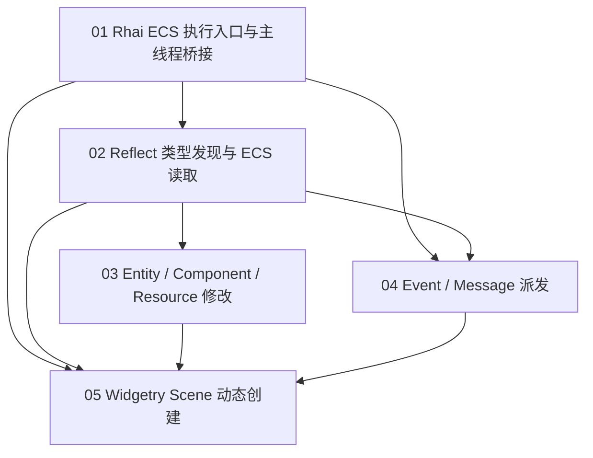

# Agent ECS 访问与动态 UI 的实施关系

Agentelier 的 Agent 通过现有 Function Calling 提交 Rhai 脚本。脚本复用现有 Session 级 Rhai 上下文，通过进程内请求桥在 Bevy 主线程访问 World。功能增量沿着这条通道逐步增加：先让脚本能够到达 World，再开放反射读取和修改，随后补上行为派发，最后把 Widgetry Scene 构造能力交给 Agent。

01 是共同基础。02 建立运行时类型发现和只读查询，03 在此基础上开放数据修改。04 使用同一请求通道增加 Event / Message 的动态派发；它依赖 01 和 02，不依赖 03，排在 03 之后只是统一执行顺序。05 将已经具备的 Entity、反射、修改和事件能力与 BSN Scene 接起来，提供运行时控件实例化。

所有 ECS 操作都在同一个进程内完成。Rhai Worker 只发送有界请求，不持有 Bevy World；AgentHostPlugin 在主线程执行请求。Agent 不使用 UI Automation、BRP、HTTP、MCP 或鼠标键盘输入来操作自身 UI。BRP 只用于开发期间检查真实 GUI、ECS State 和截图。

第一版使用现有 Function Calling 完成明确、短小的单次任务。它不依赖尚未加入的提示词管理，也不建设持续任务推进或长期自主规划。每个子方案的 GUI / BRP 验证都归入对应功能增量，不单独建立纯验收阶段。

## 唯一实施顺序

1. [建立 Rhai ECS 执行入口与进程内主线程桥接](01-Rhai执行入口与ECS主线程桥接.md)
2. [建立 Reflect 类型发现与 ECS 读取 API](02-Reflect类型发现与ECS读取.md)
3. [开放 Entity、Component、Hierarchy 与 Resource 修改](03-EntityComponentResource修改.md)
4. [开放 Bevy Event 与 Message 派发](04-Event与Message派发.md)
5. [通过 Widgetry Scene 实现运行时控件创建](05-WidgetryScene动态控件创建.md)
