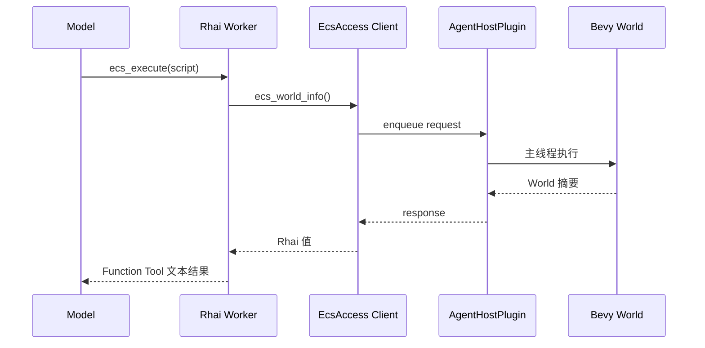

# 建立 Rhai ECS 执行入口与进程内主线程桥接

## 目标与产出

让 Agent 能通过现有 Function Calling 提交 Rhai，并让脚本在不接触 Bevy World 引用的情况下，向 Agentelier 主线程提交 ECS 请求、等待执行结果。完成后，Agent 可以调用一个最小的 World 查询函数，证明 Rhai、Agent Runtime、Bridge 和 Bevy 主线程之间的执行闭环已经建立。

本增量只建立执行入口和请求通道，不提前实现完整 Reflect API、Entity 修改、Event / Message 或动态控件模板。

## 复用现有 Rhai Runtime

当前 ScriptSession 位于 `agent/tools`，按 Conversation 保存 Rhai Engine、Scope 和函数 AST；现有工具执行器为每个 Session 创建并复用它。`computer_execute` 已经通过固定 ToolCatalog 进入 Turn Runner，再由 ScriptSession 执行模型提交的脚本。

新增内置 Function Tool，名称暂定为 `ecs_execute`。参数为 Rhai 脚本字符串，结果以文本返回。它沿用现有 ToolCatalog、ToolDispatcher、ToolAdmission 和 Function Calling 结果关联，不创建新的模型请求循环或第二套 Agent Runtime。

ScriptSession 增加 ECS 执行入口，但继续复用同一个 Engine、Scope 和函数上下文。ECS 执行与 Computer Use 执行分开：

- `ecs_execute` 在 `spawn_blocking` 中执行脚本，等待 ECS 请求结果时不阻塞 Tokio current-thread。
- `ecs_execute` 不获取 `DESKTOP_CLEANUP_CONFIRMED` 桌面独占锁，不初始化 Windows Driver、截图映射或 UIA Runtime，也不执行鼠标键盘收尾。
- `computer_execute` 保留原有桌面独占、UIA 和输入清理语义。它仍是外部桌面操作入口，不承担 Agentelier 自身 UI 的操控。

同一 Session 的 Rhai 变量和函数定义继续跨工具调用保留；不同 Session 不共享上下文。`ecs_execute` 是同步、有界的 Function Tool，沿用当前脚本执行时间、脚本大小、操作数量和输出限制，不转化为后台长期任务。

## 通过 EcsAccess 把请求交给 Bevy 主线程

Agent Tools 不能直接依赖 Bevy 或 UI。ECS Native API 使用 Agent 侧定义的 EcsAccess 请求契约，Bridge Connection 负责把 UI 宿主提供的 Client 传入 AgentRuntime，再由 AgentRuntime 交给 Session 的 ScriptSession。

AgentHostPlugin 在 UI 侧拥有请求接收端，并通过 Bevy 主线程的专用 System 处理请求。请求队列有界，每次请求携带操作名称、可序列化参数、取消状态和响应通道。主线程只处理单次 ECS 操作，不接管 Rhai 脚本的执行循环。

Native API 在 Rhai 中表现为同步函数：提交请求并等待结果。等待发生在 Rhai 的 blocking worker，而不是 Bevy 主线程。World、EntityWorldMut、Query 或其他 ECS 借用都不会跨线程传递；请求和响应使用受限、可序列化的数据值。

主线程每帧处理有限数量的请求，避免 Agent 脚本占满一帧。单次查询和结果大小也必须有界。后续查询 API 应支持 `limit` 和 `cursor`，不能默认把整个 World 序列化回模型。

## 最小 World 入口

本增量先提供 `ecs_world_info()`，返回当前 World 的基础统计和可用类型概况。它是 Agent 可以使用的真实功能，也是最小端到端验收入口。

后续的 `reflect_types`、`ecs_query`、`ecs_get` 和修改 API 分别由后续增量加入，不在本方案中提前实现。

## 取消、关闭与错误边界

每个请求都绑定当前脚本的取消令牌和截止时间：

- 请求尚未进入主线程执行时，如果脚本已经取消或超时，主线程丢弃请求并返回取消结果。
- 单次 ECS 操作一旦开始，不能在任意 Rust 调用中间强制抢占；它完成后脚本检查取消状态，不再提交后续语句。
- 响应通道关闭、宿主停止或请求超时都转换成结构化 EcsError，不能让 Rhai Worker 永久等待。
- 应用关闭沿用 AgentHost 的现有关闭协调。AgentRuntime 被取消并真实结束前，Bevy 主循环仍然运行，允许请求接收端完成取消和响应收尾。

Agentelier Application 已经安装 `App::set_error_handler(diagnostics::handler)`。预期 ECS 操作失败以结构化错误返回给 Rhai，不作为 Bevy Panic。请求处理边界对单次 Native 操作增加 Panic 隔离：意外 Panic 转换为 `ecs_operation_panicked` 返回给 Rhai，并作为 `Severity::Error` 交给现有 Handler 记录。逃出该边界的 Panic 仍遵循 Bevy FallbackErrorHandler 和应用当前的致命策略，不改变全局 Panic 语义。

脚本不是事务。已经完成的 ECS 操作不会因后续语句失败而回滚。Agent 收到失败后需要重新读取 World 状态，再决定是否继续。

## 完成条件与运行验证

- `ecs_execute` 出现在当前固定 Function Tool 目录，模型提交的脚本由现有 ScriptSession 执行。
- ECS 执行复用 Session 级 Engine / Scope，不创建第二个 Rhai Runtime。
- ECS 执行不获取桌面独占锁，不调用 UIA、Windows Driver 或 BRP。
- EcsAccess 请求由 AgentHostPlugin 在 Bevy 主线程处理，Agent Tools 和 Agent Runtime 不依赖 Bevy。
- `ecs_world_info()` 能返回当前真实 World 的结果，并通过正常 Function Calling 返回模型。
- Rhai 等待 ECS 请求时，Agent Runtime 的 Tokio current-thread 和 Bevy UI 都保持运行。
- 取消、超时、队列关闭和应用关闭都能结束等待，不留下迟到执行的排队请求。
- 通过受控故障注入验证单次 ECS 操作 Panic 被返回为失败，应用仍然运行，后续 `ecs_execute` 可以再次调用。
- 在 Windows x64 实际运行 Agentelier 验证；不编写 Unit Test、Integration Test、Benchmark 或 Example。需要检查 GUI 时使用项目规定的 BRP 状态和截图验证。

## 保持的边界

- 不在 `agent/tools` 或 `agent/runtime` 引入 Bevy 依赖；依赖方向保持 UI → Agent / Bridge、Bridge → Agent。
- 不使用 BRP、HTTP、MCP 或 UI Automation 传递 ECS 请求；请求通道仅存在于 Agentelier 进程内。
- 不把 World 引用、EntityWorldMut 或 Rhai Dynamic 跨线程传递。
- 不把 `ecs_execute` 变成持续任务、后台任务调度器或提示词管理功能。
- `computer_execute` 继续负责外部桌面操作，不与 `ecs_execute` 合并成需要桌面权限的工具。
