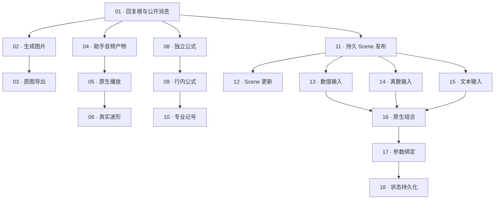
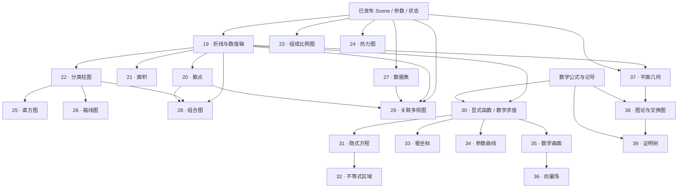
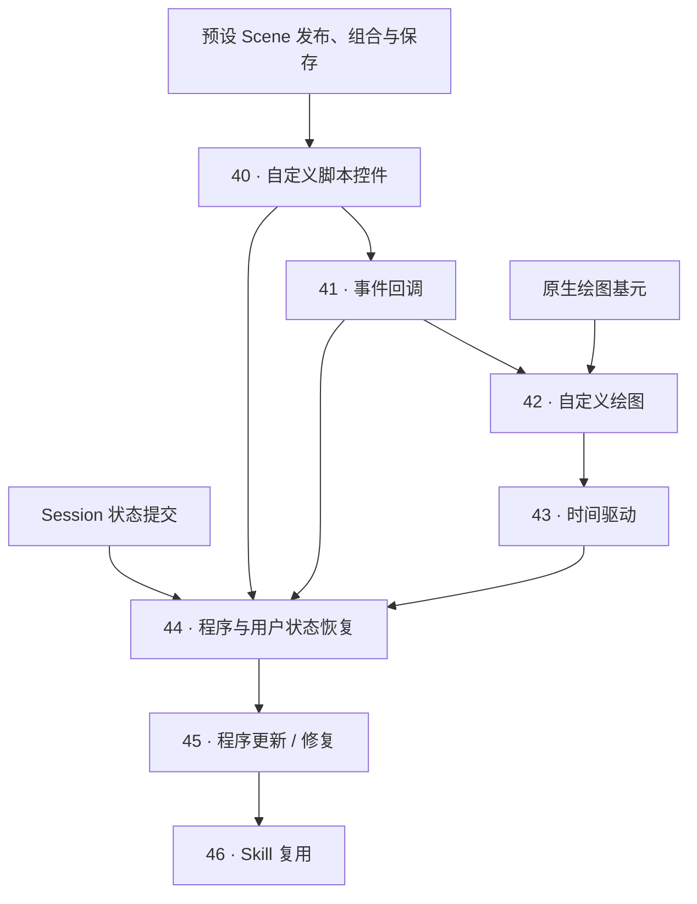

# 助手回复与动态内容实施总览

目标是让主聊天区将一轮助手回复组织为一个原生控件，并在其中承载公开文字、图片、可播放声音、数学及交互式内容。执行设计依据 [助手回复与动态内容](../../docs/design/assistant-content/README.md)。这里按可独立交付和验收的功能增量推进，编号表示唯一实施顺序，而不意味着每个相邻增量都有技术依赖。

## 整体设计关系

图片和音频分别使用已有 Session Store 附件语义。它们与数学排版没有硬依赖。动态 Scene 继续使用现有 Rhai、EcsAccess、BSN 和 Widgetry。持久定义与用户状态不进入模型协议历史；它们由 Conversation/Runtime/Session Store 管理真实归属，UI 持有原生显示及交互资源。

图中的绘图关系表示已建立的轴、路径、图形或状态能力可复用，不要求将一个图表类型的业务逻辑放进另一个类型。例如直方图使用数值区间和真实分箱，不是分类柱图的别名；证明树复用结构绘图而不依赖范畴论的语义。函数图形由数学求值和采样产生，公式排版只负责数学记号。三维部分限于数学曲面及向量，不建设独立 3D 工作台。

预设 Scene 和 Rhai 自定义控件是两条并存的原生内容路径。脚本控件按实例持有自己的程序和状态，可在前台 Turn 结束后响应用户，关闭或切换时收尾。历史 Session 保存每个实例的脚本备份和状态。第 46 项接入 Skill 关联后，重开优先使用关联 Skill 的当前脚本，找不到时使用会话备份。恢复执行选定脚本的入口，沿用现有 ECS 权限、执行控制和通信边界。

## 唯一实施顺序

### 回复和媒体

1. [将一次助手回复组织为单一控件](01-group-public-replies.md)
2. [在助手回复内直接显示生成图片](02-generated-image-preview.md)
3. [从回复图片保存原图副本](03-generated-image-export.md)
4. [将 Agent 取得的音频文件发布为回复产物](04-publish-audio-artifact.md)
5. [让聊天音频可以直接播放与暂停](05-native-audio-playback.md)
6. [展示真实音频时域波形与播放进度](06-audio-waveform.md)

### 数学和动态内容

8. [在 Markdown 中原生展示独立数学公式](08-display-math.md)
9. [让行内公式参与文字基线与换行](09-inline-math.md)
10. [扩展专业数学记号、字体与宏环境](10-professional-notation.md)
11. [将已注册的 Scene 发布为可恢复的聊天控件](11-publish-native-scene.md)
12. [让 Agent 原位更新已存在的动态控件](12-update-native-scene.md)
13. [提供动态数值参数控件](13-numeric-input-scenes.md)
14. [提供动态离散选择与开关控件](14-selection-input-scenes.md)
15. [提供动态文本参数输入](15-text-input-scene.md)
16. [在一个回复产物中组合多个原生 Scene](16-compose-native-scenes.md)
17. [让动态控件共享参数并本地联动](17-local-parameter-binding.md)
18. [保存动态控件的用户交互状态](18-persist-widget-state.md)
19. [提供原生折线图和连续坐标轴](19-line-chart.md)
20. [提供原生散点图](20-scatter-chart.md)
21. [提供有明确基线的面积图](21-area-chart.md)
22. [提供原生分类柱状图](22-bar-chart.md)
23. [提供原生组成比例图](23-pie-chart.md)
24. [提供带颜色量纲的热力图](24-heatmap-chart.md)
25. [提供具有真实分箱含义的直方图](25-histogram-chart.md)
26. [提供具有明确统计定义的箱线图](26-boxplot-chart.md)
27. [提供可供动态场景使用的原生数据表](27-interactive-data-table.md)
28. [在同一图形中组合不同数据系列](28-combined-chart.md)
29. [让多个图表视图共享选定参数](29-linked-chart-views.md)
30. [通过数学表达式绘制直角坐标函数](30-cartesian-function-plot.md)
31. [绘制直角坐标中的隐式方程](31-implicit-equation-plot.md)
32. [可视化数学不等式的成立区域](32-inequality-region.md)
33. [绘制极坐标函数](33-polar-function-plot.md)
34. [绘制由同一参数定义的曲线](34-parametric-curve.md)
35. [展示数学三维坐标中的函数曲面](35-math-surface-plot.md)
36. [展示数学向量及向量场](36-vector-field-plot.md)
37. [提供可联动的平面几何与向量示意图](37-geometry-diagram.md)
38. [展示图论结构与交换图](38-graph-commutative-diagram.md)
39. [原生展示逻辑证明树与推导结构](39-proof-tree-diagram.md)
40. [在运行时创建 Rhai 定义的自定义控件](40-scripted-widget-host.md)
41. [让自定义控件持续响应用户事件](41-scripted-widget-events.md)
42. [让 Rhai 自定义控件生成和更新图形](42-scripted-widget-drawing.md)
43. [让自定义控件支持时间驱动的演示](43-scripted-widget-animation.md)
44. [恢复自定义控件的程序与实际用户状态](44-persist-scripted-widget-state.md)
45. [原位修复或更新自定义控件程序](45-update-scripted-widget-program.md)
46. [把成功的自定义控件封装为可复用 Skill](46-reuse-widget-skill.md)

所有新增 GUI 行为随各自增量在真实应用中使用 BRP 验证；涉及音频实际声音、文件持久化和模型行为时使用真实对应证据。按项目规则不新增 Unit Test、Integration Test、Regression Test、Benchmark 或 Example，也不单独设置纯验收阶段。需要选型或核实的真实前提写在受影响方案中。实施中根据实际变化同步现有 `docs/design/` 的架构、模块和机制说明。
