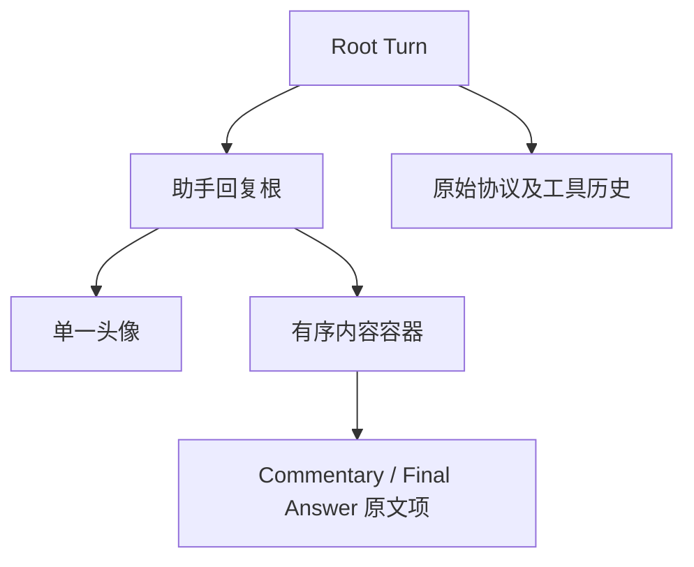

# 将一次助手回复组织为单一控件

当前 `ConversationView` 在 `reconcile_list()` 中按消息项构造行，`final_reply()` 只选最终文本。`ChatMessage` 已保留 `request_index`、`output_index`、消息 ID、phase 和正文，首段最终回复已通过 `reply` 键复用等待行。因此无需改写 Responses 协议或工具历史，只改变主聊天的展示身份与筛选。

根控件改按 Session + Root Turn 归属，头像只出现一次。内容子树仍按请求、输出、消息 ID 复用。每条非空 `commentary` 独占一个纵向内容行，长文字自然换行；`final_answer` 按原顺序接在公开说明之后，二者各用原有 MarkdownView。不要显示 phase 标题、重复头像、普通工具调用/结果、Reasoning 或子 Agent 内部消息。保留工具原始 `call_id`、存档和诊断，Memory 的 `TranscriptPresentation::Memory` 仍使用原检查呈现方式。

接纳活动 Turn 后显示现有等待圆环。第一条非空公开说明或最终回复到达时，在同一根内撤下圆环；空增量、工具、reasoning 不触发切换。此后不在说明之间重新显示等待。无可见内容的轮次结束/取消/失败时清除空等待行，已有公开文本保持真实的展示状态；未确认的文字不被重新写进模型历史。缺 phase 的消息沿用现有完成/最后请求/无工具的显示条件，未知显式 phase 不自动公开。

保持用户输入 `input_id` 去重，Retry 与跨 Turn 结果续接的回复使用自己的 Turn ID，Queue 仍是独立轮次。Steer 用户行继续独立显示真实状态；助手根挂载后保持单一视觉位置，后到 Steer 不拆开助手根，不篡改原始历史次序。组内文字按原请求/输出次序排序，增量复用同一项。当前仅建立文本内容容器，为后续有稳定来源的产物提供挂载位置；不提前实现媒体或动态 Scene。

不重建整个消息列表，保留现有阅读跟随、用户向上滚动、输入焦点、草稿、文本选择和 Memory 窗口行为。

## 验收

- 使用真实 Root 多次工具往返，取得至少两条公开说明与最终正文；BRP 核对只有一个助手头像、说明分别占行、顺序正确、无内部标签及工具行。
- 观察接纳至首个非空消息、正文流式增长、最后终态；只有 Final Answer 时保持原体验；没有正文的失败/取消不残留等待，已出现文字的失败仍可读。
- 查无 phase 的响应、Retry、Steer、Queue 和切换 Session，确认无重行、错归属或协议历史变化；滚动、焦点、草稿、Memory 检查视图无直接受影响的回归。

## 与相邻方案的关系

本方案建立后续所有回复内产物的稳定父级。下一项使用既有图片产物身份进入同一根，不改变消息协议。

设计依据：[回复呈现](../../docs/design/assistant-content/01-reply-presentation.md)。

## 工程约束

遵循 Windows x64 / DX12、PowerShell 7 与锁定 Workspace 依赖。UI 使用 BSN、Scene / SceneList、Widgetry 公开 API；Props 仅初始化，运行期状态由 Component 与相应业务所有者维护。Agent 不依赖 Bevy、UI 或 Bridge，Bridge 不依赖 UI；现有进程内通信与权限边界不变。按实际影响进行 Cargo 检查与真实应用验证，GUI 变化用 BRP 真实输入、截图和 ECS 状态确认，结束后释放 Pointer 并核对 inactive。禁止新增测试、Benchmark、Example 代码及仅用于这些目的的依赖；未经授权不改变登录、凭据或数据目录。实施中同步受影响的当前设计文档，不提前宣称其他增量已实现。
