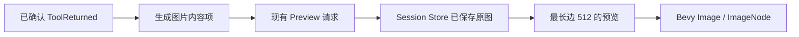

# 在助手回复内直接显示生成图片

`generate_image` 已有原图存储和模型回看链路；`ToolReturned` 保存 `GeneratedImage`，`ToolView.image` 及 Runtime `ImageAttachmentAction::Preview` 提供受控资源路径。让 Bridge/Chat UI 保留真正的生成图身份，避免 `project_turn()` 丢弃图像描述符；不公开普通 `view_image`、截图或所有工具结果。

图片内容项的位置绑定 Session、Root Turn、请求/输出序号和原 `call_id`。已有公开内容时可在原回复显示生成中状态。没有公开内容时沿用原等待圆环，空 Turn 结束时移除等待行。生成成功、失败或取消确认后，在来源 Turn 的位置补出助手回复，已有回复则原位更新。生成成功显示图片项及其真实预览状态，生成失败显示真实原因，取消显示取消反馈。生成成功但预览读取失败时，反馈预览不可用。

沿已有 `AgentHost::request_image_attachment` 和预览回执读取、核对并在 UI 建立 `Handle<Image>`。加载使用稳定占位，等比显示、限制可用宽高；不能把图拉伸、阻塞主线程或重新请求生成。像素与句柄不进入 Reflect 聊天状态、日志或协议历史。保留 32 MiB/4096 边长/256 MiB 会话原图限制及独立模型派生图约束。历史恢复使用已确认附件，同一图像源变化不覆盖存档；切换/删除时丢弃旧回执并释放显示资源。

## 验收

真实生成一张图片，核对已确认记录和 SHA-256、预览比例与实际内容，BRP 观察等待、加载、成功和滚动状态。覆盖原 Turn 无公开文本并已结束时晚到的成功、失败与取消，确认在原位置补出唯一助手回复并显示对应反馈。原回复已可见或用户已切换 Session 时，结果仍归属原回复。重开历史读取同一原图。普通读图、桌面截图和工具文本沿用原展示边界。

## 与相邻方案的关系

依赖回复根的内容身份；下一项仅接上原图导出，预览已可以独立交付。

设计依据：[媒体产物](../../docs/design/assistant-content/02-media-artifacts.md)、[回复呈现](../../docs/design/assistant-content/01-reply-presentation.md)。

## 工程约束

遵循 Windows x64 / DX12、PowerShell 7 与锁定 Workspace 依赖。UI 使用 BSN、Scene / SceneList、Widgetry 公开 API；Props 仅初始化，运行期状态由 Component 与相应业务所有者维护。Agent 不依赖 Bevy、UI 或 Bridge，Bridge 不依赖 UI；现有进程内通信与权限边界不变。按实际影响进行 Cargo 检查与真实应用验证，GUI 变化用 BRP 真实输入、截图和 ECS 状态确认，结束后释放 Pointer 并核对 inactive。禁止新增测试、Benchmark、Example 代码及仅用于这些目的的依赖；未经授权不改变登录、凭据或数据目录。实施中同步受影响的当前设计文档，不提前宣称其他增量已实现。
