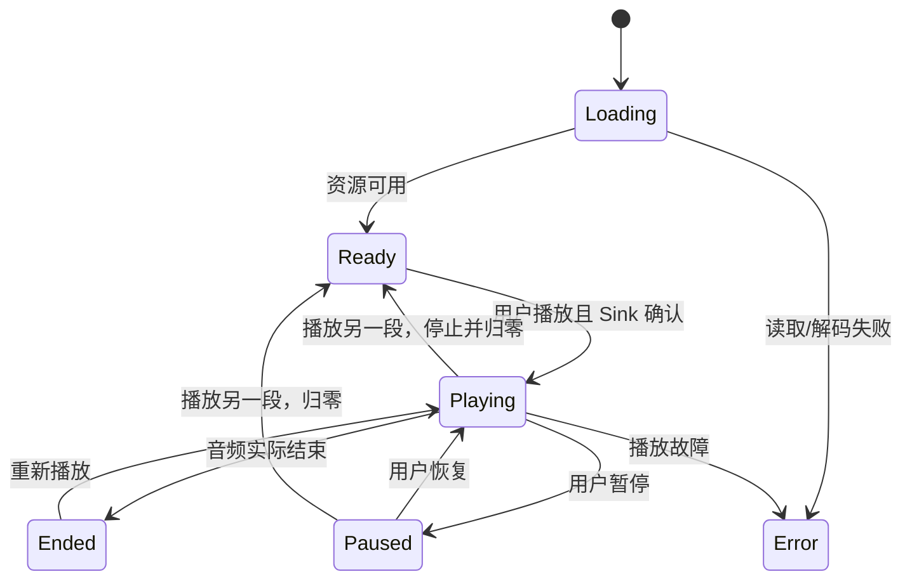

# 让聊天音频可以直接播放与暂停

让上一方案的助手音频项成为原生播放器。当前 `Cargo.toml` 的 Bevy 0.20.1 Feature 未启用音频，实施时在 UI 宿主装配 `bevy_audio` 及 MP3、FLAC、WAV 所需的解码 Feature。`AudioPlayer`、`AudioSink` 和 `AudioSinkPlayback` 管理非空间化播放、暂停、恢复、停止和实际位置。

从已确认 Session Store 附件请求播放资源，按 Session/音频 ID/当前代次关联。后台读取已校验原件，通过专用资源结果交给 UI。Bevy Assets 和播放句柄属于 UI，反射状态和日志只保留必要元数据。音频尚未加载、待播放、等待 Sink、暂停、播放、已结束和失败各有对应状态。用户点击播放后才开始，对当前音频主动暂停后可以继续，结束后从头播放。已保存的用户音频附件也可使用同一播放器，并保留原转写操作。

播放器通过同一个按钮接收播放和暂停操作，显示实际时长。后续增加只用于展示的波形。整个应用同一时刻只播放一段聊天音频。用户播放另一段时，先停止前一段、将游标归零并作废旧实例尚未完成的播放请求，再启动新实例。再次播放前一段时从头开始。切换 Session、删除及退出停止并回收所属实例。重开 Session 时音频处于待播放状态。设备不可用和格式错误按实际结果反馈。

## 验收

BRP 对真实 MP3、FLAC、WAV 检查播放、主动暂停、继续和结束后重播，核对按钮、实际 Sink 状态和位置，并核实真实声音输出。让第二段接替正在播放或已经暂停的第一段，确认第一段立即停止并归零，重新播放第一段从头开始。检查快速切换、切换 Session、删除及退出时的资源收尾，以及损坏、资源不可用和设备错误的反馈。

## 与相邻方案的关系

依赖音频快照和公开产物；下一项用同一真实播放状态绘制波形与进度。

设计依据：[媒体产物](../../docs/design/assistant-content/02-media-artifacts.md)、[回复呈现](../../docs/design/assistant-content/01-reply-presentation.md)。

## 工程约束

遵循 Windows x64 / DX12、PowerShell 7 与锁定 Workspace 依赖。UI 使用 BSN、Scene / SceneList、Widgetry 公开 API；Props 仅初始化，运行期状态由 Component 与相应业务所有者维护。Agent 不依赖 Bevy、UI 或 Bridge，Bridge 不依赖 UI；现有进程内通信与权限边界不变。按实际影响进行 Cargo 检查与真实应用验证，GUI 变化用 BRP 真实输入、截图和 ECS 状态确认，结束后释放 Pointer 并核对 inactive。禁止新增测试、Benchmark、Example 代码及仅用于这些目的的依赖；未经授权不改变登录、凭据或数据目录。实施中同步受影响的当前设计文档，不提前宣称其他增量已实现。
