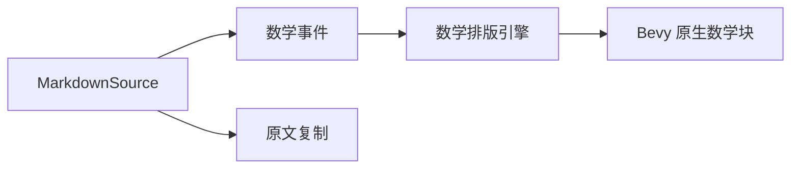

# 在 Markdown 中原生展示独立数学公式

当前 pulldown-cmark 0.13.6 已有 `ENABLE_MATH`，但解析只启用删除线、表格及任务列表，`BlockKind` 没有数学块。独立公式是引入原生数学排版的第一个可交付能力。开启并消费 `DisplayMath`，使用 `$$...$$`；验证模型常见 `\[...\]` 的适配，原文区间、转义、代码块不被全局字符串替换破坏。行内公式本次可保留源文，下一增量处理嵌入行内布局。

由本增量实施者选定并实际接入数学引擎、版本和原生渲染路径。可评估 LaTeX-Rust 的纯 Rust 解析、排版与 SVG/PNG，核对 Workspace 工具链、Windows 编译、字体许可、公式度量和原生绘制，并确认后续行内布局和专业记号所需的能力。MathJax 的 SVG 及 KaTeX 提供覆盖参考，接入仍使用经验证的原生方案。

数学块使用排版度量、主题、UI Scale 和宽度管理，长公式可横向阅读，原始 TeX 保留可复制。流式未闭合公式暂显示可读源文，闭合后原位替换；相同块复用，未知命令和排版失败局部回退。正文、代码、表格、列表仍按原 MarkdownView 行为。

## 验收

实际聊天输出分数、积分、上下标、多行式，BRP 检查真实公式、宽度、滚动与 UI Scale；流式闭合前后稳定、复制原文正确、代码围栏中的 `$$` 不误解析。候选工具链不兼容或失败时不能宣称已支持；确认失败回退不清空消息。

## 与相邻方案的关系

与音频仅顺序相邻；下一项复用已接入的数学引擎与原生显示度量，解决真正行内排版。

设计依据：[数学排版](../../docs/design/assistant-content/03-math-typesetting.md)。

## 工程约束

遵循 Windows x64 / DX12、PowerShell 7 与锁定 Workspace 依赖。UI 使用 BSN、Scene / SceneList、Widgetry 公开 API；Props 仅初始化，运行期状态由 Component 与相应业务所有者维护。Agent 不依赖 Bevy、UI 或 Bridge，Bridge 不依赖 UI；现有进程内通信与权限边界不变。按实际影响进行 Cargo 检查与真实应用验证，GUI 变化用 BRP 真实输入、截图和 ECS 状态确认，结束后释放 Pointer 并核对 inactive。禁止新增测试、Benchmark、Example 代码及仅用于这些目的的依赖；未经授权不改变登录、凭据或数据目录。实施中同步受影响的当前设计文档，不提前宣称其他增量已实现。
