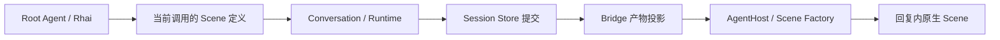

# 将已注册的 Scene 发布为可恢复的聊天控件

当前 `ecs_execute` 可调用 `scene_templates()`、`scene_spawn(name,parent,props)`、`scene_despawn(root)`，`agentelier.button` 是现有模板。普通 Scene 根只有当前 World 的 Entity 身份，不能据此重开 Session。将预设控件作为正式的用户可见产物，而不靠 Agent 搜索聊天列表中的任意父实体。

扩展现有通信机制，使发布操作携带真实的 Session、Root Turn、请求/调用身份、稳定产物 ID、模板标识、语义 Props、所需数据/资源与初始状态；模板发现和构造仍由原 Scene Factory，普通 ECS 操作能力不收窄。具体 Native API 名称和 RecordEvent 由现有代码类型确定，不建设通用 UI Tree DSL 或新增权限体系。初始定义需要有可确认创建结果及持久记录，回执区分成功与失败，UI 按原调用位置显示。模板无法构造、参数错误、保存失败不能留下成功产物；清理该次拥有的半成品而不声称回滚其他 ECS 操作。

先用现有注册按钮交付一项静态原生控件。保存模板名及其定义/资源快照；重开 Session 时通过相同语义定义重新构造新 Entity，不保存旧 Entity ID、Handle、World 或脚本 Scope。Conversation 持业务归属，Runtime 提交，Store 单写入者；UI 管理 Scene，关闭/切换回收实例，重开无模型调用。普通工具不自动公开。该步骤不需要先实现所有参数控件或自定义回调。

## 验收

真实 Root 通过已注册模板创建一个可见按钮，检查实际调用来源、持久记录、单头像内位置及原生 ECS 结构。切换、重开、重启后重新创建同一产物，Entity ID 可不同；错误模板/Props、保存失败、迟到回执不会产生假成功或残留子树。普通 `scene_spawn` 和内部 ECS 用途继续按原合同执行。

## 与相邻方案的关系

依赖回复容器，不依赖专业公式；下一项为已有持久产物增加原位定义更新。

设计依据：[动态 Scene](../../docs/design/assistant-content/04-dynamic-scenes.md)、[持久化与 Skill](../../docs/design/assistant-content/07-persistence-and-skills.md)。

## 工程约束

遵循 Windows x64 / DX12、PowerShell 7 与锁定 Workspace 依赖。UI 使用 BSN、Scene / SceneList、Widgetry 公开 API；Props 仅初始化，运行期状态由 Component 与相应业务所有者维护。Agent 不依赖 Bevy、UI 或 Bridge，Bridge 不依赖 UI；现有进程内通信与权限边界不变。按实际影响进行 Cargo 检查与真实应用验证，GUI 变化用 BRP 真实输入、截图和 ECS 状态确认，结束后释放 Pointer 并核对 inactive。禁止新增测试、Benchmark、Example 代码及仅用于这些目的的依赖；未经授权不改变登录、凭据或数据目录。实施中同步受影响的当前设计文档，不提前宣称其他增量已实现。
