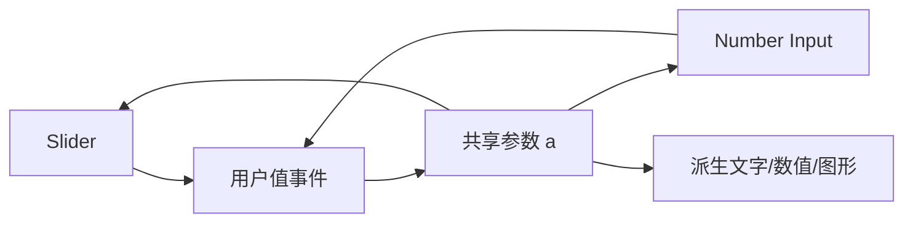

# 让动态控件共享参数并本地联动

以 `a` 为例，Slider 和 Number Input 不应拥有两份彼此手工同步的数值。为一个已发布的组合场景建立有类型的命名参数、默认值、范围/步进及依赖关系，输入控件与输出内容绑定同一业务语义。借鉴 Vega-Lite 的命名参数和选择绑定，但使用 Bevy System、Widgetry 真实事件和现有 Runtime 数据关系，不引入网页运行环境。

用户修改任一输入，另一输入和依赖输出同步变化，无需再次请求模型。数值、布尔、枚举、文本使用实际类型。控件显示状态以真实参数为准，避免更新 UI 导致同一事件循环触发；只重算依赖变更的内容。恢复默认值的按钮按同一参数机制处理。Agent 修改场景定义时保留仍有效的状态，对更新后仍存在但旧值失效的参数，使用 Agent 随更新指定且校验通过的当前值。参数发生变化与持久提交是不同事实，本增量先完成实际本地联动，下一项保留用户状态到 Session。

## 验收

创建一个组合场景，滑块和数字输入共同引用 a、文本显示 `a²`，开关控制显示，按钮恢复默认。BRP 实际修改每种输入并核对输出和事件数；不触发模型请求、不产生反馈循环，另一个产物的同名参数不变化。

将 `a` 调到 `8` 后，让 Agent 将范围从 `0–10` 缩到 `0–5`，并在更新中指定 `a = 3`。核对两个输入和依赖内容都采用 `3`。单独验证更新缺少新值或给出无效值时返回结构化错误。

## 与相邻方案的关系

依赖组合与基础输入。下一项把该本地状态写入会话，后续图表也复用同一参数机制。

设计依据：[动态 Scene](../../docs/design/assistant-content/04-dynamic-scenes.md)、[持久化与 Skill](../../docs/design/assistant-content/07-persistence-and-skills.md)。

## 工程约束

遵循 Windows x64 / DX12、PowerShell 7 与锁定 Workspace 依赖。UI 使用 BSN、Scene / SceneList、Widgetry 公开 API；Props 仅初始化，运行期状态由 Component 与相应业务所有者维护。Agent 不依赖 Bevy、UI 或 Bridge，Bridge 不依赖 UI；现有进程内通信与权限边界不变。按实际影响进行 Cargo 检查与真实应用验证，GUI 变化用 BRP 真实输入、截图和 ECS 状态确认，结束后释放 Pointer 并核对 inactive。禁止新增测试、Benchmark、Example 代码及仅用于这些目的的依赖；未经授权不改变登录、凭据或数据目录。实施中同步受影响的当前设计文档，不提前宣称其他增量已实现。
