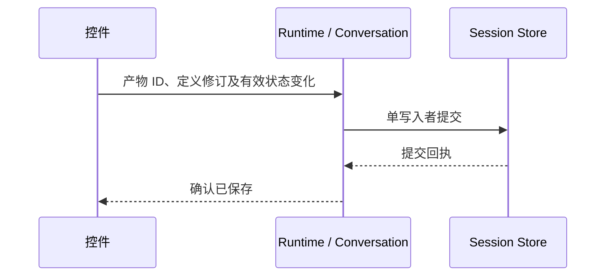

# 保存动态控件的用户交互状态

预设 Scene 已保存构造定义，现在用户可本地修改命名参数。持久化当前有效状态，而不是只保存初始 Props。例如 a 从 1 变为 1.7，下次重新打开 Session 时显示 1.7；初始值仍用于明确的重置操作。

新增与定义修订关联的状态记录，通过原 Agent/Bridge/Host 通信接入，每次只写对应产物状态。高频拖动或动画式更新可以合并中间状态，操作结束、切换和正常关闭确认应保存的最终状态。保存失败时可保留本地可用显示并明确未保存，恢复采用最后确认状态。旧修订的回执不覆盖新定义，交互失败保留最近一次有效状态。Store 的实际回执确认存档写入结果。

保存的是参数和有意义的用户状态，不写入 Entity、Handle、输入焦点、悬停或 GPU 数据。记录不修改模型 ProtocolHistory、不增加用户消息或记忆证据，不自动发模型请求。Session Store 按既有单写入者/恢复/删除机制保存必要定义资源与状态。应用重启、切换及删除时释放实例，不删除独立项目文件。

## 验收

通过 BRP 将数值改到 1.7、切换开关和选项，核对真实提交及重开、重启后的状态。Agent 完成定义更新后保留仍有效的值，并保存其为失效参数指定的新值。用户可以继续操作并保存。检查恢复默认值、实际写入失败、切换和退出，核对未保存反馈及最终已确认状态。状态写回只影响对应产物。

## 与相邻方案的关系

依赖参数联动与原产物定义。后续数据图表和数学探索器直接使用该本地状态机制。

设计依据：[动态 Scene](../../docs/design/assistant-content/04-dynamic-scenes.md)、[持久化与 Skill](../../docs/design/assistant-content/07-persistence-and-skills.md)。

## 工程约束

遵循 Windows x64 / DX12、PowerShell 7 与锁定 Workspace 依赖。UI 使用 BSN、Scene / SceneList、Widgetry 公开 API；Props 仅初始化，运行期状态由 Component 与相应业务所有者维护。Agent 不依赖 Bevy、UI 或 Bridge，Bridge 不依赖 UI；现有进程内通信与权限边界不变。按实际影响进行 Cargo 检查与真实应用验证，GUI 变化用 BRP 真实输入、截图和 ECS 状态确认，结束后释放 Pointer 并核对 inactive。禁止新增测试、Benchmark、Example 代码及仅用于这些目的的依赖；未经授权不改变登录、凭据或数据目录。实施中同步受影响的当前设计文档，不提前宣称其他增量已实现。
