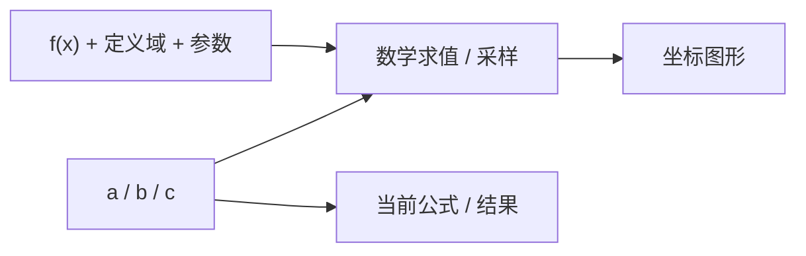

# 通过数学表达式绘制直角坐标函数

数据图表输入观测，函数图输入数学表达式、定义域和参数。由本增量实施者验证并选定适用的 Rust 求值库或原生实现，支持变量、常量、基本运算与常用函数，并处理定义域、错误和有限值。函数求值使用自己的数学表达式语法，公式展示复用已经实现的原生排版。

复用数值坐标轴与路径绘制，支持一条或多条显式函数、点/曲线、定义域和显示范围。对除零、奇点、非有限值分段处理，不能把 `1/x` 跨越零点连成直线；缩放和参数变化重算必要曲线。数学计算可在适当工作者完成，UI 主线程只应用绘制结果。用组合模板建立二次函数探索器，Slider/Number Input 联动 a、b、c，显示公式及结果，支持恢复初值；拖动全程无需 LLM。定义域、表达式、数据及用户参数按所属产物保存。

## 验收

真实 Agent 创建二次函数探索器，BRP 拖动 a/b/c，核对公式和曲线同时正确变化、恢复初值和重开状态；再绘制 `1/x`、定义域外函数、无效表达式并核对断点及错误。缩放、样本计算和更新使用真实数据，不以截图冒充求值验证。

## 与相邻方案的关系

依赖数学显示、坐标绘制、参数绑定及持久化；普通图表模板不依赖该数学求值器。下一项扩展非显式函数关系。

设计依据：[数学与数据可视化](../../docs/design/assistant-content/05-visualization.md)、[动态 Scene](../../docs/design/assistant-content/04-dynamic-scenes.md)、[数学排版](../../docs/design/assistant-content/03-math-typesetting.md)。

## 工程约束

遵循 Windows x64 / DX12、PowerShell 7 与锁定 Workspace 依赖。UI 使用 BSN、Scene / SceneList、Widgetry 公开 API；Props 仅初始化，运行期状态由 Component 与相应业务所有者维护。Agent 不依赖 Bevy、UI 或 Bridge，Bridge 不依赖 UI；现有进程内通信与权限边界不变。按实际影响进行 Cargo 检查与真实应用验证，GUI 变化用 BRP 真实输入、截图和 ECS 状态确认，结束后释放 Pointer 并核对 inactive。禁止新增测试、Benchmark、Example 代码及仅用于这些目的的依赖；未经授权不改变登录、凭据或数据目录。实施中同步受影响的当前设计文档，不提前宣称其他增量已实现。
