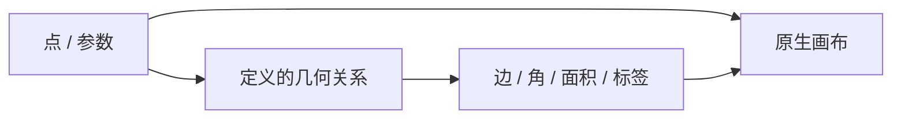

# 提供可联动的平面几何与向量示意图

平面几何的输入是点、线段、圆、角、标记以及明确几何约束，不把模型生成的一串屏幕像素作为数学定义。利用 Widgetry Canvas 或其他现有公开原生绘图能力表达这些对象，支持方向、边、角度标签、向量分解、面积示意和数学标签。布局、逻辑坐标、比例、裁剪和文字由本地绘图层管理。

允许用户拖动可操作的点或通过参数改变几何对象，重算其依赖边、角、面积或向量关系。对于明确约束，变化须保持实际定义；若约束未提供或无法满足，反馈不可计算状态，不伪装为成立。无需为所有几何问题实现通用约束求解器或自动定理证明。Scene 定义和交互状态按现有 Session 机制保存，不建设独立白板。

## 验收

用真实 Agent 生成三角形、圆、向量分解等示意，BRP 拖点/调整参数后检查实际几何关系和标签，非法约束有反馈。切换、重开后点位和定义一致。

## 与相邻方案的关系

依赖原生绘图及参数绑定，不依赖三维向量场；下一项处理抽象节点和连接关系。

设计依据：[数学与数据可视化](../../docs/design/assistant-content/05-visualization.md)、[动态 Scene](../../docs/design/assistant-content/04-dynamic-scenes.md)。

## 工程约束

遵循 Windows x64 / DX12、PowerShell 7 与锁定 Workspace 依赖。UI 使用 BSN、Scene / SceneList、Widgetry 公开 API；Props 仅初始化，运行期状态由 Component 与相应业务所有者维护。Agent 不依赖 Bevy、UI 或 Bridge，Bridge 不依赖 UI；现有进程内通信与权限边界不变。按实际影响进行 Cargo 检查与真实应用验证，GUI 变化用 BRP 真实输入、截图和 ECS 状态确认，结束后释放 Pointer 并核对 inactive。禁止新增测试、Benchmark、Example 代码及仅用于这些目的的依赖；未经授权不改变登录、凭据或数据目录。实施中同步受影响的当前设计文档，不提前宣称其他增量已实现。
