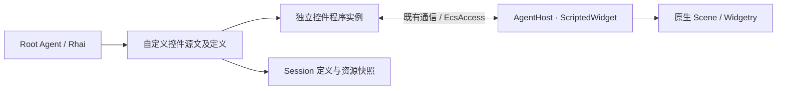

# 在运行时创建 Rhai 定义的自定义控件

预设 Scene 已能接受参数和组合。现在让 Agent 定义一种此前没有编写过的控件，而不是只能选择完整的 Rust 模板。建立原生脚本控件宿主（设计中称 `ScriptedWidget`），Rust 按 BSN 负责实际原生布局、资源所有权及构造，Rhai 描述该实例的初始化、参数、逻辑位置和独立状态。脚本可利用已注册布局容器、基础控件及现有 Scene Factory 构造自己的内容；不建立第二套 UI Tree DSL，不要求运行时编译 Rust 类型、插件或新的原生 System。

`ScriptSession` 当前为普通工具保存 Engine、Scope 和函数 AST，执行 `ecs_execute` 后返回结果。复用现有 Rhai 引擎、Native API、取消和脚本控制，建立归属具体产物的独立程序实例，不共享无关控件的可变 Scope，不让 Bevy 主线程或 Tokio current-thread 直接执行长脚本。程序生命周期独立于一次普通工具调用，Runtime 承担执行与回收，World 仍由 UI 所有。Agent 现有普通 ECS 操作能力不收窄，不新增沙箱或审批规则。Bevy Dynamic ECS 与 bevy_mod_scripting 只作技术参考，不引入第二种脚本执行体系。

初始定义持久化沿现有产物机制，保存实际需要的 Rhai 源文、参数、资源快照及构造和恢复约定。重开用此阶段保存的程序调用恢复入口，并沿用现有 Native API 与 ECS 操作边界。存档保存源文和语义定义，运行期重新创建 Scope、AST、Entity 和资产句柄。当前 Rhai 启用 `no_module`，脚本定义需要独立可加载。接口形状、事件函数约定和 API 组织在实施时依据当前 Rhai 验证。本阶段先交付 Agent 自行描述布局、状态和初始计算的自定义控件，后续接入持续交互和绘图，第 46 项接入 Skill 脚本来源。

初始化错误通过原结构化回执交给 Agent；构造失败清理本次实例拥有的场景，不把脚本当作整个 World 的事务。持久提交、实际 Scene 安装与错误的确认遵循原 Session 生命周期。

## 验收

真实 Root 创建一种项目没有预定义完整 Rust 模板的控件，例如带自定义计算结果、文字和两个原生输入的场景。核对程序与 Scene 的实际构造、稳定产物身份及源文保存；关闭前台 Turn、切换和重开，从自身定义重新构造。故意使用实际无效的 Rhai 定义或 Scene 参数，检查结构化错误和半成品清理。

## 与相邻方案的关系

依赖现有发布、组合及持久定义能力，使用已实现的基础控件即可，不技术依赖所有图表类型。下一项为该程序接入用户事件。

设计依据：[Rhai 自定义控件](../../docs/design/assistant-content/06-scripted-widgets.md)、[持久化与 Skill](../../docs/design/assistant-content/07-persistence-and-skills.md)、[动态 Scene](../../docs/design/assistant-content/04-dynamic-scenes.md)。

## 工程约束

遵循 Windows x64 / DX12、PowerShell 7 与锁定 Workspace 依赖。UI 使用 BSN、Scene / SceneList、Widgetry 公开 API；Props 仅初始化，运行期状态由 Component 与相应业务所有者维护。Agent 不依赖 Bevy、UI 或 Bridge，Bridge 不依赖 UI；现有进程内通信与权限边界不变。按实际影响进行 Cargo 检查与真实应用验证，GUI 变化用 BRP 真实输入、截图和 ECS 状态确认，结束后释放 Pointer 并核对 inactive。禁止新增测试、Benchmark、Example 代码及仅用于这些目的的依赖；未经授权不改变登录、凭据或数据目录。实施中同步受影响的当前设计文档，不提前宣称其他增量已实现。
