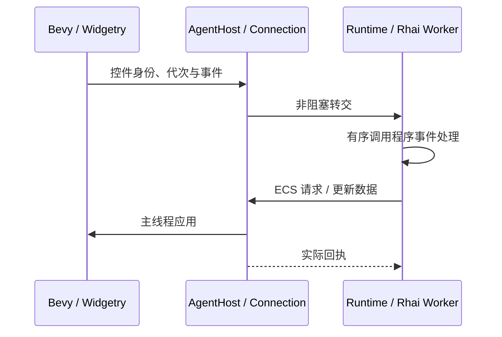

# 让自定义控件持续响应用户事件

普通 `ecs_execute` 只在 Agent 工具执行时运行，控件不能在每次用户交互时要求模型再发工具调用。让已创建的独立 Rhai 程序能够接收所属实例的实际点击、键盘、数值变化、选择和拖动事件，调用其对应的用户定义处理函数，产生状态和界面变化。

复用 `ScriptSession` 的引擎配置与 Native API 执行基础，独立控件事件运行于合适的工作线程。Bevy 主线程不等待回调，否则回调再请求 ECS 时会死锁；Tokio current-thread 不执行长脚本。每个实例的事件按其状态语义有序推进；来自已销毁、替换或切换代次的事件和回执不更新新实例。继续使用原有请求队列、Winit 唤醒、取消和 30 秒脚本期限等执行机制，不另设安全权限。合并必要更新时不得丢失有业务意义的点击、选择、最终拖动值。

Widgetry 仍拥有正常交互状态，Rhai 定义专用计算和行为。运行错误保留最近有效状态与可用内容，错误发生于 Active Turn 时向模型交付真实回执，否则在控件内反馈并允许用户重试/要求修复。不得因错误自行请求模型。切换或删除停止事件投递并回收实例；应用退出时仍保证主线程可处理必要收尾请求。

## 验收

真实 Agent 创建未预定义的自定义计算器，让自编 Rhai 在用户点击、数值变化和文本/选择事件中修改结果；结束模型轮次后 BRP 操作仍有效且没有新模型请求。验证两控件的独立状态、连续交互、失败回调、切换中的旧回执与实际收尾。

## 与相邻方案的关系

依赖独立脚本控件宿主；下一项让该程序生成自定义图形，而不只控制现有显示项。

设计依据：[Rhai 自定义控件](../../docs/design/assistant-content/06-scripted-widgets.md)、[持久化与 Skill](../../docs/design/assistant-content/07-persistence-and-skills.md)。

## 工程约束

遵循 Windows x64 / DX12、PowerShell 7 与锁定 Workspace 依赖。UI 使用 BSN、Scene / SceneList、Widgetry 公开 API；Props 仅初始化，运行期状态由 Component 与相应业务所有者维护。Agent 不依赖 Bevy、UI 或 Bridge，Bridge 不依赖 UI；现有进程内通信与权限边界不变。按实际影响进行 Cargo 检查与真实应用验证，GUI 变化用 BRP 真实输入、截图和 ECS 状态确认，结束后释放 Pointer 并核对 inactive。禁止新增测试、Benchmark、Example 代码及仅用于这些目的的依赖；未经授权不改变登录、凭据或数据目录。实施中同步受影响的当前设计文档，不提前宣称其他增量已实现。
