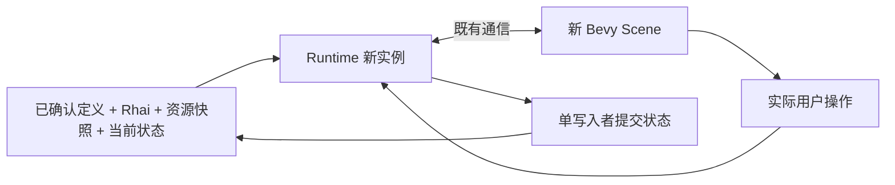

# 恢复自定义控件的程序与实际用户状态

预设 Scene 的状态保存已能处理命名参数，脚本控件还可能有自定义变量、计算结果、交互选择或模拟进度。扩展同一 Session 产物记录，保存完整的独立程序源文、实际使用的定义修订、必要数据及资源、初始状态和当前可序列化状态。不能保存不可恢复的 Rhai Engine、Scope、AST、闭包、执行句柄、ECS Entity ID 或 Asset Handle。程序定义必须能独立重建自身，不依赖普通 `ecs_execute` 工具的其他语句或当前磁盘临时脚本。

运行成功后提交有意义的状态，沿之前定义修订、回执和用户状态规则合并高频更新。操作结束、暂停、切换及正常退出应保存最后需要保留的有效状态；不逐帧写入渲染数据。保存失败显示未保存，恢复只认最后确认状态；状态变更不改写模型历史、不自动发起模型请求。每个控件状态只更新自己所属记录，旧程序或旧代次的回执不能覆盖新状态。

本增量从已确认源文和资源快照选择脚本，重新编译并调用其恢复入口，创建新 Entity、重新绑定事件和图形。恢复入口沿用现有 Native API 和 ECS 操作边界。第 46 项接入 Skill 关联时扩展脚本选择，继续复用这里的实例状态。重建失败时在原位置反馈错误，保留已保存的定义与状态。存档写入结果由 Store 实际回执确认。删除和退出按归属回收，并沿现有 Store 受控清理。

## 验收

在真实自定义控件中修改初速度、角度或其他自定义状态，暂停在某进度，核对已保存事实；切换、关闭并重开应用，看到同一状态和图形且仍可交互，无新模型请求或历史工具重放。使用独立实例验证状态不串，检查脚本资源丢失/写入失败的局部反馈及实际收尾。

## 与相邻方案的关系

依赖脚本宿主及事件运行能力，复用预设控件状态记录机制。下一项让模型修复和更新自定义程序本身。

设计依据：[Rhai 自定义控件](../../docs/design/assistant-content/06-scripted-widgets.md)、[持久化与 Skill](../../docs/design/assistant-content/07-persistence-and-skills.md)。

## 工程约束

遵循 Windows x64 / DX12、PowerShell 7 与锁定 Workspace 依赖。UI 使用 BSN、Scene / SceneList、Widgetry 公开 API；Props 仅初始化，运行期状态由 Component 与相应业务所有者维护。Agent 不依赖 Bevy、UI 或 Bridge，Bridge 不依赖 UI；现有进程内通信与权限边界不变。按实际影响进行 Cargo 检查与真实应用验证，GUI 变化用 BRP 真实输入、截图和 ECS 状态确认，结束后释放 Pointer 并核对 inactive。禁止新增测试、Benchmark、Example 代码及仅用于这些目的的依赖；未经授权不改变登录、凭据或数据目录。实施中同步受影响的当前设计文档，不提前宣称其他增量已实现。
