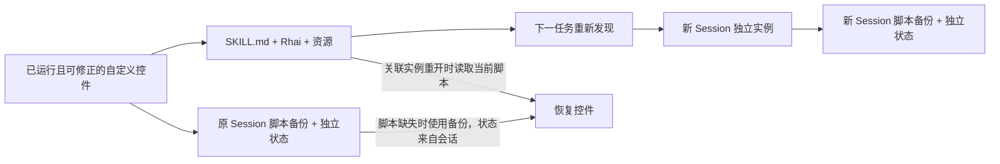

# 把成功的自定义控件封装为可复用 Skill

自定义控件是某次会话的产物；Skill 是以后能重复使用的工作方法、代码与资源。沿现有 `skill-creator`、标准 Skill 目录、用户 Skills 发现和校验流程，将一个已经能够运行的脚本控件整理为新的 Skill，不建设控件包管理器、不创建同名 Function Tool。

例如 `projectile-simulator/` 使用 `SKILL.md` 说明使用场景、创建方式、依赖的 Native 能力和参数，在 `scripts/widget.rhai` 保存初始化、计算、事件与绘图程序；需要时添加 `references/physics.md`、资源目录。重力、速度范围、角度范围、速度向量显隐等应参数化，避免只复制某次 Session 的固定状态。当前 Rhai 启用 `no_module`，多个脚本文件应按实际支持的方式装入独立程序，不能假定 `import` 已可用。按已有 Skill 创建/校验和发现规则保存，自动发现只读取元数据，实际选择后才读取和执行；自然任务匹配与 `$name` 继续复用。

按 Skill 创建控件时保存实际 Skill 来源、脚本相对入口以及会话内备份。封装已有控件时，可以明确将原实例关联到新 Skill。关联实例每次重开时按该来源和入口读取当前脚本，避免误选同名来源。找不到对应 Skill 或脚本入口时用会话里最后保存的脚本。当前脚本存在但编译或执行失败时反馈实际错误。用户状态仍由每个会话实例独立保存，新脚本沿初始化和恢复约定使用该状态。发布、持久提交和 Rhai 执行沿用现有机制。当前任务如需立即使用新建 Skill，通过现有目录快照规则显式读取新材料。

## 验收

真实 Root 使用现有 skill-creator 封装一项已可操作的自定义控件，检查实际目录、脚本内容及参数说明；下一任务通过自然匹配或 `$name` 创建不同参数的新实例，BRP 验证交互可用。修改 Skill 脚本后重开已关联的 Session，确认使用新版脚本且保留仍兼容的独立用户状态。移走或删除关联脚本后重开，确认使用会话备份。检查同名来源区分，以及当前脚本存在但运行失败时的实际反馈。

整体收口使用真实应用完成一个包含公开说明、普通工具往返、图片、已发布 MP3、数学公式、预设图表和自定义控件的场景；确认单一助手头像、内容来源及顺序、无普通工具行，关闭/重开后真实资源和已确认状态可用。该检查只覆盖本次整体协作边界，不另建纯验收方案，也不新增持久化测试代码。

## 与相邻方案的关系

依赖可独立恢复和可修复的自定义控件。此增量完成现有 Skills 与动态内容的复用闭环，不扩展为 Skill 商店或新的执行引擎。

设计依据：[Rhai 自定义控件](../../docs/design/assistant-content/06-scripted-widgets.md)、[持久化与 Skill](../../docs/design/assistant-content/07-persistence-and-skills.md)。

## 工程约束

遵循 Windows x64 / DX12、PowerShell 7 与锁定 Workspace 依赖。UI 使用 BSN、Scene / SceneList、Widgetry 公开 API；Props 仅初始化，运行期状态由 Component 与相应业务所有者维护。Agent 不依赖 Bevy、UI 或 Bridge，Bridge 不依赖 UI；现有进程内通信与权限边界不变。按实际影响进行 Cargo 检查与真实应用验证，GUI 变化用 BRP 真实输入、截图和 ECS 状态确认，结束后释放 Pointer 并核对 inactive。禁止新增测试、Benchmark、Example 代码及仅用于这些目的的依赖；未经授权不改变登录、凭据或数据目录。实施中同步受影响的当前设计文档，不提前宣称其他增量已实现。
