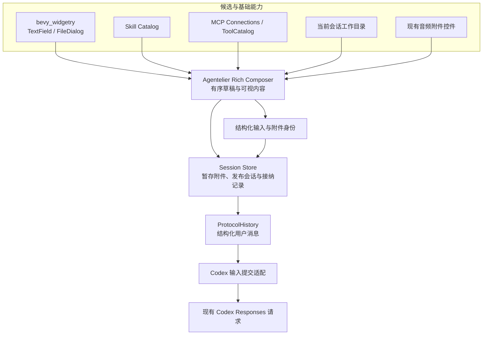

# 富文本聊天输入整体设计

这组方案把聊天输入从单一文本草稿扩展为有序的结构化消息。它不是把附件数组简单挂到文本后面：Composer 保留用户编辑顺序，Conversation 保存不可变输入快照，Codex Submission Adapter 再按 Codex CLI/Core 的输入组织方式构造模型请求。

## 设计关系

完整设计见 [富文本聊天输入组件](../../docs/design/modules/chat-composer.md) 与 [Codex 兼容的多模态输入提交](../../docs/design/mechanisms/codex-input-submission.md)。

结构化输入契约先建立消息身份和持久化边界。选择附件时保存草稿快照。创建会话并发送首条富媒体消息时，正式附件先写入，`Created` 与首条 `Accepted` 随同一份日志一并发布。Send、Queue 和 Retry 共用输入快照和正式附件引用，已有的转写文稿仍作为独立材料。随后 Codex 适配器将快照转换为一条结构化用户消息。

Rich Composer 复用 bevy_widgetry 的 TextField 与 FileDialog。首版保证跨元素移动光标、整项删除和中文输入法，选择和复制粘贴沿用单个文本段的编辑行为。`$` 使用 Skill 与会话冻结的 MCP 工具目录，`@` 搜索当前会话工作目录。

图片经 Codex `LocalImage` 路径提交。音频在第 07 步用现有 Codex OAuth、目标模型和实际传输验证直传。直传确认不可用时，沿用已保存的附件、显式转写和文稿选择。音频草稿与历史复用现有播放和波形控件。

## 唯一实施顺序

1. [建立结构化输入与会话历史](01-结构化输入与会话历史.md)
2. [建立 Codex 输入提交适配](02-Codex输入提交适配.md)
3. [实现 Agentelier 富文本 Composer](03-富文本Composer.md)
4. [加入 Skill 与 MCP 能力补全](04-Skill与MCP能力补全.md)
5. [加入项目文件引用补全](05-项目文件引用补全.md)
6. [接入图片输入附件](06-图片输入附件.md)
7. [接入音频文件输入](07-音频文件输入.md)

`$` 与 `@` 都依赖 Composer 和结构化输入契约，数据来源各自独立。第 05 步交付普通文件路径引用，第 06 步接入图片候选分流并完成图片请求验证。第 07 步依赖共同的附件和请求契约，可独立于图片实现验证音频。

## 全程保持的设计边界

- Rich Composer、补全弹层和内容元素由 Agentelier 实现；不修改 bevy_widgetry。
- 用户看到的内容顺序保持原始插入顺序；最终请求按 Codex CLI/Core 方式组织。
- 普通 `@` 文件引用是路径文本，不是通用文件上传；图片文件是特殊媒体输入。
- Skill 和 MCP 选择只是显式引用，不直接执行工具、不绕过权限。
- 用户图片要求会话明确支持图片输入。图片能力未知时保留附件和草稿。
- 音频直传可用时采用 Codex 支持的格式，FLAC 转为 WAV，单文件上限为 50 MiB。显式转写沿用现有格式和单文件限制。
- 音频附件展示与播放使用现有控件与波形。
- GPT-Live、GPT-Realtime、麦克风输入和实时语音会话不属于本组方案。
- Steer 保持现有文本输入边界；包含引用或媒体的富输入在任务执行期间应走 Queue，不得静默降级成纯文本。
