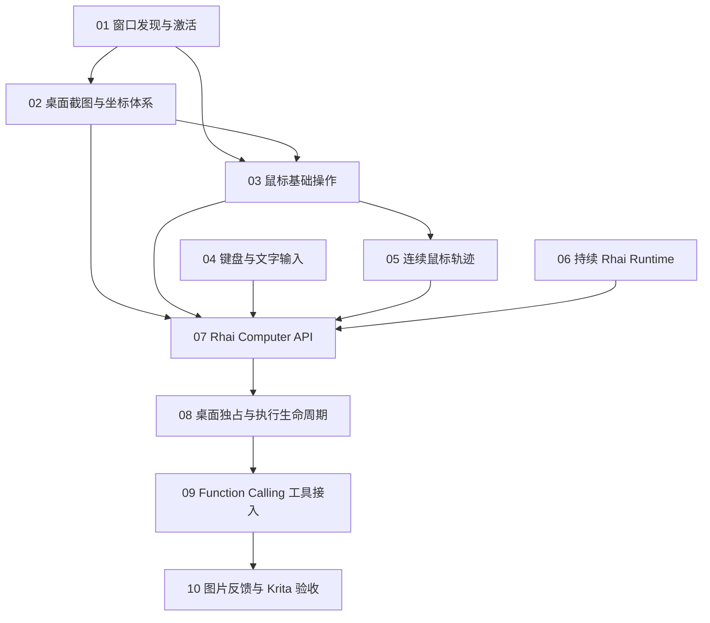

# Computer Use 实施方案总览

Computer Use 的整体机制见[设计文档](../../docs/design/computer_use/computer-use.md)。实施从真实 Windows 桌面能力开始，逐步建立 Rhai 执行环境和脚本 API，最后接入现有 Function Calling，并通过 Krita 绘画任务完成端到端验收。

## 整体依赖关系

窗口发现提供窗口目标和边界；截图方案建立视觉反馈与坐标基准；鼠标和键盘分别提供基础输入，连续轨迹建立绘画所需的多点输入。Rhai Runtime 提供持续脚本执行上下文，Computer API 将前序能力组合为脚本接口。桌面独占与收尾在模型工具开放前形成完整执行边界，Function Calling 接入后再补齐图片反馈并完成 Krita 验收。

## 唯一实施顺序

1. [窗口发现与激活](01-window-discovery-and-activation.md)
2. [桌面截图与坐标体系](02-desktop-capture-and-coordinates.md)
3. [Windows 鼠标基础操作](03-windows-mouse-control.md)
4. [Windows 键盘与文字输入](04-windows-keyboard-input.md)
5. [连续鼠标轨迹输入](05-continuous-pointer-trajectories.md)
6. [持续 Rhai Runtime](06-persistent-rhai-runtime.md)
7. [Rhai Computer API](07-rhai-computer-api.md)
8. [桌面独占与执行生命周期](08-desktop-session-lifecycle.md)
9. [Function Calling 工具接入](09-function-tool-integration.md)
10. [图片反馈与 Krita 绘画验收](10-image-feedback-and-krita-acceptance.md)

每份方案对应一个独立功能增量，实施、验证和必要文档同步归入同一方案。Krita 验收放在最后一个实际交付图片反馈能力的方案中，不另设纯验收阶段。
