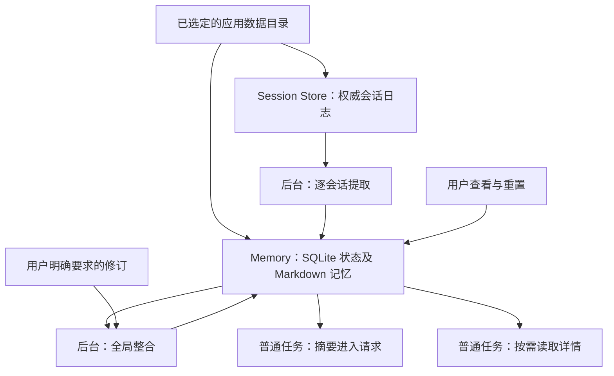

# 长期记忆的整体结构

长期记忆把既有会话存档转换为可跨会话使用的历史上下文。系统保留两类不同性质的材料：`session_store` 中的权威业务记录，以及由 Memory 从这些记录中生成、可以随新证据修订的记忆材料。记忆生成与普通任务读取分离，不改变当前会话、模型协议和工具执行的所有权。

`runtime` 拥有后台任务的实际生命周期，通过现有 Account 与 LLM Model 发送提取、整合请求；Memory 管理状态、选择、文件与来源证据；`turn_runner` 在普通模型请求中使用已经发布的记忆，不负责后台整合。`conversation` 保留会话和请求的核对事实；Bridge/Host/UI 仅在用户操作需要时负责安全投影。所有材料属于本次固定数据目录，不按项目或登录账号另起一套存储。

具体实现按唯一顺序分为以下独立增量。顺序表示交付路径，不表示所有模块之间都是相邻单向调用关系。

1. [建立可持久化的记忆状态与数据目录边界](01-persistent-memory-store.md)
2. [从已提交会话中自动提取来源记忆](02-session-memory-extraction.md)
3. [把来源记忆整合为可阅读的全局摘要](03-global-memory-consolidation.md)
4. [让新会话自动使用已发布的记忆摘要](04-memory-context-in-requests.md)
5. [按需检索详细记忆并反馈使用信息](05-selective-memory-retrieval.md)
6. [接收用户明确的记住、纠正与忘记要求](06-explicit-memory-revisions.md)
7. [在现有界面查看长期记忆](07-memory-inspection.md)
8. [确认并持久重置长期记忆](08-reset-long-term-memory.md)

以上各项的目标是连续形成完整的默认常驻记忆能力。不存在“启用长期记忆”“生成记忆”或记忆版本选择设置；记忆文件和代码名称也不带机制参考方的版本标签。实现某项增量时，相关 Cargo、运行和界面检查随该项完成，不另外拆出纯验收阶段。
