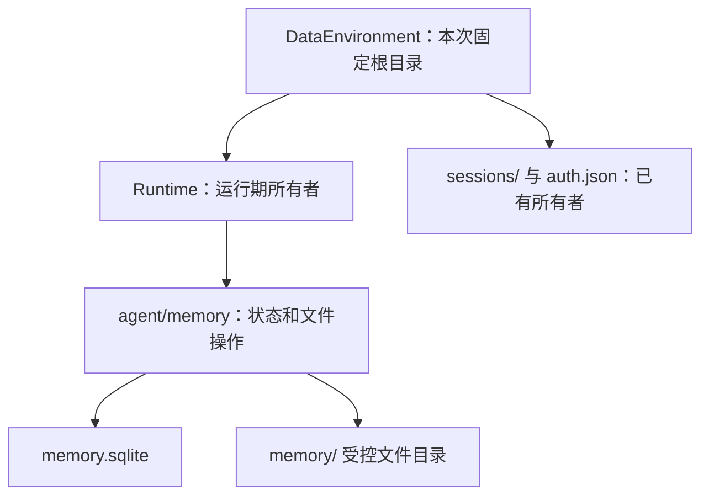

# 建立可持久化的记忆状态与数据目录边界

本增量的交付目标是在当前应用数据目录中建立一个能打开、保存、重新读取并正常收尾的 Memory 存储所有者。完成之后，即使尚未进行模型提取，运行应用也能形成可靠的记忆工作空间，并看到持久状态而非一份内存中的临时列表。

## 让记忆归入已有数据环境

应用启动时已经选定并独占一个规范化数据目录，`DataEnvironment` 持有整个运行期的固定根路径。新功能直接使用这一路径，不扫描 `~/.codex`、工作项目目录或登录账号的默认 HOME；改变下次启动目录也不在当前运行中移动、合并记忆。



数据环境的 `.agentelier.lock` 已防止两个应用实例同时占用同一个根目录。Memory 复用这项应用级约束；它仍须在自身存储内部串行化事务，不把目录锁当作 SQLite 并发事务机制。

目标布局为：

```text
<应用数据目录>/
├── memory.sqlite
└── memory/
    ├── memory_summary.md
    ├── rollout_summaries/
    └── extensions/ad_hoc/notes/
```

目录和文件可以按需创建：空记忆应是一种有效状态，而不是启动错误。SQLite 与 Markdown 分开，是为了让来源任务、处理状态和增量整合进度用可靠结构化记录表达，让将来提供给模型或用户的内容仍然是可阅读文本。名称统一采用 `memory`，不建立旧版兼容目录、双写数据库或迁移入口。

## 明确 Memory 与会话存储的所有权

新增 `crates/agent/memory/` 承担记忆持久化和相关业务状态；Crate 入口按 Workspace 的 Windows x64 规则声明平台，并按实际依赖使用统一的 Workspace Dependency。`runtime` 负责创建、持有与结束服务；Memory 不依赖 UI、Bridge、Agent Runtime 反向接口，也不成为模型网络或凭据所有者。它提供可传递的受控读写能力，供将来提取、整合和普通任务使用。

Session Store 继续独占 `sessions/<uuid>/` 的权威日志与附件。Memory 从不负责向会话日志分配序号，也不改变 Session Store 的删除、恢复或压缩检查点规则。`login`/`account` 继续管理认证，记忆表内不存 Token、Cookie 或认证文件内容。

## 第一批持久状态支持后续工作而不过度承诺

本增量需要建立能够承载以下实际业务事实的结构，避免后续功能临时用文件名猜测状态：

- **来源身份**：持久 Session ID、已读取的提交边界、来源工作目录及源内容修订信息。相同来源有新的已提交内容时能够识别变化。
- **提取输出及状态**：每份来源的摘要文本、安全标识，以及尚未处理、成功有内容、成功无内容和失败待重试的区别。
- **整合的已发布基线**：最近成功选用的来源及其内容修订、全局产物的摘要/发布身份，用于找出新增、变化和删除。只有真正完成发布才推进基线。
- **使用信息**：详细记录的使用次数和最近使用时间，供后续有限选择使用。
- **修订和重置边界**：将来可以知道哪些修订尚待整合，以及一次重置前的来源处理边界，防止旧任务反向覆盖新状态。

这些是持久业务状态，不意味着这一增量就要实现提取、合并、检索或 UI。SQLite 的具体表划分、Rust 类型和事务包装应以单一职责和操作原子性确定，不需要预设一类记录一个 Crate，也不引入仅为未来兼容所需的层级。

## 写入、读取与生命周期

SQLite 事务决定一组相关状态变化是否成功。文件发布由 Memory 受控地写入临时文件并完成必要确认，再原子替换目标；对外只能看到已经完成发布的产物。后续两阶段工作可以引用当前确认的来源边界、已发布基线和文件版本，而不是从普通日志猜测成功状态。

存储启动失败、数据库不可用或目录受阻，应形成真实诊断和 Memory 不可用状态；基本聊天和既有会话存储不能因为没有记忆而被拒绝启动。Memory 自身明确区分“没有记忆”和“读取失败”，为用户查看与运行日志保留诊断信息，不需要现在增加 UI 入口。

这一服务挂在现有 Tokio 运行期，阻塞文件工作通过可等待、可回收的边界处理；不创建第二个 Agent 运行时或独立长期守护进程。正常退出时先结束 Memory 的在途工作，再释放数据目录占用；不能只提交取消请求就假设文件句柄已关闭。

## 完成后的可观察结果

在已由用户选定的数据目录启动真实应用，能够观察到记忆数据库按需建立，文件工作空间受控且不会污染 `sessions/`、`auth.json` 或项目目录；退出并重新运行后保留已提交的数据库状态。目录不可写、SQLite 事务失败等场景要返回真实错误，不以空记忆代替错误；正常聊天仍可以继续运行。

根据本次修改执行 Windows x64 目标下适用的 Cargo 格式、编译、Clippy 与依赖检查，并通过实际运行确认后台资源正确关闭。此次没有可观察的 UI 变化，不需要为这个存储增量增加 BRP 界面场景，也不得编写 Unit Test、Integration Test、Regression Test、Benchmark 或 Example。实现改变了实际架构后同步更新总体架构、应用数据目录及记忆机制设计的当前事实。

本增量只建立供后续任务使用的存储基础，不发送额外模型请求、不注入记忆、不新增管理开关。下一增量才能把已存在的历史会话真正转换为来源记录。
