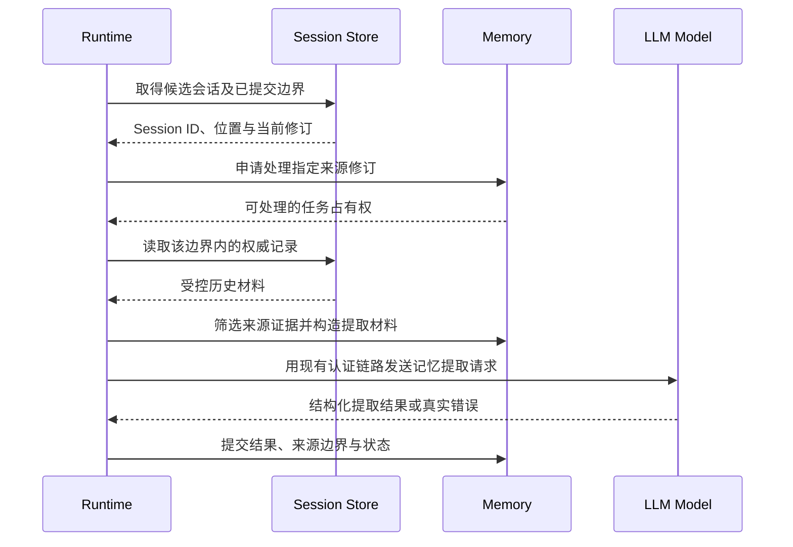

# 从已提交会话中自动提取来源记忆

本增量把已经持久保存的会话历史变成 SQLite 中可追溯的逐会话记忆记录。完成后，后台处理一个符合条件的会话，会留下确切的来源、处理结果和结构化摘要；普通聊天尚不因此自动收到记忆。

## 从会话记录出发，而不是从聊天展示反推

`session_store` 已有按 UUID 保存的会话事件、原始协议历史、完成与失败状态以及项目来源。Memory 的输入必须来自这些**已提交事实**，不能抓取 UI 中当前可见的部分正文来总结，也不能读取 `summary.json` 作为唯一依据。Session Store 提供受控、只读的来源快照或与当前日志读取规则一致的受限读取接口，Memory 对输入做证据筛选，二者职责不相互侵占。

处理时使用 `SessionId` 及已提交日志序号/修订身份。文件末尾仍在变化、未确认的记录、部分流式文本、工具尚未封闭的结果都不能凭界面状态推断成完整历史。对已经闲置到可提取条件的会话建立快照；同一个会话后来写入了新记录，下一次处理其新的提交边界。正在进行中的任务不要求立即生成记忆。

## 默认生成并不等于每个会话都强行输出摘要

应用已不存在“是否生成记忆”的用户配置：所有正常的本地会话进入候选范围，记忆工作只在可用来源、资源和合法时机满足条件后发生。临时内部的提取/整合模型请求不是用户会话，不能反过来被采样形成循环。执行失败、内容无价值和暂未满足闲置条件分别保留实际状态。

与 Codex 的来源选取方式一致，处理任务应有明确的闲置窗口、来源扫描上限、输入预算以及有界并发数。并发工作需要先取得针对来源修订的占有记录，避免不同启动周期对同一来源重复耗费模型请求。失败后记录错误和重试退避；没有可用账号、模型目录或网络时只是延后记忆生成，不主动退出、重新登录、切换账号或发起 OAuth。

模型选择复用当前已经可用的账号和模型请求能力。由 Runtime 为后台请求确定一个实际可用的模型上下文，而不是让 Memory 自己访问账号文件或建立新的 HTTP 协议实现。提取请求不进入用户会话的聊天历史，也不改变当前会话固定的模型、推理设置和提示词快照。后台请求的消耗与失败应作为后台工作记录，不能冒充用户主动发送的聊天任务。

## 只保留对未来确有意义的证据

输入按原顺序保留对历史判断有影响的材料：用户要求和纠正、已确定的范围、项目工作目录、实际执行/验证结果、最终状态、重要错误和仍未解决的点。区分“用户明确决定采用”“助手提出建议”“工具观察到”“用户否定了”四类事实。工具输出巨大或重复时按预算选择证据片段；图片等非直接可读的内容只留下安全的来源说明，不把加密 reasoning 或完整 HTTP 载荷写入记忆。

提取器返回严格结构化的 `rollout_summary` 和可选安全 slug；没有保留价值时明确返回空结果。内容不从上下文外编造偏好和完成状态。写库前执行凭据及访问性秘密脱敏，并保留来源 Session ID、采集边界、项目范围和可追溯的时间信息。

例如一次会话中助手推荐过方案 A，但用户最终要求使用 B。提取结果必须表达 B 是已采纳决定、A 是被否定的提议。另一个任务中用户仅要求“这次先别修改文件”，不能被升级为用户永远不允许修改文件的全局偏好。

## 在现有运行期内安排后台工作

Runtime 在合适的应用/正常会话启动边界安排一次有限候选检查，使用当前 Tokio 和实际 JoinHandle 管理工作。文件读取沿 Session Store 的真实读取边界，模型通信沿 LLM Model/Account，结果交给 Memory 的 SQLite 事务提交。后台不可长期占据 Runtime 的普通命令循环；取消之后应回收已经启动的 I/O 和模型工作。关闭应用时不能留下未持有的后台写入者。

成功写入需要区分三类状态：有内容、无内容和失败。只有成功且来源修订对应的结果可供全局整合选取；迟到结果如果已被更新来源或重置边界取代，不应覆盖较新的状态。相同有效来源不因启动次数增多而反复生成同一份摘要。

## 完成后的可观察结果

在已有真实会话的选定数据环境下进行实际运行，检查本地 SQLite 中来源 Session ID、提交修订、提取状态和结构化摘要。再次启动后，同一修订不应被重复处理；给同一会话增加新的已提交内容后可以取得新的提取结果。确认已取消或失败的后台请求不会被记录成成功，空输出可以正常跳过。

还需通过实际日志和请求诊断确认后台调用没有污染普通会话协议历史、工具执行结果、账号登录状态或窗口消息。按修改范围执行适用的格式、编译与 Clippy 检查。没有新的 UI 交互，不增加 BRP 界面动作，也不创建测试代码、Benchmark、Example 或专门测试宿主。

这一增量不更新全局摘要，也不将来源结果注入模型的普通聊天请求；下一增量负责把多个来源合成可复用的发布材料。
