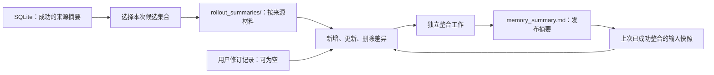

# 把来源记忆整合为可阅读的全局摘要

本增量使用已经提取到 SQLite 的来源结果，生成数据目录中的 `memory_summary.md` 和按会话划分的详细摘要。完成后，即使尚未接入聊天请求，也能从可阅读文件里找到有来源依据的项目决策、当前任务线索和对应历史记录。

## 全局摘要不是另一次简单拼接

第一阶段的结果属于各个 Session。多次会话可能重复同一个项目、推翻先前决定，也可能分别证明同一项工作习惯。直接把这些段落按日期拼接，会让新模型同时收到过时和最新的说法。

第二阶段只读取已经成功提取的来源，先按当前候选集准备 `rollout_summaries/`，再运行独立整合工作，生成供新会话快速理解和定位详情的总摘要。

每份来源详细摘要要有可核对的稳定 Session ID、已处理修订、来源工作目录或项目范围，以及内容正文。文件名可以含经安全处理的简短 slug，但真实身份不能只靠 slug 反推。总摘要优先保留明示的用户偏好、近期项目的有效决策、仍在进行的任务状态，以及对详细记录的准确入口。单条来源没证明的跨项目普遍偏好不应由整合阶段补出来。

## 选择、差异与发布保持一致

候选集有明确上限，依来源最近更新、已经被实际阅读的次数和最近使用时间来选择；从未被读过的来源仍可依据生成时间进入近期候选。不同来源最终按稳定顺序生成详细材料，使无关排名变化不会反复触发重写。

Memory 从 SQLite 保存的上一次成功整合输入快照计算本次变化，识别新增、修改和已移除来源，而不是要求每次重新处理全部会话。来源的修订由 Session Store 的已提交事实决定；删除一个会话后，应使它从记忆候选中消失，在下一次整合中清理只由该会话支持的结论。如果同一结论仍有其他证据支持，只清理失效的来源线索。

同一数据目录只有一个全局整合写入者。整合输出先在受控位置生成并校验，成功后发布新的 `memory_summary.md` 和对应详细材料，再提交本次输入快照的完成状态；失败不能把新输入误标成已经整合。若输入没有变化且现有摘要有效，不必额外耗费模型请求。实现可以利用 SQLite 中已发布的输入版本与内容摘要计算差异，不必为了模仿参考实现而建立嵌套 Git 工作区。

整合输出应具有短小的导航性质，完整摘要维持在约 10 KiB UTF-8 量级的明确上限；详细材料按需存放，不把几百个会话全部压入摘要。既有项目历史优先用正确的来源路径定位，避免猜测旧文件名。

## 整合的模型职责与结果含义

整合请求通过 Runtime 所有的后台任务和现有 LLM Model/Account 请求链路执行，不创建可与聊天竞争的第二个认证状态。给整合模型的是已选定的记忆文件、输入差异和必要的用户修订材料，而不是原始全量会话日志。输出必须保留用户真正说过的话、已完成与仍未完成的界限、项目适用范围及重要不确定性。

例如“会话 X 曾采用 A，后续会话 Y 明确改为 B”，新的全局摘要应呈现 B 是当前决定，同时在详情中留下能够找到 X、Y 的线索。仅当证据足够时才建立可跨任务复用的用户偏好。删除来源或有明确纠正时，旧说法不能靠未变化的缓存自动复活。

用户修订记录的完整提交路径将在后续增量加入；这里先使整合输入能够容纳修订变化，当前修订集合为空时按正常来源工作。整合成果是历史数据，不应被包装成当前项目的 `AGENTS.md` 或强制执行指令。

## 完成后的可观察结果

使用真实来源提取结果运行后台整合，检查 `memory/rollout_summaries/` 中每个条目能回溯 Session ID，`memory_summary.md` 能从项目和日期线索定位详细来源。重复运行同一输入不应无谓更新产物；修改、删除来源后应产生对应的受控变化。整合失败时旧摘要与已发布状态保持一致，后续能够继续处理未完成差异。

通过真实文件内容、SQLite 已发布输入状态和后台日志验证结果；按影响范围执行 Cargo 及源文件静态检查。不编写测试代码、Benchmark 或 Example，也不设置独立验收工作者。此阶段尚不改变用户的普通模型请求或聊天 UI；下一增量将使用这里发布的摘要。
