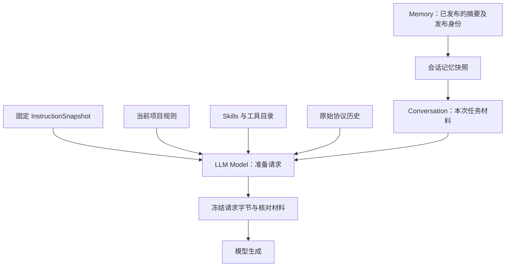

# 让新会话自动使用已发布的记忆摘要

本增量让前一个增量产生的 `memory_summary.md` 真正进入普通模型请求。完成后，新建会话可以在不重新读取全部历史的前提下利用已有记忆，并且能够核对**哪一份记忆、以什么身份、在什么请求中**发送给了模型。

## 一份摘要怎样进入已有请求链

记忆属于历史背景，不是聊天消息、项目当前规则或用户固定提示词。新会话在具备运行条件时，从本数据目录 Memory 的**已成功发布结果**中选定一份有界快照；未生成过记忆时可以取得空快照。`conversation` 负责将这份材料及其身份绑定到会话所使用的上下文，`turn_runner` 将它交给模型请求准备流程，`llm_model` 仍然拥有唯一的 Responses 序列化和冻结边界。

引入记忆不得改变 `SessionSettings.instructions` 的原有含义，也不能把历史摘要写进 `ProtocolHistory`，伪装成用户刚发来的内容。沿用官方记忆读取思路并参考现有 Skills 材料的独立注入方式，在请求准备时形成一个与固定基础指令分开的 `developer` 上下文片段。这个片段由宿主标识为历史背景，同时明确其中的记忆正文是供核对的数据，而不是可执行的当下指令；它不能覆盖当前用户要求或实时项目事实。

## 快照、请求核对与历史连续性

一次会话选定的摘要需有内容、来源发布身份与内容摘要；普通模型请求在执行之前由 Runner 读取当前会话所绑定的记忆材料。后台生成新的摘要，不得插入一项已经准备或正在发送的请求，也不得悄悄改变本任务中的记忆文字。认证重发继续使用原先冻结的 `PreparedGeneration` 字节，不重复读取文件构造另一份请求。

`GenerationRequest` 应承载确定的记忆材料，`RequestProjection` 记录其角色、输入位置、来源发布身份与 SHA-256。请求准备事实仍由现有单写入者提交，只有提交确认后才允许发送。恢复后旧请求展示当时已使用的摘要版本与注入内容；新请求不能拿后来磁盘里的文字回填历史事实。需要调整持久 Session 状态时，遵循 `conversation` 的序号、存档与 `turn_runner` 的确认边界，不额外建立第二套会话时间线。

服务端自动 compaction 只处理工作历史窗口。对仍应出现的记忆背景，新的工作窗口由请求准备再次提供当前合法的摘要快照，不把它算作一条新的用户发言。摘要材料产生的 Token 估算参与 `ContextState` 的任务材料/固定输入计量；与 Skills、项目规则、工具声明以及 32 MiB 的实际请求序列化预算一起检查，不依赖模型以后自行忽略超出的文本。

## 摘要失效时怎样处理

没有已发布记忆是正常状态：模型请求沿原有路径继续，不为制造“非空记忆”启动额外生成。已发布文件丢失、内容损坏或无法读取则由 Memory 返回明确错误和可诊断状态；普通任务可以在不使用该材料的情况下继续，但请求核对必须如实显示本次没有注入记忆，而不是把读取失败说成成功读到了空白内容。

每个正常会话默认使用有效记忆，不新增个人设置、会话设置、功能开关、模型选项或版本名称。Memory 仍属于选定数据目录，切换项目工作目录只影响记忆内容的适用判断，不切换记忆物理目录。当前 `AGENTS.md` 等项目规则若与旧记忆冲突，以当前规则及用户本次要求为准。

## 完成后的可观察结果

在实际应用中先用已有的发布摘要创建新会话，查看模型准备事实与实际请求材料：出现一次有身份、来源与哈希的记忆背景项，能够回答与该历史相关的问题；没有记忆时仍能正常聊天。保持会话活跃并产生一次新的后台整合，检查当前已冻结请求的正文和哈希未被改写，之后新建的会话能够选用新的发布结果。

继续观察已存在会话的 Retry、工具后续请求和自动 compaction：工具/历史项的 `call_id` 与原顺序保持不变，认证重发不重新选摘要，历史请求仍能回溯当时发送的具体记忆。相关 Cargo 检查、实际请求核对和必要的运行日志属于本增量验证；不编写测试、Benchmark、Example 或专门测试宿主。涉及当前架构事实变更时同步相应模块和机制文档。

本增量只使用**摘要**；当摘要不够详细时怎样查询来源记录，属于下一增量。
