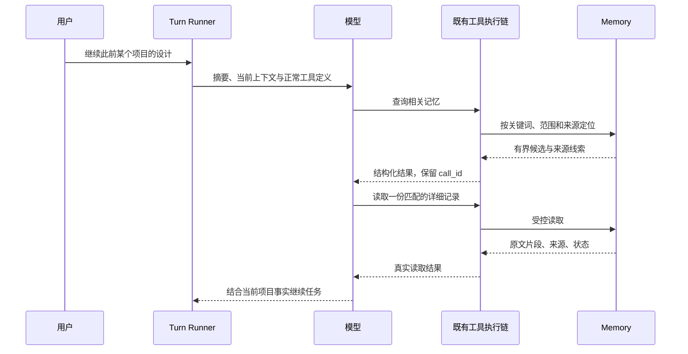

# 按需检索详细记忆并反馈使用信息

摘要能告诉模型“过去讨论过什么”，但遇到具体任务时还需要找到原有决策的出处。本增量让正常任务可以根据当前问题查询、读取 `rollout_summaries/` 中的详细记录；只有确实读取了历史时才产生相应的使用反馈。

## 从摘要中的线索进入一份详细记录

模型先得到上一增量提供的短摘要。摘要中的项目范围、日期、来源 Session ID 和详细摘要文件名是检索线索；模型只有遇到确实依赖旧讨论的任务时，才使用受控查询工具，而不是每轮扫描所有历史。Memory 负责索引、范围判断和文件读取，`turn_runner` 继续负责执行工具往返、取消和结果反馈。

最小工具面是“查询记忆”和“读取指定记忆”两项能力；工具语义可以依照当前 `ToolRegistration` 注册为内置的 Agent 扩展，不需要建立新的 MCP Server、向量数据库或全局自动全文注入器。查询结果应给出稳定记忆身份、可显示的来源、任务范围、摘要片段与可再次读取的精确标识；读取返回受限文本和证据定位信息，不直接开放 Memory 目录任意路径。

## 检索依据与安全边界

使用当前任务的工作目录及摘要里的项目线索定位候选；跨项目共通的用户偏好与具体项目决定应区别处理。查询匹配可以采用 SQLite 可维护的文本与来源字段，不以引入复杂向量索引作为完成目标。任务没有可靠匹配项时明确返回空结果，模型继续按当前事实工作；不根据相似关键词把另一项目的旧决定当成本项目当前状态。

对 `memory/rollout_summaries/` 的读取必须采用 Memory 提供的受控 ID 或已校验的相对路径，并遵守真实文件边界、大小限制、UTF-8 与取消契约。不能利用 `../`、符号链接或从模型输入直接指定系统任意文件。单次查询与读取均有限量，避免把大量旧记录压回上下文。详细记录是历史证据，不是具有更高优先级的指令；历史中的工具输出和提示词注入文本不得转化为当前执行命令。

Memory 可以记录一次已确认的详细读取所对应的 `usage_count`、`last_usage` 和来源身份，供后续整合选择使用；搜索未命中、工具调用失败或只是展示候选列表不应被记作成功使用。即使读取成功，仍需区分“过去这样决定”和“现在代码仍然这样实现”。有关当前文件、依赖或行为的实质判断仍由当前仓库实际证据决定。

## 接在已有工具协议上

两项工具进入新会话的固定 ToolCatalog；模型获得正常 function tool 声明，工具调用经过既有 ToolExecution 的接纳、执行、结果封闭与持久存档，不创建独立聊天通道。返回值保留 `call_id`、请求序号、工具名、成功或错误语义，使后续 Responses 请求得到完整、合法的工具结果。

旧会话在建立时已固定工具目录。对于旧存档恢复后的后续任务，新增记忆工具的提供必须遵守目录重绑定和已保存请求的声明核对边界：不能悄悄重写历史 ToolCatalog 或旧请求声明。若现有存档契约不允许在同一会话增加新的系统工具，应在该会话按明确的现有工具边界执行并保留可观察的限制；不能为了兼容伪造旧调用的定义。新会话的完整能力不因此受影响。

此增量不提供普通聊天之外的新记忆管理后台，亦不使 Session Store 提供全量任意聊天日志的工具化检索。需要原始证据时可沿现有会话存档的合法查看/核对流程确认；长期记忆查询以已整理、已发布的详细摘要为界。

## 完成后的可观察结果

在两个具有相似关键词但实际工作目录不同的项目里分别形成来源记忆，然后用真实新会话发起相关追问。观察模型只针对相关项目查询并读取必要详细记录，响应可以指出准确的历史来源；不相关问题不应自动展开全量历史，确实没有结果时返回空候选而非编造内容。

检查真实工具往返的名称、参数、调用 ID、响应序号和历史持久化；确认 SQLite 的使用计数只在成功读取详情后变化。对非法路径、过大结果、缺失记录和取消执行观察实际错误与记录的封闭状态，不额外创建测试代码、Benchmark、Example。受影响的请求展示若发生变化，采用已有 BRP 检查新增的可观察结果，否则只做 Cargo 与实际运行核对。

下一增量让用户能显式要求修订长期记忆；那是修改意图的持久写入，不应混入本增量的只读查询逻辑。
