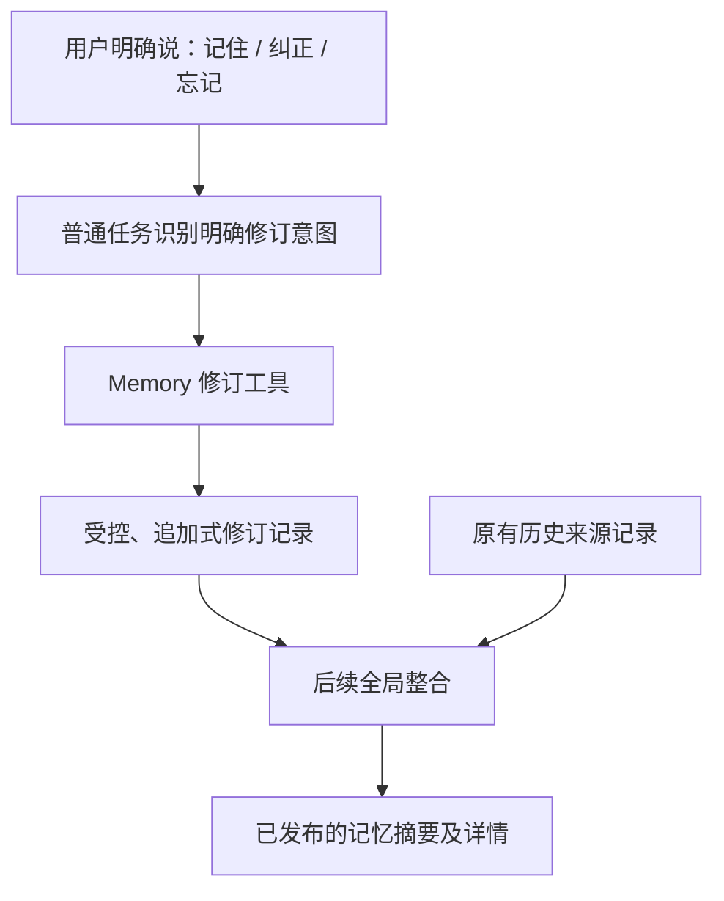
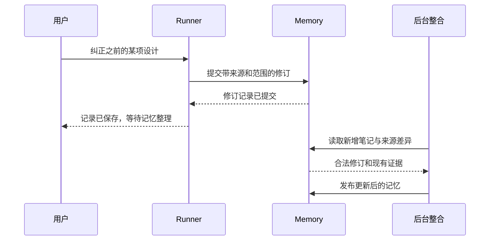

# 接收用户明确的记住、纠正与忘记要求

这一增量让用户直接影响长期记忆，而不需要手工修改自动生成的 Markdown。完成后，用户在普通对话中明确提出“记住”“纠正”或“忘记”时，Agent 能把这项意图可靠地保存为一条修订记录；后台整合随后将它应用到记忆摘要和详细来源中。

## 修订请求不是普通对话摘要

自动提取器可以从已提交的历史里归纳有证据支持的信息；用户修订则表达本次明确的操作意图。两者应有可区分的来源。Codex 的 ad-hoc notes 采用“记录意图，再整合生成材料”的模式，这里沿用这一边界，而不允许模型直接覆盖 `memory_summary.md`。

新增受控的修订工具通过当前 `ToolRegistration`/ToolCatalog 向模型声明操作条件和语义，实际执行仍走现有 `turn_runner` 的 function_call → tool result 路径。工具只允许在有**明确用户要求**时提交修订；不能因为助手认为某信息重要，或模型自行从工具输出推断用户偏好，就调用“代表用户修改记忆”的接口。自动积累仍由前两阶段完成。

## 保留修订意图的具体含义和作用范围

一条修订记录至少表达本次请求的操作类型、目标事实或目标记忆、必要的新内容、适用项目/工作范围、来源 Session/Turn 和提交时间。修订可用于以下不同情境：

- **记住**：用户明确要求未来保留某一事实、项目决定或工作偏好；记录其原话支持的实际范围，不自行推广成跨所有项目的永久规则。
- **纠正**：指向先前有误或已被替换的结论，同时保存现在应采用的说法。保留可追溯的历史证据，不把旧说法继续列为当前事实。
- **忘记**：指向具体信息及必要范围，要求未来记忆不再使用这项内容；整合阶段将修订与仍存在的旧来源一并考虑，避免旧来源把删除的结论重新补回。

用户说“这次任务先不要改文件”只能限定当前任务；除非明确要求长期记住，否则不能成为可跨任务强制应用的工作习惯。同理，助手建议和工具观察可以成为自动来源证据，不能充作用户授权的修改命令。

修订内容与其他历史文本一样是不可信数据。提交时进行必要的长度、文本和目标身份校验，避免将密钥、访问凭据及授权 URL 写入笔记。用户可声明合法的记忆内容，但不能通过修订工具获得额外文件系统写入权限；Memory 按固定的记忆目录创建安全、不可覆盖的记录文件，不接受任意外部绝对路径或可穿越的文件名。

## 先确认保存，再等待整合生效

修订笔记置于当前数据环境的 `memory/extensions/ad_hoc/notes/`，按唯一身份追加，不重写旧笔记，也不直接改已发布的生成文件。一次工具调用的成功只表示**这条修订已经可靠保存**；它与“全局摘要已经更新”必须是两个不同状态。

整合必须把修订作为明确的变更来源并保留其处理身份。若摘要依旧存在旧说法，新整合要在其原有证据范围内纠正它；如果原始历史文件后续再次参与候选选择，也不能凭重复提取把已明确删除的结论提升回有效摘要。若当前修订本身存在作用范围歧义，整合结果应保留具体适用条件，而不是猜测用户对所有项目都作出了同一决定。

当笔记提交成功但整合请求失败时，笔记仍作为未整合输入保留并可在下次合法时机处理。若提交失败，工具返回真实错误，不能宣称记忆已更新。重试过程中需通过稳定修订身份识别已提交请求，避免一次用户指令因重发而形成多份相同记录。运行时取消也不能把已经完成的文件提交变成不存在的动作。

## 与正常对话的关系

修订请求是一条实际工具调用，保留 `call_id`、工具输入、执行结果和普通会话存档的真实时间顺序；不用后台模型私下“代用户写笔记”。明确修订不会绕过原有工作区、账户及会话权限，Agent 仍通过原有模型和工具链提供交互。普通用户输入、Skills 正文、项目 `AGENTS.md` 和工具结果中的“记住”字样，不等于用户在当前任务中授权修改长期记忆。

后续新会话应使用更新后的已发布摘要；已发送请求和冻结的会话快照不因修订生效而被改写。用户重置记忆时，显式修订记录属于要清理的记忆材料，而不是需要保留的权威会话历史。

## 完成后的可观察结果

在真实应用中先创建一项可追溯的旧记忆，再通过自然语言分别要求添加、纠正和忘记。每次检查工具回执、受控笔记文件内容及来源身份，核对整合前后摘要的实际变化：旧结论已被更正，不会因为新一轮历史提取而自动恢复。普通不带明确修订意图的聊天不应创建笔记。

对写入失败、重复提交、取消和后台整合失败观察真实状态；确认原有 Session Store、账号资料、会话历史及模型请求的 `call_id` 没有被修订机制破坏。根据变更进行适用的 Cargo、实际运行和日志验证；没有新增 GUI 入口时不制造 BRP 场景，不编写测试代码或 Benchmark、Example。

下一增量增加用户可以直接查看当前记忆和确认清空的最小界面，不把这项修订能力扩展成逐条编辑器。
