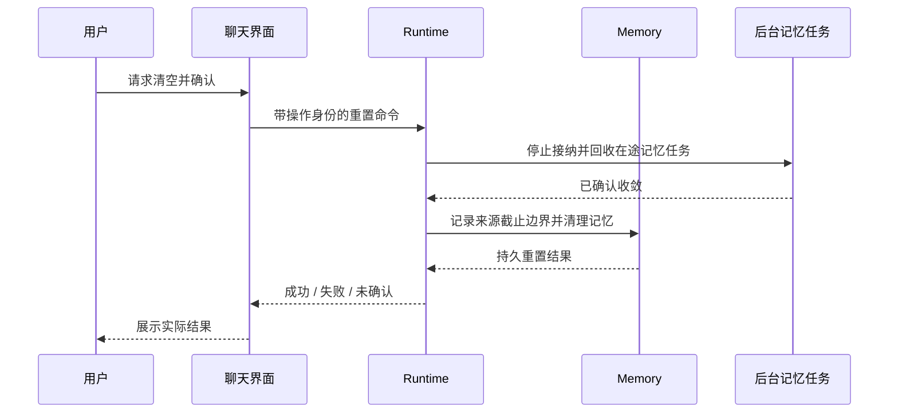
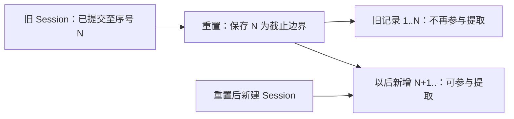

# 确认并持久重置长期记忆

本增量让用户在明确确认后清空当前数据环境里的长期记忆，既保留过去的会话与账号，也阻止旧后台任务或旧会话历史立刻把刚清空的记忆重新生成。完成后，长期记忆仍然常驻使用和自动生成，但只会从**重置边界之后的新事实**积累新的记录。

## 重置不等于暂停或关闭记忆

用户在已有的长期记忆查看入口发起重置，界面先给出明确的确认机会。取消只关闭确认状态，不改变数据库或文件。确认后才由 UI 经 AgentHost/Bridge 交付带操作身份的重置命令，Runtime 负责协调 Memory、后台提取与整合的生命周期。这里不增加“关闭记忆”“停止生成”等运行开关；重置之后 Memory 的使用和生成仍按正常机制运行。

Runtime 先暂停新记忆工作的接纳，并等待已启动的模型请求、文件写入和整合任务真正结束，随后由 Memory 处理重置。这与普通聊天的 Stop 是不同控制对象；用户正在使用的会话不能被重置流程当成待删除工作。只有清理和持久边界都确认后才能返回成功；如果文件被占用、数据库失败或收尾不确定，必须保留可诊断状态，而不能给用户一个虚假的成功消息。

## 清理范围必须与权威历史分开

清理 Memory 的生成数据及操作状态，包括 `memory.sqlite` 中旧提取输出、整合输入快照、已发布状态和记忆使用信息，以及 `memory/` 中的 `memory_summary.md`、`rollout_summaries/` 和用户明确提交的 `extensions/ad_hoc/notes/`。这些材料是可以从历史重新生成或人为修订的长期记忆数据。

不清理 `sessions/` 下的已提交会话日志、会话列表、附件和压缩检查点；不清理 `auth.json`、模型登录、项目文件、提示词或已有 Skills/MCP 设置。重置后旧会话仍可打开、阅读和继续，工具曾经执行过的历史事实与原始请求摘要也不被重新解释。Memory 不读取或删除其它 Agent 的目录。

## 为重置之前的历史留下不可逆的提取边界

如果仅删除现有记忆记录，下次启动时 Memory 仍会扫描 `sessions/`，旧的完整会话可能被再次提取，已清除的记忆于是立即回来。因此，持久重置需要为当时已存在的每个 Session 记录一个**最后已提交序号**或等价的稳定来源修订边界，作为后续提取的起点。

边界来自权威 Session Store 的已提交状态，不根据文件修改时间或 UI 最后打开时间猜测。重置和扫描/提取之间要有明确的纪元或提交身份：旧工作即使在取消前完成计算，也不允许跨越重置纪元重新提交结果。下一次应用启动读取重置边界，再选择重置后真正新增、已提交且满足闲置条件的来源。旧来源被删除或后来追加新事件时，也要遵守相同序号约束，不能把旧前缀误当作全新材料。

Memory SQLite 与磁盘 Markdown 不能依赖一个跨数据库/文件系统的虚构原子事务。应以重置状态/纪元作为恢复依据，按照可重复恢复的清理顺序完成操作，确认文件和数据库都已收敛才标记重置成功。失败后重新启动能够继续清理或明确报错，不把部分删除当成全部完成，也不因空摘要文件误判当前记忆已安全重置。

## 活动会话和已发送请求保持历史真实性

已经准备、冻结并发送的请求不能因为用户清空记忆而重新构造；原有 `RequestProjection` 保存的记忆来源与哈希也保留作为当时请求事实。相反，当前活动任务若在重置后尚未准备下一次请求，Runner 需要在安全请求边界感知新的记忆纪元，不再把已清空的旧摘要继续注入。恢复曾经使用旧记忆的会话时，也不能从旧核对记录重新创建被删除的记忆。

发生重置之后，尚无新提取和整合结果的正常模型请求以空记忆继续运行；下一次真实工作又可以按官方参考机制自动积累，不需要用户重新启用任何配置。用户已提交的新“记住/纠正/忘记”操作需要遵守重置的先后顺序：在清空确认之前提交的笔记属于清理范围，之后真正提交的新笔记属于新记忆纪元。

## 完成后的可观察结果

通过真实 GUI/BRP 在已有记忆状态下请求重置：取消确认后记忆与来源不变；确认后 Memory 文件和 SQLite 的旧生成内容被清理，查看入口显示空结果，同时旧的会话列表、会话全文、账号凭据和项目文件仍存在。关闭再运行应用，重置前的已提交历史不能立即重新生出相同记忆；同一会话新提交的事实、以及重置后新建的会话仍然能够正常参与提取和整合。

特别观察后台提取/整合与重置交错、模型请求已经冻结、等待中的记忆修订、部分文件清理失败和重复点击的情况，检查每项操作有真实最终状态，没有迟到写入者把旧摘要恢复。通过 BRP 的确认交互、截图、状态查询及日志核对结果；释放 Custom Pointer，确认 `inactive`。同时执行受影响的 Cargo 检查、实际运行和既有会话/账号关键行为确认，不创建任何测试代码、Benchmark、Example 或测试基础设施。

当本增量完成，常驻的长期记忆便具备持久生成、自动注入、按需读取、用户明确修订、查看和确认重置全部能力。实际变更涉及的架构、数据目录、请求与会话设计文档应与实现同步，仍不增加版本名称或启停开关。
