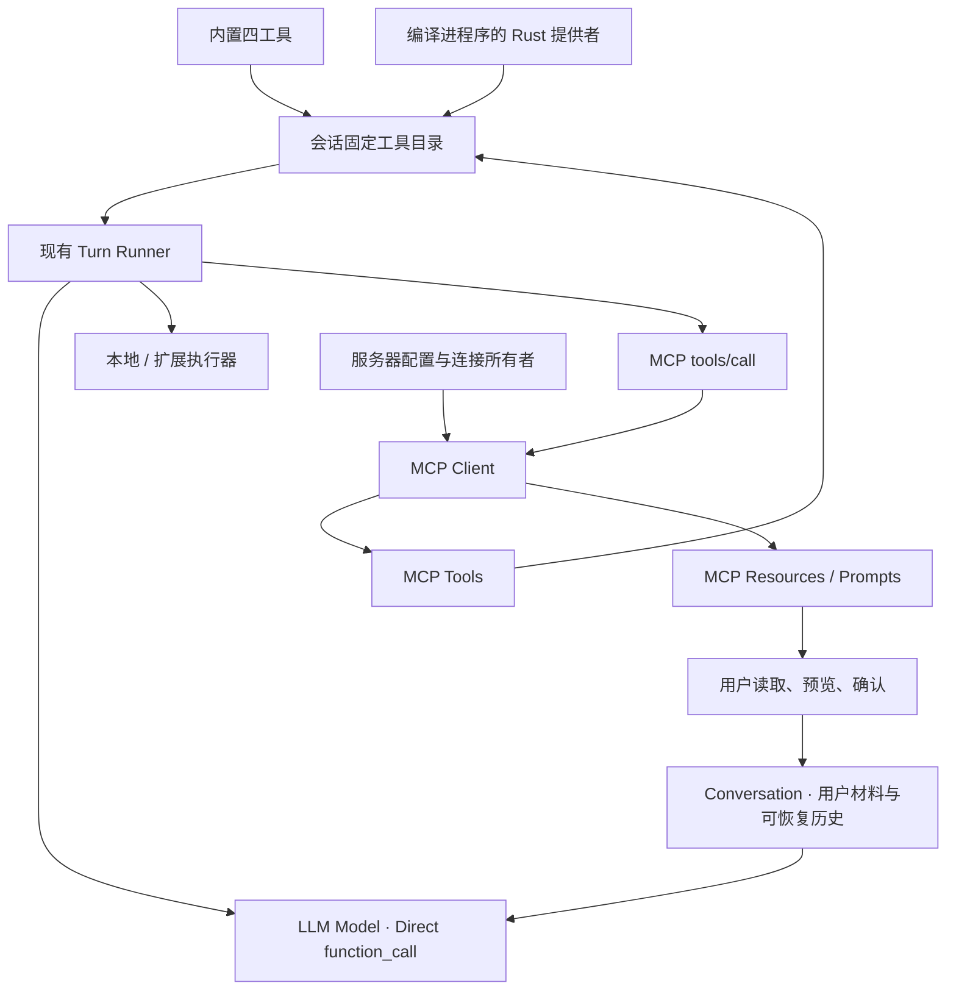

# 工具来源扩展与 MCP 客户端的整体设计

现有 Direct Mode 已经完成了从模型 `function_call` 到本地工具执行、再把 `function_call_output` 交回模型的闭环。本次扩展保留它的控制权和历史语义，把“只有四项内置工具”的前提改为“会话目录可汇集多种已绑定执行器的工具”；另为 MCP 的 Resources 和 Prompts 提供用户可选择的材料入口。

图中 `ToolCatalog` 是模型声明与实际执行的同一份登记，不代表引入第二套 Agent 运行器；`MCP Client` 持有协议连接及服务端进程，而不拥有工具步骤的历史。`Resources` 与 `Prompts` 不被当成外部函数直接注册到模型工具目录，它们在用户确认后进入正常的用户输入与会话历史。

## 现有机制哪些保持不变

- 任务仍由 `turn_runner` 独占活动记录。完整模型响应后执行工具，同批调用按模型输出顺序串行执行，复用 Stop、Steer、Queue、请求与工具预算，以及步骤封闭、取消后归还和展示时间线。
- `conversation` 决定创建会话时固定的工具目录和可重放历史；`llm_model` 只负责 Responses 的工具声明、解析与结果序列化。`agent/tools` 保存执行接口和结果语义，独立 MCP 业务所有者处理协议与连接。
- Windows x64、PowerShell 7、现有 Tokio Runtime、唯一 Bridge Connection、BSN/Widgetry UI、启动数据目录和登录保护继续适用。新增 MCP 配置不复用 ChatGPT 凭据。
- 会话创建后不随 MCP 服务器列表变化或应用配置编辑而改变模型可见工具。存档只保留声明还不够；恢复必须按来源身份重新绑定匹配的执行器，拒绝同名替换。

## 分开处理工具与外部材料

工具可以由内置、Extension 或 MCP 提供，最终均使用模型名称、描述、输入 Schema 和绑定的执行目标。模型接收到的名称必须唯一，调用时不能根据可能被压缩的模型名推测 MCP 原始服务器和工具名称。内置工具原有严格 Schema 保持不变；MCP 的可选字段不能被统一的 `strict=true` 声明强制改成必填。

Resources 是 URI 标识的可读数据，Prompts 是带参数的消息模板。两者从 MCP Server 取得后由用户明确预览和使用；本地 `InstructionSnapshot`、项目规则和 Skills 不随之改写。已提交材料按当时内容进入可恢复历史，不能恢复时重新从服务器读取不同版本。

## 外部参考与边界

官方 `codex-rs/ext/extension-api/` 的工具贡献者、`core/src/tools/handlers/extension_tools.rs` 的适配层、`codex-rs/codex-mcp/` 的连接/协议边界及 `core/src/tools/handlers/mcp_resource/` 的 Resources 调用可以借鉴，但不照搬全套插件生态、权限服务、复杂缓存或动态客户端工具协议。MCP 的 Prompts 按协议和本地现有 Prompt 边界接入，不假定官方已有相同 UI 行为。

真实验证使用标准 MCP Server：先由 `bevy_brp_mcp` 证明 stdio Tools，再用它补充的 Resources 与 Prompts 验证材料流程。Streamable HTTP 用真正提供 HTTP MCP 端点的服务器验证；BRP HTTP 端口不等于 MCP HTTP 端点。

## 唯一实施顺序

1. [让内部 Rust 提供者注册原生 Extension Tools](01-native-extension-tools.md)
2. [保存并管理 MCP Server 配置](02-mcp-server-config.md)
3. [连接并回收 stdio MCP Server](03-mcp-stdio-lifecycle.md)
4. [把 MCP Tools 发现结果固定进会话目录](04-mcp-tools-discovery.md)
5. [完成 MCP Tools 的真实执行与结果反馈](05-mcp-tools-execution.md)
6. [让用户读取并使用 MCP Resources](06-mcp-resources.md)
7. [让用户展开并使用 MCP Prompts](07-mcp-prompts.md)
8. [通过 Streamable HTTP 连接 MCP Server](08-mcp-streamable-http.md)

每份增量分别保留所改变行为的实际运行验证，不设只负责运行测试的尾部阶段。应用 禁止新增 Unit Test、Integration Test、Regression Test、Benchmark 和 Example；GUI 新行为须在真实应用中以 BRP 自动验证。`bevy_brp_mcp` 的服务端改动按其仓库自己的测试与 Review 规则另行执行。
