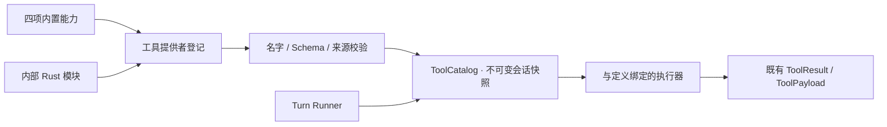

# 让内部 Rust 提供者注册原生 Extension Tools

这一增量让内部模块可以把“工具定义 + 实际执行器”交给现有工具目录。交付后，新增 Rust 工具不再要求修改四工具枚举的每一处分发分支；当前四项内置能力仍按原样工作。这个注册机制服务于编译进程序的模块，不加载外部 DLL/EXE 插件，也不建立另一个 Tool Runner。

设计依据：[内部扩展工具与 MCP 客户端](../../docs/design/mcp-extension-tools.md#从固定四工具目录扩展到多来源目录)。它是随后 MCP 工具适配的共同执行入口；下一增量的服务器配置在业务上独立，只是按唯一顺序衔接。

## 从声明与 `Implementation` 枚举到一份执行绑定

目前 `agent/tools/catalog.rs` 把 `ToolDefinition` 与四种 `Implementation` 配对，`execution.rs` 通过 `match` 调用固定处理器，`ToolDefinition.name` 是 `&'static str`。扩展时保留固定目录语义，但令目录条目以实际名称、描述、Schema、来源身份和执行器作为同一登记单元。注册者必须提交可执行的处理器，目录不允许仅对模型公布一个没有执行目标的工具。

目录接受多个提供者但只形成一个名称空间。重名或无效声明是构造错误，不以后注册覆盖前注册；内置四工具的名称不能被扩展抢占。内部提供者身份是稳定标识，不要求扩展单独声明 `Backend` 类型：执行器内可以调用 Rust 业务函数、受控子进程或 HTTP，但需要继续尊重现有取消与资源回收结果。

## 与现有执行及模型协议协作

- `turn_runner` 继续调用目录所选的执行器，按同批模型输出顺序执行，不为扩展工具另建调度器或消息通道。执行器以现有取消令牌/执行上下文得到工具参数，返回原有 `ToolResult`；失败、取消与未执行状态沿用已有分类和展示。
- `llm_model` 通过同一目录生成模型可见工具声明；扩展声明要有明确的输入 JSON Schema 与严格模式策略。内置工具保持当前 `strict=true`，扩展登记可以声明兼容模型接口的严格或非严格结构，但不为适配而改变业务入参含义。模型输出仍需执行器独立检查参数。
- 不允许扩展工具绕过当前完整 `response.completed` 执行边界、历史提交规则、单次结果预算、图片载荷处理或日志脱敏。已有 `exec_command` 的进程会话不能被扩展随意共享到其他任务。
- `agent/tools` 不反向依赖 `turn_runner`、`conversation`、`runtime`、Bridge 或 Bevy。应用在有适当所有权的位置装配提供者，目录接口只表达可执行能力；无需引入 Codex 完整的配置、上下文与生命周期贡献者体系。

## 会话快照与恢复的最小契约

`StoredTool` 当前只记录名称、描述、参数 Schema，恢复时按四个标准工具逐条精确比较。新增来源后，保存模型可见严格模式及可稳定重绑定的来源身份。恢复时从当前可用的提供者中获取执行器，并严格对照保存的声明和来源；缺少原提供者、同名工具指向另一个提供者或 Schema 不同，都沿用既有“历史可看，继续执行被阻止”的结果。相同提供者恢复时仍保留固定工作目录、图片能力和其他已保存设置。

当前存档没有额外来源字段时，原四个内置名称应被解释为原内置身份而非任意新提供者；仅为确实需要的旧存档重建保留最小兼容处理，不给早期未定义的插件配置编造来源。恢复只恢复已确认记录，不重放工具。

## 可观察交付与验证

通过一次真实应用构造与执行，确认四个内置工具仍能正常列入目录并被模型调用；内部提供者能够通过统一接口装配、在新会话中呈现声明并执行，但不长期添加与产品无关的第五项“回显诊断工具”。适合把现有一项内置能力转换为注册式执行器以确认机制，再由扩展注册方式复用。观察工具时间线、`call_id`、Stop/Steer 和结果历史仍由原有路径处理。

使用真实存档做恢复核对：同一执行声明可继续使用；名称冲突、来源变化或声明变化阻止继续执行但保持历史可查看；旧四工具存档不被意外锁死。静态验证执行当前修改范围对应的 `cargo fmt`、`cargo check`、`clippy`；若 UI 行为未变化，无需人为增加 GUI 操作。禁止新增测试代码、Benchmark、Example 或假模型服务。

## 边界

注册是应用内原生 Rust 能力，不提供用户安装第三方插件的界面或 ABI。扩展执行器对外部资源的操作仍受程序权限与原工具安全边界约束，不因为来源为 Extension 而自动拥有 ChatGPT 账号凭据或 Bevy World。
