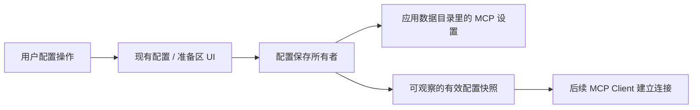

# 保存并管理 MCP Server 配置

这一增量让用户能在 应用 中添加、查看、修改、启用和移除 MCP Server，并在应用重启后保留正确配置。它只交付**服务器配置能力**，不把“已保存”冒充“已连接”；真正的 stdio 启动与协议通信在后续增量完成。

设计依据：[内部扩展工具与 MCP 客户端](../../docs/design/mcp-extension-tools.md#mcp-连接负责什么)。它与先前扩展工具登记没有调用关系，按实施顺序为后续 MCP 连接提供可核对输入。

## 服务器是独立于会话的配置对象

一个服务器配置至少有稳定名称、启用状态、传输类型和对应参数。stdio 需要可执行文件路径或命令、参数、启动目录、允许传入的环境变量；Streamable HTTP 需要端点 URL 及该模式实际支持的认证设置。两种类型不能混用不适用字段。能够分别表达“没有该服务器”“服务器禁用”“配置无效”“已经保存但尚未连接”。

配置根沿用启动时确定的应用数据目录，但服务器集合保存为独立配置材料，而不是借用 ChatGPT `account` Token 存储或把所有字段塞进 `application` 的 BRP/窗口 `AppConfig`。序列化、路径显示、原子保存及失败保留原设置参考现有 ConfigStore 和提示词库做法。用户修改下一次数据目录不即时切换当前 MCP 配置来源。

UI 保存编辑草稿、字段错误和状态投影，不拥有后台 MCP 进程。配置存储 owner 与实际 MCP 连接 owner 是不同职责；后续连接错误不会覆盖已保存的正确设置。Bridge 只在确有跨线程业务操作时传递命令和结果，不维护另一份权威设置。

## 配置有效性和用户操作

保存前校验重复服务器名、缺失路径、无效 URL、空名称、相互冲突的传输参数和危险的隐式默认值；错误定位到对应服务器及字段，不悄悄删除其他已保存项。编辑失败不写入半份文件；移除或禁用需要在界面中明确反映结果。命令参数与工作目录应按 Windows 路径和 PowerShell 7 当前环境处理，不自动给用户输入的程序套上一条 PowerShell 字符串以增加转义风险。

服务器的 HTTP 授权材料与 ChatGPT 登录凭据分开管理。当前没有决定完整 MCP OAuth 授权生命周期，因而首批仅容纳能用已支持传输/凭据方式连接的服务器；出现需要交互授权的服务器时应报告支持边界，不擅自启动浏览器或借用 Account 登录。日志及 GUI 安全反射不包含秘密的原值。

配置变化是新会话与后续连接捕获的候选输入。一个已有会话的工具声明仍按创建时冻结；编辑或删除服务器时不能在正在执行的工具调用中偷换调用目标。后续方案将定义执行绑定对应的连接生命周期与失败表现。

## 可观察交付与验证

在真实 UI 中建立一条 `bevy_brp_mcp.exe` stdio 配置并保存，重启后核对服务器名、启用状态、命令、参数及路径仍一致；再尝试一条 Streamable HTTP 配置，确认两种传输参数不会混淆。提交无效 URL、重复名称、缺少命令时，应看到明确定位而不是空白成功。禁用再启用和移除操作不误改其他条目。

涉及界面的修改按 `rules/gui-debugging.md` 使用 BRP 操作真实字段、按钮、返回与重进页面，并用截图、UI 安全状态和磁盘结果核对。运行静态检查并保护现有登录状态。此阶段不创建额外 MCP 连接，也不添加测试代码、Example、Benchmark。

## 边界

服务器配置既不是 Skills，也不是原生 Extension Tools 注册表。不存在“保存一项配置即获得工具执行权限”的隐含动作；只有后续连接和工具发现真正成功，能力才能进入新会话。
