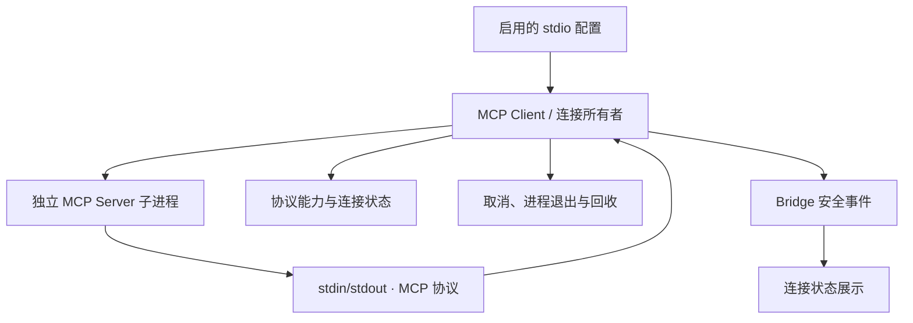

# 连接并回收 stdio MCP Server

这一增量把已保存的 stdio 配置变成真实可用的 MCP 协议连接，并负责服务端子进程从启动到退出的完整生命周期。交付结果是用户能看到服务器连接状态、初始化能力与失败阶段；工具调用和清单登记仍由后续增量完成。

设计依据：[内部扩展工具与 MCP 客户端](../../docs/design/mcp-extension-tools.md#新旧-mcp-协议在连接处收敛)。它依赖服务器配置已能提供稳定且可校验的输入。

## 连接所有者放在 Agent 运行侧

MCP 是 Agent 的外部能力，因此建议由 `crates/agent/mcp/` 独立持有 MCP Client 协议、stdio 子进程、版本与 capabilities、请求关联、关闭流程和错误。该职责长期存在，适合一个独立 Crate；`agent/tools` 只依赖所需的调用抽象，不直接管理 stdio 进程，`runtime` 负责将其纳入现有 Tokio 与应用收尾。

stdio MCP 子进程不是 `exec_command` 产生的任务级 PowerShell 会话。它可能跨越多次用户任务，不能在一个模型任务结束后被 `ExecutionContext.cleanup` 当成普通 Shell 子进程关闭；应用退出、禁用或替换连接时由 MCP 所有者确实关闭与回收。子进程 stdout 只用于协议，诊断应使用 stderr 和安全日志。

## 协议版本而非固定初始化脚本

MCP SDK 处理实际使用的标准版本与 JSON-RPC 数据。旧协议连接走对应的 `initialize` / `initialized` 会话流程；支持 `2026-07-28` 的服务端按请求级 `_meta` 与发现语义处理，不用固定旧握手替代新版协议。双方不能协商版本或必需能力时连接失败，并报告阶段，而不是返回一个虚假的“成功但没有工具”目录。`bevy_brp_mcp` 的 rmcp 服务可用于核对两个协议分支；具体采用哪版 SDK 以及版本选择细节以实际依赖能力为准。

启动、协商、能力获取、空闲、退出和异常终止形成清楚的状态；每个客户端请求需要稳定身份、超时、取消与结果匹配。服务器断开时当前等待请求明确失败，其他服务器互不牵连。不能通过重新启动替换已经开始执行且绑定旧连接的工具调用；若将来需要重连，由同一个所有者先收敛旧连接再公开新可用状态。

## 生命周期及状态传递

UI 的启用/禁用命令使用现有 Bridge/Connection 的可靠命令与回执路径；连接状态由 Agent 运行侧发布安全摘要，由唯一 Agent Host 唤醒 Winit。状态应至少能表达：未连接、启动中、可用、启动或协议失败、关闭中和已关闭；失败附带服务器身份与阶段，不泄露命令环境秘密或原始服务器输出。连接并非模型任务，不能占用普通用户聊天的唯一活动任务槽。

停止一轮用户任务时，不终止共享 MCP 服务器本身；取消其在途调用由调用生命周期处理。应用关闭时先停止接受新 MCP 请求，处理已接纳操作的取消和回收，再结束子进程，避免 Winit 或 Bridge 提前释放而遗失结果。

## 可观察交付与验证

使用独立安装的 `bevy_brp_mcp.exe` 从 应用 启动 stdio Server，核对进程确实产生、MCP 协商成功、服务器声明了 Tools 能力，状态正确显示。对错误可执行路径、损坏的启动参数、无输出后超时、提前退出和无法协商协议分别观察明确失败；其他内置工具仍可用。禁用后确认该服务器进程结束，应用正常关闭后也没有遗留自己启动的 MCP 子进程。

仅验证已实现的连接/能力和关闭，不把 `tools/list` 或真正 `tools/call` 当成此阶段已经交付的功能；后续分阶段处理它们。对可观察 UI 新增行为使用 BRP 自动操作和状态核对，静态检查按影响范围执行；不得生成测试程序、模拟 MCP Server 或 Example。

## 边界

服务端进程权限与当前用户一致，不把 MCP 当作沙箱。MCP 错误需区别于 `bevy_brp_mcp` 经 BRP 调用某个 Bevy App 时的业务失败；这一阶段的连接成功也不意味着 BRP 目标应用已启动。
