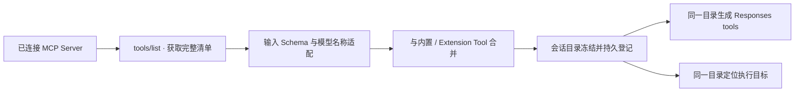

# 把 MCP Tools 发现结果固定进会话目录

这一增量让成功连接的 MCP Server 的工具真正变成**新会话可见的模型工具**，并保持会话冻结、名称唯一和存档恢复契约。交付后的用户可以在工具目录中看到 MCP 工具及其来源；执行它们的远端调用留给下一个增量。

设计依据：[内部扩展工具与 MCP 客户端](../../docs/design/mcp-extension-tools.md#tools进入模型可调用目录) 和 [冻结目录、实时连接与可恢复历史](../../docs/design/mcp-extension-tools.md#冻结目录实时连接与可恢复历史)。本方案依赖 stdio MCP 连接可用，也依赖已经建立的统一工具登记。

## 工具发现不等于直接调用

对启用且已就绪的服务器使用 `tools/list` 获取原始工具，遵守响应分页和当前协议的列表结果约定。MCP Client 拥有原始清单和服务器身份；工具适配层将其变成 `ToolCatalog` 条目：模型可见名称、描述、可表达的 JSON 输入 Schema、严格模式设置、来源身份、原始服务器/工具名与实际执行绑定。

模型能合法表达的名称并不一定等于 MCP 原始工具名。命名规则应稳定且可区分来源，例如对服务器名与工具名做确定性编码并检查冲突；运行时调用使用登记的原始两个身份而不是尝试反解模型名。任何两个来源产出相同模型名称时拒绝冲突，不通过随机后缀或“最后写入者胜出”掩盖问题。无效工具的错误只影响对应条目并能被用户核对，不删除其他已确认的工具。

## 保留 MCP Schema 的真实含义

`llm_model/generation.rs` 当前硬编码 `strict=true`；现有四个工具声明符合这个约定，但 MCP `inputSchema` 中可能有可选字段、默认值或开放结构。借鉴 Codex `codex-rs/tools/src/mcp_tool.rs` 与 `responses_api.rs` 的处理，外部工具的输入 Schema 应保留原含义，用适合模型接口的**非严格函数声明**表达。不得为了发送 `strict=true` 把 optional 参数一律补进 `required`，也不得对复杂对象任意关闭 `additionalProperties`。模型接口要求对象存在 `properties` 时，可以做不改变行为的最低限度适配。无法无损表达的 Schema 应拒绝公布，并提供来源与原因。

`outputSchema` 是 MCP 工具的输出描述，不能误放进模型输入 `parameters`。模型给出的实参仍由本地进行有界 JSON 解析和基本类型核对，真正的 MCP 参数合法性由 Server 按自己的输入声明裁定。一次 `tools/list` 的响应、Schema 和描述都来自外部服务，必须有大小与数量界限；超限是具体服务的可诊断错误，而非任意截断后宣称取得了完整工具目录。

## 新会话快照与老会话恢复

创建会话时合并当前已发现的 MCP 工具与内置、Extension Tool，之后模型声明和工具执行都只使用该只读目录。服务器 `tools/list_changed` 或设置修改，可以影响下一个会话，但不能改变当前会话正在使用的名称和 Schema；即使 MCP Server 动态新增或删除工具，旧会话仍以原契约解释已有调用。

存档中的 `StoredTool` 除模型声明外必须保存来源种类、服务器稳定身份和原始工具名等重绑定信息。恢复时先对照当前注册来源、工具声明与执行约定：工具被同名替换或 Schema 改变时阻止继续执行、保留历史。**连接暂时离线**与**工具契约已经改变**不能混为一谈：如果可从存档的原始来源身份和当前配置安全绑定到同一服务器，离线表现为真实连接错误而不是悄悄把工具换成另一来源。无法确认原来源时宁可阻止执行。

目录的数量与声明体积要纳入现有请求字节上限、上下文估算与 UI 展示预算。模型请求仍从同一份 `ToolCatalog` 取得工具数组；不能一边显示新目录，一边让旧执行映射处理调用。

## 可观察交付与验证

启动 `bevy_brp_mcp` 取得其真实 `tools/list`，新建会话后在会话核对页确认外部工具名称、来源、描述和参数 Schema 与服务器响应可对应，现有四工具同时存在。随后禁用该服务器并新建会话，确认新会话不再列出它的工具，而旧会话仍保留当时声明。重新启动应用并恢复旧会话，确认工具契约核对按照来源而非只按显示名完成。

使用服务端实际包含可选字段的工具观察 `strict=false` 声明及其 `required` 语义未变化；构造同名不同来源、格式不支持、清单超限和部分清单错误时核对是否按真实失败处理。这里重点验证**发现、登记、冻结与恢复**，不把未接入的远端 `tools/call` 结果作为通过标准。按项目约束以实际运行、日志、BRP 界面检查和 Cargo 静态检查完成验收，不新增测试代码或 Mock Server。

## 边界

不为本次功能另做工具搜索系统、热更新 API、独立 Dynamic Tools 协议或大型审批框架。服务器提供的描述和 Schema 是外部输入，不因为被登记进目录就获得高于用户授权的控制权。
