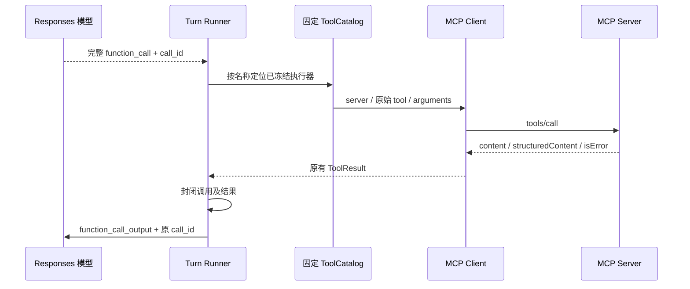

# 完成 MCP Tools 的真实执行与结果反馈

这一增量让模型能像调用 `exec_command` 一样调用已经登记的 MCP Tool，由对应 MCP Server 产生真实结果，再通过 `function_call_output` 进入同一任务下一次模型请求。交付的是完整一次与连续多次 MCP 工具往返，不新增独立任务循环。

设计依据：[内部扩展工具与 MCP 客户端](../../docs/design/mcp-extension-tools.md#tools进入模型可调用目录)。它依赖上一增量取得了带来源和执行绑定的工具目录。

## 从模型名称转回原始工具身份

`turn_runner` 已对完整 `response.completed` 校准工具调用身份，并按请求输出顺序串行执行。选中 MCP 执行器后，用保存的服务器身份与原始工具名称发送标准 `tools/call`，传入模型提交并经基本检查的 JSON 实参。外部 JSON-RPC 请求 ID 用来关联 MCP 响应，模型的 `call_id` 则绑定 `function_call_output`，这两种 ID 不能互换。

没有可用连接、服务器已被关闭或不能重新绑定原始工具时，需要返回可读、可定位的失败，不允许路由到另一个服务器的同名工具，也不自动把用户输入的 arguments 交给本地 Shell 执行。

## 保留结果结构和真实错误

MCP 工具返回 `content` 内容块、可选 `structuredContent` 和 `isError`。转换为 应用 的 `ToolResult / ToolPayload` 时，按已有协议项的要求保留人能阅读的文本以及必要的结构化 JSON，区分 MCP 的业务失败、JSON-RPC 协议错误、连接失败、超时和用户取消；不能因为 HTTP 或 stdio 收到回复就断言业务成功。

对于服务端提供的 `outputSchema`，保留可观察的输出与声明关系；不把其字段直接解释成 应用 的业务对象。结果可能包含文本、图片或资源链接等异构内容；按顺序处理可用类型。图片只有满足现有 `view_image` 一样的模型输入能力、数据解码与预算时才能转成实际图片结果；无法支持的内容给出明确可读的失败/说明，不能把 URL、Base64 或链接当成已读取的图片。响应体、单次工具结果和历史持久化均受既有限额约束，禁止静默裁掉结构化成功结果造成错误语义。

本地 Tool Timeline 仍按任务、请求序号、输出项 ID 和 `call_id` 呈现调用开始、运行、结果与失败。MCP 服务器名和工具名是展示来源，而不是可以从 UI 编辑后回放的调用命令。敏感认证、完整原始服务器消息和模型正文不得写入普通 `tracing`。

## 取消、停止及资源回收

MCP 连接可以跨任务复用，但单个 `tools/call` 的等待由本任务取消令牌控制。Stop 请求到达后，先按实际 MCP SDK 能力取消/结束当前等待，并保留已知真实结果；如果远端已经产生副作用，不能把“本地取消等待”解释为远端回滚。连接失效、客户端关闭或返回迟到结果时，调用归属仍由执行所有者与 `call_id` 校验，不能把迟到输出写给另一轮任务。

多项工具调用继续使用现有串行批次。用户在工具等待过程中 Steer，新输入只在原执行取得终态与安全边界时生效；尚未执行调用标为未执行并补齐历史。Stop、网络失败、普通工具错误和结果过大分别沿用现有规则，Runner 真正回收后 Runtime 才发布最终任务状态。MCP Server 不与一次用户任务同时关闭；其独立关闭由连接生命周期负责。

## 可观察交付与验证

在真实 应用 会话中连接 `bevy_brp_mcp` 并运行一个真实 Bevy 目标，通过模型调用一个只读 MCP Tool（例如发现或查询实际 BRP 状态），观察服务端真实响应、工具时间线、所使用的工具身份及模型收到的结果。随后调用会产生可验证变化的 BRP 工具，核对工具状态与目标 Bevy 状态，而不只检查模型“声称操作成功”。

还需用真实可触发的工具失败、参数错误、无法连接、长等待 Stop、混合内置与 MCP 的串行批次验证错误及资源回收。进行中断后检查会话历史是否封闭，恢复时不重放已经执行过的 MCP 调用。真实 GUI 变更依项目规则使用 BRP 点击/截图/状态查询验证；只运行与改动有关的 Cargo 格式、编译和 Clippy 检查，不新增测试代码、模拟协议服务或 Example。

## 边界

MCP 工具不是一个自动获准的安全命令。当前用户下外部 MCP Server 可实施其本身允许的操作；结果中的 `readOnlyHint` 等声明不能替代权限边界。这个增量不创建新的审批平台、跨任务后台工具调度器或自动补偿机制。
