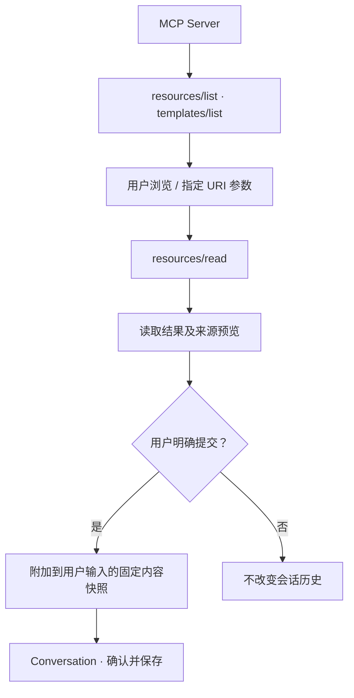

# 让用户读取并使用 MCP Resources

这一增量把 MCP 的资源能力从服务端发现转换成 应用 用户可操作的上下文材料。用户可以查看某个 MCP Server 提供的 Resource、读取和预览内容，并明确选择将其作为下一次输入的一部分；模型不会在工具目录中自动得到一组叫作 `resources/read` 的外部业务工具。

设计依据：[内部扩展工具与 MCP 客户端](../../docs/design/mcp-extension-tools.md#resources读取服务器提供的上下文)。该增量依赖已有的 MCP 连接与原有会话、用户输入、记录保存通道；与 Tools 执行是同一连接的不同协议能力。

## 从资源清单到一次确定的读取

客户端使用 `resources/list` 获取服务器标明的 URI、名称、描述和 MIME 等可用信息；如果服务器公开 `resources/templates/list`，还应允许用户为模板提供参数并看到实际生成的 URI。列表按当前协议支持的翻页/版本字段完整取得，不把第一页冒充全部资源。真正读取使用 `resources/read`，按 URI 与来源服务器关联结果。

Resource 可以是带 MIME 的 `text` 或二进制 `blob`，一个 URI 读取结果也可能包含多个内容项。首个实用闭环要求文本可以准确预览并提交；对于图片、音频及其他不能转换成当前模型协议的 MIME，显示实际类型、大小和失败原因，不以空文本蒙混通过，也不假定所有二进制都是 UTF-8。带模板的 URI 必须保留服务器边界；不能让界面输入自动拼造授权凭据或把 URI 变成 Windows 本地文件路径。

## 与当前历史和固定指令的关系

当前 `prompts` Crate 的 `InstructionSnapshot` 是创建会话时确定的 Developer 指令，`project_context` 采集项目规则，Skills 为任务工作流；MCP Resources 属于用户主动选用的外部数据。提交时应把实际读取的资源文本、来源服务器、原始 URI、MIME 与足以核对的内容摘要作为用户材料保存，并明确显示哪些文字将进入请求。

不能只保存 URI 并在以后发请求或恢复存档时重新读取，因为远端 Resource 可能更新；已经提交的文本必须沿用当时的内容与原有完整历史、压缩和持久确认规则。浏览列表和预览不自动追加 User/Developer 消息；用户取消、读取失败或切换资源时不会污染固定 Prompt、Skills 和现有会话内容。

Resource 并不绑定创建会话时的模型工具目录，允许用户在下一任务前重新读取最新资源。但某次已确认的读取结果与其提交记录必须不可变，不能在生成途中被“刷新资源”悄悄替换。服务器异常或返回过大内容应有明确失败和可读的有界诊断；不得绕过现有模型请求大小、会话上下文预算。

## 与界面和运行所有者的关系

沿用既有 Chat UI 的输入与展示方式提供可查的 Resource 列表和读取预览，不建立新的网络 UI 客户端。跨线程的 `resources/read` 请求交给 Agent 侧 MCP Client，Bridge 提供安全命令/结果投影，`agent_host` 继续负责 UI 唤醒。提交后的用户材料走原有会话身份和存储确认路径；预览操作的取消与模型任务的 Stop 应区分归属。

## 可观察交付与验证

使用单独服务器计划给 `bevy_brp_mcp` 增加的真实 Resource：通过 应用 列出 URI、读取内容，核对文本与 MIME、预览和来源；按用户确认提交到下次任务，让模型引用读取到的实际文本。重新启动并恢复会话后，原提交内容保持不变，即使 Server 下线、资源正文后来变化也不产生隐藏替换。对错误 URI、缺少模板参数、空清单、二进制或超大资源和用户取消进行明确状态核对。

界面交互使用 BRP 实际选择、查看、取消、确认和截图；核对模型请求材料及 Session Store 的记录，不用显示气泡代替真实发送内容。只执行相关静态检查和实际运行，不写测试代码、Example 或模拟服务器。

## 边界

首版不自动注入服务器全部资源，不实现 `resources/subscribe` 订阅推送，也不把 URI 的远端来源提升为系统或 Developer 指令。Resources 与 MCP Tools 属于不同的协议入口，绝不因资源名相似而自动变成可执行工具。
