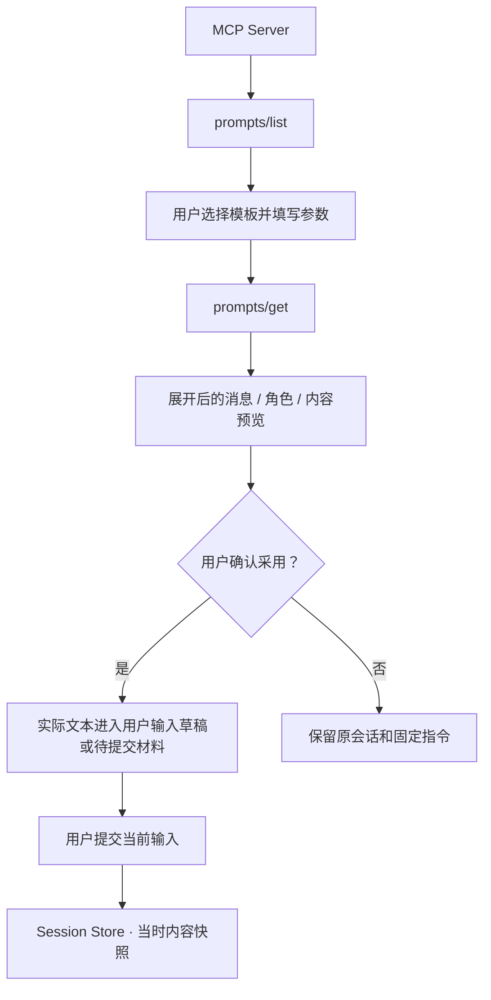

# 让用户展开并使用 MCP Prompts

这一增量让用户能在已连接服务器公布的 MCP Prompt 中选择模板、填写参数、预览真实展开内容，并在明确确认后把可支持的内容作为用户输入提交。它不改变本地 `prompts.json` 的版本库，也不会让外部服务替换会话创建时固定的 Developer 指令。

设计依据：[内部扩展工具与 MCP 客户端](../../docs/design/mcp-extension-tools.md#prompts服务器给出的可参数化消息模板)。它使用此前已经存在的 MCP 连接、用户输入、请求核对与存档能力，和 Resources 属于不同协议请求与材料类型。

## Prompt 的角色是外部模板，而不是预设指令

MCP Client 通过 `prompts/list` 取得服务器公开的名称、描述和参数列表，按对应协议的分页规则处理完整清单。用户选择某项后看到所需参数和缺失项；确认获取时调用 `prompts/get`，将用户给出的参数交给原始服务器并保留来源身份。

MCP 允许返回多条带角色的消息和多种内容块。首个完整闭环应支持**可带参数的单条纯文本 user 消息**，并保持字段及换行内容准确。返回多条消息、`assistant` 角色、`resource_link`、嵌入 Resource、图片或音频时，界面应让用户看到实际结构与未支持的部分，而不能偷偷把多角色序列拼成假的历史消息，也不能把远端 `assistant` / `developer` 内容当成 应用 已发生的对话或基础规则。若后续确定多模态模型映射，可在不破坏这些语义的前提下单独扩展。

## 与本地 Prompt、Skills 和用户输入的边界

本地 `agent/prompts` 记录用户版本化的固定 Developer 指令及预设；项目 `AGENTS.md` 进入对应项目上下文；Skills 在任务边界被发现和选择。MCP Prompt 则是外部服务器返回的**用户选择的即时材料**。它的参数来源、模板服务器与展开结果都需可见，不能被自动保存成 PromptRevision、自动安装为 Skill 或改写指令快照。

展开成功后仅表示获取了内容，不等于用户已经提交聊天任务。用户确认后进入草稿或明确的待提交材料；真正提交时按当前 Conversation 的消息身份、Queue/Steer 接纳规则和持久确认处理。Prompt 的远端版本可能在下一次获取时不同，已发送的实际内容必须按提交当时快照保存，不在历史恢复时重新 `prompts/get`。

`prompts/list`/`prompts/get` 的失败、缺失参数、服务器离线、返回畸形内容或超过输入/上下文预算，应明确反馈并保留当前输入草稿及其他会话设置。用户取消展开，不产生模型请求，不向 `llm_model` 注入任何额外 Developer 文本。外部模板文本一律按不可信用户材料处理，不赋予额外执行权限。

## UI 及归属

Chat UI 的 MCP Prompt 选择区负责参数输入、只读展开预览与用户确认；不把服务器列表加载逻辑放进 Bevy ECS System。MCP Client 执行协议请求，Bridge 转成安全业务结果，Agent Host 继续负责 Winit 唤醒。用户既能确认所提交的实际内容，也能知道该内容属于哪台服务器的哪个模板。模板改变不触及冻结的模型工具目录。

## 可观察交付与验证

使用 `bevy_brp_mcp` 后续补充的真实 MCP Prompt，通过 `prompts/list` 发现一个有参数的模板，填写实际 Bevy App 名或 BRP 端口，执行 `prompts/get` 后查看返回的文本及参数替换结果。先取消一次，核对聊天历史未新增记录；再确认并发送，核对请求中包含的就是预览时的实际文本，而不是模板名称或重新获取的内容。重新打开会话后验证已提交内容不变。

对缺失参数、空列表、未知 Prompt、服务端错误、超限材料及不支持的内容角色进行明确展示检查。GUI 操作通过 BRP 真实选择、输入、取消和截图完成，核对本地 Developer 指令与 Skills 目录未被改写。只运行静态检查及真实应用验证，不新增 应用 测试代码、Mock 服务、Benchmark 或 Example。

## 边界

不将 MCP Prompts 变成可自动执行的工具，不添加提示词市场或跨服务器模板聚合规则，不在此增量引入自动执行多轮模型会话的脚本机制。
