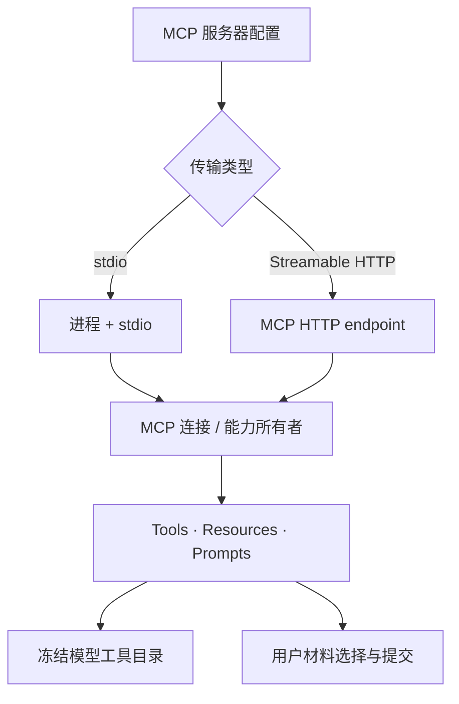

# 通过 Streamable HTTP 连接 MCP Server

这一增量让已经具备 stdio MCP 能力的客户端也能连接标准的 Streamable HTTP MCP Server。在此之后，同一个 Tools/Resources/Prompts 业务入口无需关心服务器是本机子进程还是远端 HTTP 端点。交付的目标是第二种真实可用的传输，不是重新实现工具目录或新增跨平台网络框架。

设计依据：[内部扩展工具与 MCP 客户端](../../docs/design/mcp-extension-tools.md#mcp-连接负责什么) 和 [新旧 MCP 协议在连接处收敛](../../docs/design/mcp-extension-tools.md#新旧-mcp-协议在连接处收敛)。它依赖前面已提供了 Server 配置、协议客户端与 MCP 三类能力的用户调用路径。

## 传输切换不改变业务契约

客户端统一将“连接可用 / 版本与能力 / 请求完成 / 失败与终止”暴露给上层。stdio 连接负责进程与管道；Streamable HTTP 连接负责端点、HTTP 请求/响应及所需的流式传递。两者按 MCP SDK 与协议版本支持的方式交换 JSON-RPC 消息，不自行发明一套轻量 HTTP `tools/call` 私有格式。

`bevy_brp_mcp` 目前只通过 stdio 暴露 MCP 协议，运行中 Bevy 的 BRP HTTP 接口是**另一种协议**。不得把 `http://localhost:15702` 当成 MCP Streamable HTTP 服务来验证；本增量必须连接一个真实提供 MCP Streamable HTTP 的服务器。目标版本若使用请求级 `_meta`，由协议客户端处理；旧版有状态 HTTP 行为也按对应版本完成，不用固定旧握手或假设每次请求都需要同一会话标记。

## 端点配置、安全材料和连接收敛

应用数据目录中的服务器配置已保存传输类型、URL 和明确的认证参数。本增量补齐当前受支持的 HTTP 客户端连接方式，并与现有服务器状态共享启用、失败、恢复、关闭的展示。URI 校验、请求超时、重定向处理、必要的来源与本地回环地址约束要在建立连接前明确；不自动将模型服务 Token 当作 MCP Bearer 凭据。当前未确定的交互式 MCP OAuth/企业授权流程不应被伪装为已经支持：遇到需要其他授权的端点，明确报告认证受限。

对 HTTP 流断开、服务器返回应用层协议错误、非成功状态码、服务端过早结束和调用超时，保持服务器与请求关联，不能在同一名称下悄悄切到另一个端点。服务器连接拥有 HTTP 相关资源关闭，应用退出时结束所有在途 MCP 请求；不会为了 HTTP 服务再启动 Agent Runtime 或另建一个桥接进程。

对模型和会话来说，原始工具来源中的服务器稳定身份不变。HTTP 端点修改只影响此后显式重新获取的配置和新会话；旧会话的来源与 Schema 校验仍有效，无法安全重绑定的工具保持可查看历史与明确不可执行状态。Resources/Prompts 选用的已提交文本也保持旧快照。

## 与此前能力的完整收敛

在同一个实际 HTTP MCP Server 上核对 `tools/list`、`tools/call`、`resources/list/read` 和 `prompts/list/get` 中其实际提供的能力；服务器缺少某类能力时应给出正常不可用状态，而不是编造空响应为已测试通过。通过真实新会话观察模型声明和远端执行，再通过用户选择材料观察读取预览、确认、提交和存档恢复。

同时用已有 `bevy_brp_mcp` stdio 连接再次确认原传输功能未回归。分别检查多服务器配置、跨服务器同名工具、一个服务离线而其他服务正常、HTTP 认证失败、配置更改与旧会话冻结行为。若 UI 展示有可观察变化，用 BRP 真实输入和截图核对；不创建自动化测试、Example 或专用 Mock HTTP 服务。必要的 Cargo/Clippy 检查与真实运行证据归属于本增量，不另生成纯回归阶段。

## 边界

本增量只支持 MCP 标准的 Streamable HTTP，不额外兼容历史 HTTP+SSE 私有启动方式、代理插件市场或远端任意代码安装。Remote MCP 的权限与身份仍由用户和服务器控制；应用 只持有明确允许的连接凭据，不在日志、会话历史与模型工具描述中泄露授权头。
