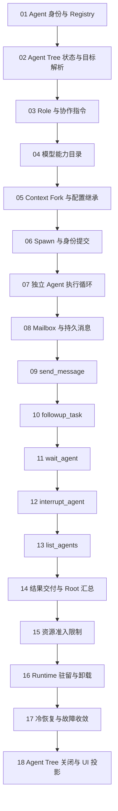

# Multi-Agent v2 实施总览

本系列将 Agentelier 的单 Root Agent 执行模型扩展为同一 Session 内的 Agent Tree。执行方案按可独立实施、可独立验收、能够形成语义单一提交的增量拆分。方案序号是唯一交付顺序；序号相邻不自动表示 Cargo 依赖。

图中的线表示实施顺序和必要前置关系的主链；部分后续增量复用早期已形成的接口。Agent 角色与模型目录各自有独立产出，仍按唯一顺序执行。

## 设计归属

整体机制见 [`docs/design/multi-agent-v2/`](../../docs/design/multi-agent-v2/README.md)。该设计文档描述目标架构和模块职责；本目录每份方案描述一个可独立交付的实施增量。六个协作工具没有合并为一个“工具阶段”：每个工具有独立的行为契约和验收场景。

## 唯一实施顺序

1. [建立 Agent 身份与 Registry](01-agent-identity-registry.md)
2. [建立 Agent Tree 状态与目标解析](02-agent-tree-state-and-resolution.md)
3. [加入 Agent Role 与协作指令](03-agent-roles-and-collaboration-prompts.md)
4. [扩展模型目录的 Multi-Agent 能力](04-model-capability-catalog.md)
5. [实现 Context Fork 与子 Agent 配置继承](05-context-fork-and-child-config.md)
6. [实现可靠 Spawn](06-spawn-agent.md)
7. [让每个 Agent 拥有独立执行循环](07-independent-agent-runtime.md)
8. [建立持久 Mailbox 与消息接纳](08-mailbox-and-message-durability.md)
9. [实现 send_message](09-send-message.md)
10. [实现 followup_task](10-followup-task.md)
11. [实现 wait_agent](11-wait-agent.md)
12. [实现 interrupt_agent](12-interrupt-agent.md)
13. [实现 list_agents](13-list-agents.md)
14. [完成子 Agent 结果交付与 Root 汇总](14-result-handoff.md)
15. [加入总量、并发与深度限制](15-resource-admission-limits.md)
16. [实现 Runtime 驻留与安全卸载](16-runtime-residency-and-eviction.md)
17. [实现 Agent 冷恢复与故障收敛](17-agent-cold-recovery.md)
18. [完成 Agent Tree 关闭与 Root 对话集成](18-tree-shutdown-and-root-integration.md)

## 跨方案验收约束

- Root 验收模型固定为 `gpt-6.2-sol`。所有执行记录都要确认实际 Root 模型 slug，不接受静默回退。
- 子 Agent 验收模型只从当前模型目录选择 GPT-6 及以上代际的非 Astra 级别模型。模型目录不能确认代际或 Astra 级别时，先人工确认；没有合格模型则停止该项模型验收。
- 每次真实模型验收记录模型 slug、推理等级、Agent Role、父子路径、任务目标和实际结果。不要把不同模型配置混在同一轮证据里。
- 真实模型交互可能有非确定性。通过标准关注系统行为和可观察事实，不要求模型每次生成完全相同的措辞；但必须通过实际消息、状态、历史和执行记录证明行为发生。
- Agentelier 禁止新增自动化测试代码、Benchmark 和 Example。验收通过编译/Clippy、真实应用运行、日志/状态检查及必要的 BRP 验证完成。GUI 变化遵守 `rules/gui-debugging.md`。
- 未经明确授权不得退出登录、重新授权、切换账号或重置凭据。不得用切换数据目录绕开该约束。
- 不移植完整 Rollout Trace、App Server 协议兼容、Telemetry、Analytics 或 Git Worktree。基础协作事件仍需持久化。

## 关键验收原则

每份方案都要求验证正常路径、拒绝路径、并发/时序边界及持久化结果。凡是存在“请求已接纳但结果未知”的窗口，验收必须检查系统是否保留未知状态并阻止重复副作用，而不是只检查最终 UI 文案。每个状态终态都要与真实执行回执一致；取消请求不等于资源已经回收。
