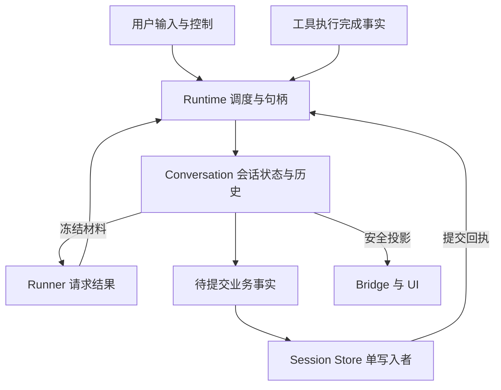

# 让会话保留唯一的状态与历史所有权

本增量把会话历史与状态永久留在唯一业务所有者中，消除 Runner 拿走整份会话、结束时再整份覆盖的交接方式。前台请求、控制输入、存储回执和工具完成事实通过 Runtime 的串行调度归并，彼此不能覆盖已经确认的新事实。

上一份：[保留原生异步工具的传输契约](01-native-protocol.md)。下一份：[让调用与结果在历史中分别提交](03-open-history.md)。本增量使用上一份能保留的模式与调用身份；下一份需要这里的单一写入边界，才能独立提交未配对调用和晚到结果。当前运行仍按整批收齐工具，跨 Turn 产品行为继续关闭。

## 为什么必须先留下会话

当前工具循环的基本单元是一批完整响应：得到全部调用，依次执行，再把响应和全部结果一起封闭。这个闭环便于确定下一次请求的历史，却同时把“响应已经合法完成”和“它启动的所有工作已经结束”绑在了一起。

| 当前事实 | 对目标行为的影响 | 核查入口 |
| --- | --- | --- |
| `ToolDefinition` 与 `FunctionCall` 没有异步模式 | 请求声明与流式解析无法保留原生异步语义 | `tools/src/catalog.rs`、`llm_model/src/stream.rs` |
| `ProtocolHistory::seal` 要求调用与结果逐项齐全 | 无法提交仍有未完成异步调用的合法响应 | `llm_model/src/protocol.rs` |
| `ActiveTurn` 持有整个会话历史及展示快照 | 后台结果与新 Turn 各自更新时会互相覆盖 | `conversation/src/active.rs`、`conversation.rs` |
| Runner 串行执行，Executor 全程借用可变上下文 | 仅增加 spawn 不能形成独立并发执行 | `turn_runner/src/runner.rs`、`tools/src/catalog.rs` |
| 每次 Turn 收尾都 cleanup 进程 | 前台结束可能杀掉仍有用的后台进程 | `turn_runner/src/runner.rs`、`tools/src/sessions.rs` |
| UI 按当前 operation 过滤聊天事件 | 旧 Turn 的后台结果会被当成过期事件丢弃 | `chat_ui/src/conversation.rs` |

这些事实来自[当前源码入口](../../docs/design/native-async-tools/sources.md#当前实现)。现有 Steer 和 Queue 已经可用：活动 Turn 可以接纳补充，排队输入在活动执行真实回收后进入下一 Turn。目标是在此基础上允许工具继续存在，并继续保持一个活动 Turn。

当前最需要移除的是“整个会话随前台任务搬走”的所有权关系。工具并发与进程寿命后续再改；这里即使仍串行运行，也必须能分别接纳前台进度、队列、名称和已经收到的任务事实。

## 所有者、执行器和写入者各自保留什么

跨 Turn 后，前台和后台会同时产生事实。若继续让 Runner 带走整份会话、结束时整份归还，后台已经保存的新结果可能被较旧快照覆盖。目标结构把会话权威状态始终留在 `agentelier_conversation`；Runtime 按会话串行调用其业务转换，Runner 只持活动 Turn 的局部执行状态和冻结请求材料。

Runtime 负责 I/O 等待、执行句柄和控制接纳，Conversation 决定身份、状态转换、历史追加和可否继续。Store 负责实际文件提交。它们共同形成单一业务写入顺序，不建立第二份共享可变历史，也不让工具直接操作 UI 或存储日志。

`ActiveTurn` 不再作为整个 SessionView 的搬运容器。前台进度是针对 Turn 的事实或受版本校验的局部更新；任务进度按任务身份归并。名称、Queue、旧任务结果、当前正文各自更新自身字段，不能用整份旧快照覆盖其他来源。

等待磁盘回执期间，Runtime 继续接纳控制和凭据事件。相关业务提交保持有序；接到取消信号可以先停止尚未开始的派发，已经进入提交的记录仍等待实际回执。提交未确认时不通过猜测释放状态或重新写入。

## 稳定身份与原子响应登记

每个工具调用都保留以下关联，原生异步调用另有应用分配的稳定任务 ID。

| 身份 | 用途 |
| --- | --- |
| 会话 UUID | 隔离历史、任务、进程与附件 |
| 原始 Turn ID、请求序号 | 说明工作由哪次用户任务和响应产生 |
| 原始 `call_id`、输出项 `id` | 分别关联协议结果及校验响应项 |
| 应用任务 ID | 供查询、等待、取消和 UI 稳定定位；会话内永不复用 |
| 本次执行实例身份 | 识别当前进程中的真实执行，拒绝旧句柄或旧通道的迟到回报 |
| 来源契约与调用上下文引用 | 固定工具来源、参数、目录、原始用户陈述、记忆纪元及能力 |

UI 物理行号、当前 operation 和当前 request_index 都不是任务身份。原任务完成于 Turn 3，也不会把来源改成 Turn 3。恢复后沿用保存的任务身份，运行句柄重新从“无”开始；它们不可从存档复活。

任务 ID 在准备完整响应接纳记录时分配，响应和获准调用到任务的映射作为同一个原子追加事实持久确认，成功后才向投影或执行端公开。取消可以阻止尚未开始的派发，但不能把一个未确认的磁盘提交当作已撤销。调用身份、参数上限、模式、重复性必须在正常接纳前整批校验；非法响应不派发其中任何工具。

本阶段把原子登记与唯一所有者建立起来，执行仍经过现有逐批路径。方案 03 才扩展为多个独立开放调用及各自的结果追加；不能因为这里出现稳定任务 ID，就提前在模型历史里留下当前表示还不能承载的未配对调用。会话、原 Turn、请求、call_id 和执行实例是共同校验条件，不能仅按应用任务 ID 接受迟到事实。

## final 与输入接纳共享同一裁决边界

用户发送时若已有活动 Turn，继续走现有 Steer；显式排队继续走 Queue。没有活动 Turn 时才启动新 Turn。后台工具的存在不占用这个前台槽。

“关闭当前输入接纳”和“确认最终是否还有已接纳 Steer”必须在同一业务边界裁决。恰好撞上 final 的输入，要么明确属于当前 Turn 并在下一请求应用，要么得到已经结束的回执后保持草稿或由明确的新请求接纳；不能显示 Accepted 后静默丢弃，也不能既补充又新建一次。

参考 Codex 的 `start_or_steer`、输入队列与结束临界区，保留应用当前的 Accepted、Applied、NotApplied 差别。新输入不要求抢占或改写已经发出的 HTTP 请求，也不要求本次引入 WebSocket steering。

Stop、等待、工具结果和前台 final 都经过相同的会话控制边界。停止全部后台工作同时暂停新的副作用派发；正在返回的模型响应若又请求启动工作，应形成明确的未执行结果。只有用户明确恢复/开始新工作后才能解除这个派发暂停，避免“刚停止全部，模型又自动启动一批”。正在进行的前台文字回复可以收束。

这里建立控制意图与 final 的共同接纳入口，当前发送/Steer/Queue 的回执语义随所有权调整保持。停止全部后台工作、结果处理按钮和对应用户界面的完整行为分别在后续控制、界面及跨 Turn 增量落地；本阶段不发布这些尚不存在的入口。上述派发暂停规则约束后续调用同一所有者的方式，不要求以占位按钮提前开放。

## 前台关联与任务关联分别投影

现有 `ChatState.operation` 过滤仍用于拒绝过期前台响应。新增会话任务投影携带会话 UUID、任务 ID、执行实例和单调业务修订；接收端先核对会话与身份，再更新对应任务。

不能为了让旧结果出现而直接取消 operation 过滤。当前前台来自新 Turn、旧任务来自旧 Turn，两条关联分别有效；其他会话、已经关闭的执行实例或旧投影的迟到更新仍被拒绝。任务清单的修订与协议历史位置分开，不用 UI 排序变化使请求快照过期。

Bridge 只发布可展示字段，保留安全摘要的惯例。原始协议、隐藏 reasoning/compaction、认证信息和附件字节不进入 Reflect、UI 或普通日志。日志记录会话/Turn/任务/请求关联、提交序号、状态转换、数量和必要错误，用它证明时序；不以完整用户内容替代关联信息。

日志沿用宿主的单一订阅与持久化，正文使用中文，结构化字段使用英文。用户控制及明确业务结果使用适当的 INFO，执行阶段使用 DEBUG，真实错误进入错误处理并记录；正常等待和取消不被标成 WARN。必要的临时 TRACE 诊断在交付前移除，不新增专用日志框架。

空闲时任务完成也必须经过现有 Connection 和 Winit 唤醒链。窗口没有新鼠标输入时，应能更新后台计数和状态；不能依赖用户下一次敲键才刷新。后台调度仍属于 Agent Runtime，Widgetry 的辅助 JobManager 不成为第二个 Agent 执行所有者。

此增量准备安全事件与身份分流，并使已有消费者不再要求整份 Session 覆盖。任务区的布局、列表交互和空闲跨 Turn 刷新由方案 12 与 13 完成；现在不删除 operation 防线，也不新建第二条可直接写会话的 UI 路径。

## 源代码与模块文档的边界

| 实际边界 | 此增量负责的变更 |
| --- | --- |
| `crates/agent/conversation/src/conversation.rs`、`active.rs`、`archive.rs` | Conversation 永久保留会话/历史；ActiveTurn 仅持本 Turn 的局部状态和冻结材料；记录稳定身份及原子响应映射，不从前台旧快照恢复所有字段 |
| `crates/agent/conversation/src/control.rs`、`queue.rs` | Steer、Queue、暂停、final 接纳关闭在同一业务边界决定；名称、队列、正文和任务更新分别归并，保存 Accepted/Applied/NotApplied 事实 |
| `crates/agent/turn_runner/src/runner.rs`、`control.rs` | Runner 请求材料、报告进度/完成事实，不再拥有或归还整个 Session；工具仍由运行端执行，不能自行改 UI 或日志存储 |
| `crates/agent/runtime/src/runtime.rs`、`runtime/model_task.rs` | Runtime 持真实执行句柄、控制接纳与 I/O 等待；等待 Store 回执仍能处理控制和正常凭据协调，真实回收后才处理前台终态，不以取消信号替代确认 |
| `crates/agent/session_store/src/journal.rs`、`reader.rs` | 保持单写入者、连续序号与实际回执；响应和映射同次提交；未知提交继续阻断，读取不依赖 Runner 归还的旧 Session |
| `crates/bridge/conversation/src/conversation.rs`、`crates/bridge/connection/src/connection.rs`、`crates/ui/agent_host/src/host.rs` | 安全会话事件与前台事件使用不同关联；沿用 Connection、宿主唤醒及单日志订阅，业务仍归 Runtime/Conversation |
| `crates/ui/chat_ui/src/conversation.rs` 及现有输入消费者 | 保留前台 operation 过滤；局部更新按会话、任务、实例和修订判断，既有回执不丢草稿；完整任务界面留给后续增量 |

Conversation 不持 OS 句柄、锁或 Tokio JoinHandle，Runtime 不建立第二份独立决定历史的共享状态，Bridge 不反向决定 Agent 业务。长期记忆来源、进程管理和 MCP 执行继续留在各自现有模块，后续按同一所有者边界接入。

同步更新 `docs/design/architecture.md`、`docs/design/modules/conversation.md`；请求材料和保存边界实际改变的内容分别同步 `docs/design/modules/model-request.md`、`docs/design/modules/session-store.md`。文档清楚写明此时仍按批次等待，不能把后续空闲结果动作或跨 Turn 状态展示记成现有能力。

不新增承担整个 Agent 的总包，不把业务移到 `app/`，不修改 Bevy、Widgetry 或 BRP 上游。根 Workspace 的依赖规则、Windows x64 / DX12 / PowerShell 7 目标以及当前锁定依赖继续适用。[结构与 UI 参考](../../docs/design/native-async-tools/sources.md#结构与界面参考)解释资料的采用范围。

实施时，随着相应行为真正落地，同步更新总体架构、会话、模型请求、会话存储、长期记忆和 Direct 工具调用等现有设计。这里的目标文档不能提前替换尚未改变的事实，也不新建一套逐项功能说明目录。

## 以交错事实验证所有权

运行验收使用 Windows x64、DX12、PowerShell 7、当前锁定依赖和真实应用。涉及模型服务时使用现有 Sign in with ChatGPT 与 `gpt-6.2-sol`，不自动替换模型、登录路径或工具契约；本方案形成的文档本身不代表已经通过构建或运行验收。编译和静态检查只覆盖此增量实际影响的范围，遵守 [项目约束](../../rules/project-context.md) 与 [常用命令](../../rules/common-commands.md)。

在现有数据环境中正常创建专用验收会话，保留其他会话、登录和文件；可写工具仅操作明确的验收工作目录。不得为验收重置数据目录、删除原会话或复制认证材料。登出、切号、重新授权、凭据重置以及会导致登录失效的数据目录变更，仍须已有明确授权；清单不是这类授权。未授权的分支保留静态证据并标为未执行。

不编写或引入测试、Benchmark、Example、mock 服务、专用 harness 或测试专用依赖。使用真实应用、正常工具、既有诊断和调试器边界观察；无法实际到达的条件记录为未覆盖。四类证据分别记录：

| 标记 | 证据与边界 |
| --- | --- |
| 静 | 源码、依赖方向、序列化、状态转换和错误路径审阅；不能证明真实交错、服务或界面已工作 |
| 调 | 调试器控制真实应用边界或检查正常诊断；人工替换响应/事件注明注入位置，不能称为服务实际返回 |
| 运 | 真实应用、正常工具、存储记录、进程事实和关联日志；涉及 GUI 时使用 BRP 真实输入与状态/截图，不能仅靠本地状态推断服务已使用结果 |
| 服 | 真实 Responses 请求/响应的安全记录及关联结果，必要时准确复述工具独有随机标记；HTTP 200 本身不足以证明完整行为 |

每项记录场景 ID、实际前提、操作、预期顺序、实际结果、证据位置、是否通过和清理结果；关联会话、来源 Turn、请求、任务、原 `call_id` 与提交序号。只记录必要的安全字段，不导出凭据、隐藏 reasoning/compaction 或完整敏感正文。实际日志沿用 [日志规则](../../rules/logging.md)。

未执行、故障条件未达到、只取得部分种类证据，均不把整项标为通过。后续增量改变这里的边界时，复核直接受影响的项目，保留未受影响证据，不机械重跑全仓检查。

涉及现有发送、Steer、Queue 和状态回执的界面验证，使用实际安装的 `bevy_brp_mcp` 发现应用与方法，按稳定 `Name` 找控件。Pointer、Keyboard、Focus、Scroll 均走真实输入；不能直接修改 ECS 后冒称交互通过。分别核对工具接纳、输入动作执行结束和目标 UI 行为，观察必要中间态与最终收敛。结束时通过已发现的 `brp_extras/pointer_control` 执行 `release`，查询 `status` 至 `phase=inactive` 并核查 `last_error`；`busy=false` 不独立证明成功。BRP 不具备的 OS 行为按真实环境另行观察，不用不等价输入代替标准验收。

当前可实际覆盖的主线是已有前台生成、改名、Queue、正常存储回执与控制接纳的交错。对仍不能自然产生的后台/旧 Turn 事实，可以调试真实应用的事实接纳边界检查身份与局部归并，但必须注明这是局部验证，不能当作旧 Turn 任务真实跨越生命周期的运行证据。

O-02 的响应/映射原子提交在此阶段具备完整前提，应实际暂停提交前、提交中和确认后三个位置，观察公开身份与派发状态。O-03、O-06 的旧 Turn 真实完成路径在方案 13 再补运证据；O-05 的普通发送/Steer/final 竞态本阶段覆盖，结果处理动作在方案 12–13 具备真实入口后联动。不得为覆盖它们提前放开未完成的跨 Turn 功能。

O-04 使用正常凭据协调事件和调试时序观察，不主动退出、切换或破坏账号。控制可以接纳与业务提交仍需等待真实回执可以同时成立；验证应分别记录接纳时刻与提交确认时刻。

## 唯一会话权威与接纳的完整验收清单

| ID | 前提与动作 | 明确通过标准与证据 |
| --- | --- | --- |
| O-01 | 审阅一次前台推进、后台完成和存储回执经过的实际所有者；运行时观察状态归并。 | Conversation 保留唯一会话状态和历史；Runner 只持局部/冻结材料，完成时不整份归还旧 Session；Tools 不直接写 UI/日志存储，Conversation 不持 OS 句柄或 JoinHandle。证据：静＋调。 |
| O-02 | 在额度充足的响应与任务映射提交前、提交中、确认后暂停，查询可见任务并观察派发。 | 应用生成的任务 ID 随完整响应和映射原子提交，确认前不公开、不派发；确认后获准后台调用与任务一一对应。中断后不存在只保存响应却丢失映射的半状态。证据：调＋运，连续提交记录。 |
| O-03 | 在前台流式更新/终态归还附近，交错执行旧任务结果提交、会话改名和 Queue 入队。 | 当前正文、旧任务结果、名称和 Queue 各自保留最新有效事实；没有整份旧快照覆盖；恢复后的记录与实时状态一致。证据：运＋调，前后业务快照和提交序号。 |
| O-04 | 暂停一个真实存储回执，让控制输入和正常凭据协调事件到达，再释放回执。 | Runtime 能接纳控制和凭据事件，尚未开始的派发可被停止；相关业务提交仍有序，已提交操作不因等待被遗忘或盲重写。取消不是磁盘确认。证据：调＋运，接纳与回执时序；不主动破坏账号。 |
| O-05 | 将发送/Steer 与前台 final 的接纳关闭放在边界两侧，并尝试同时发起结果处理。 | 始终至多一个活动 Turn；输入要么已接纳并被明确应用/终结，要么拒绝且保留草稿；不存在 Accepted 后消失、同一输入既 Steer 又新建 Turn。证据：运＋调，接纳回执、Turn 身份和请求集合。 |
| O-06 | 让旧执行实例或其他会话的迟到完成抵达当前所有者；另投递本会话旧 Turn 的有效完成。 | 无效实例/会话不能改当前账本；同会话旧 Turn 的有效结果仍按稳定任务身份归并。来源 Turn、请求与 `call_id` 不变，任务 ID 不因终态或恢复而复用。证据：调＋运，身份核对及资源收尾记录。 |
