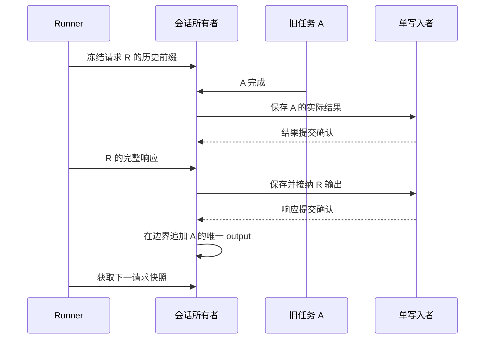

# 让调用与结果在历史中分别提交

本增量让合法响应中的调用先进入唯一历史，结果在形成并持久保存之后按原调用独立追加。数据表示、任务账本和请求准备可以容纳尚未配对的异步调用，且明确区分执行、保存、追加、发送和请求成功。

上一份：[让会话保留唯一的状态与历史所有权](02-conversation-owner.md)。下一份：[从已确认事实恢复任务和结果](04-task-recovery.md)。这里依赖前一份的唯一所有者和原子响应登记；下一份会根据这里留下的独立事实恢复数据。

本增量开放历史表示，不提前启用实际非阻塞循环。运行仍收齐整批工具，方案 07 才允许原结果缺席时发送后续请求，方案 13 才允许旧 Turn 工作与新 Turn 并存。提前明确排序与预算，是为了让后续放开执行时不再改动历史含义。

## 从完整批次走到独立事实

当前工具循环的基本单元是一批完整响应：得到全部调用，依次执行，再把响应和全部结果一起封闭。这个闭环便于确定下一次请求的历史，却同时把“响应已经合法完成”和“它启动的所有工作已经结束”绑在了一起。

| 当前事实 | 对目标行为的影响 | 核查入口 |
| --- | --- | --- |
| `ToolDefinition` 与 `FunctionCall` 没有异步模式 | 请求声明与流式解析无法保留原生异步语义 | `tools/src/catalog.rs`、`llm_model/src/stream.rs` |
| `ProtocolHistory::seal` 要求调用与结果逐项齐全 | 无法提交仍有未完成异步调用的合法响应 | `llm_model/src/protocol.rs` |
| `ActiveTurn` 持有整个会话历史及展示快照 | 后台结果与新 Turn 各自更新时会互相覆盖 | `conversation/src/active.rs`、`conversation.rs` |
| Runner 串行执行，Executor 全程借用可变上下文 | 仅增加 spawn 不能形成独立并发执行 | `turn_runner/src/runner.rs`、`tools/src/catalog.rs` |
| 每次 Turn 收尾都 cleanup 进程 | 前台结束可能杀掉仍有用的后台进程 | `turn_runner/src/runner.rs`、`tools/src/sessions.rs` |
| UI 按当前 operation 过滤聊天事件 | 旧 Turn 的后台结果会被当成过期事件丢弃 | `chat_ui/src/conversation.rs` |

这些事实来自[当前源码入口](../../docs/design/native-async-tools/sources.md#当前实现)。现有 Steer 和 Queue 已经可用：活动 Turn 可以接纳补充，排队输入在活动执行真实回收后进入下一 Turn。目标是在此基础上允许工具继续存在，并继续保持一个活动 Turn。

`ProtocolHistory::seal` 的“所有调用与结果数量、顺序一起齐全”不能继续作为唯一提交方法。开放表示仍需保留完整的原始响应、调用和不透明材料；它只解除异步调用必须立即有结果的表示约束，不解除同步调用的下一请求屏障，也不改变已发生的用户输入位置。

## 开放历史仍遵守原生传输契约

[官方异步协议](https://developers.openai.com/api/docs/guides/async-tool-calling)允许声明为异步的应用工具在结果缺席时继续后续请求，最后用原 `call_id` 配对结果。执行器、调度、保存和取消都由应用承担。

本应用使用 Function Tool：请求保留 `type: function`，符合资格的声明增加 `async: true`；响应解析保留调用项的 `async` 标志，结果仍使用 `function_call_output`。`call_id`、输出项 `id` 和应用任务 ID 各有用途，不可互换。协议支持的 Custom Tool 不属于当前工具体系，本次不扩展它。

SIWC HTTP 继续使用 `store: false`、`stream: true` 和完整有序的 `input`，不发送 `previous_response_id`。异步指南中的服务器链式状态示例不改变本地历史重放路径。[SIWC 限制](https://developers.openai.com/siwc/token-sharing-open-source/preview-limitations)、[会话状态](https://developers.openai.com/api/docs/guides/conversation-state)分别约束接入方式和历史材料。

新建 `gpt-6.2-sol` 会话将冻结的工具目录作为每次 HTTP 请求 `input` 的首项。该项使用 `type: "additional_tools"`、`role: "developer"` 和 `tools` 数组。顶层省略 `tools`，符合资格的 Function Tool 保留 `async: true`，叶子名称、参数 schema 和执行器参数沿用原契约。[Responses 请求结构](https://developers.openai.com/api/reference/resources/responses/methods/create)

每次全量重放从同一冻结目录生成这一项，后面依次使用已有指令、上下文和协议历史顺序。工具声明是请求材料，应用历史只保存实际发生的协议内容。完整调用按 `name` 绑定本次请求目录，未知名称或意外 namespace 在派发前拒绝。保留原始调用项及 `call_id`，已有平铺同步存档继续按保存契约重放。正式验收仍需要在应用的会话路径上观察服务调用和真实结果交付。

声明资格和实际返回模式分开处理：

- 同步声明不能接受服务端突然返回 `async: true`；在完整响应提交和工具派发之前报告协议错误。
- 已声明异步而最终调用省略标志或返回 `false` 时，按同步依赖处理并保留诊断事实；不擅自假设服务端已解除了等待。
- SSE 的完整调用项与最终响应必须在调用身份、名称、完整参数和异步模式上相容。`response.completed.output` 是提交依据；增量展示不触发副作用。
- 同一响应、历史重放或重复流事件中的同一 `call_id` 不得再次启动。相同完成事实可幂等归并；同 ID 不同来源或载荷是冲突。

第一版明确等待完整响应验证、保存之后再启动工具。它比完整流项到达就启动稍晚，却沿用了项目已经存在的“先保存合法响应，再允许副作用”的边界。Codex 的早派发实现可作为后续性能研究材料，当前不会同时引入这个额外失败窗口。

现有 `parallel_tool_calls: true` 可以继续用于这个 Direct 请求路径；本方案没有启用服务端 Multi-agent，也不会把该模式特有的组合限制误套到普通应用工具上。

历史使用实际返回模式决定哪个调用允许暂时开放。冻结的 `additional_tools` 随请求构造，原始调用和本地任务身份作为各自的事实保存。旧平铺会话继续使用原始记录。

## 调用身份和状态分别记账

每个工具调用都保留以下关联，原生异步调用另有应用分配的稳定任务 ID。

| 身份 | 用途 |
| --- | --- |
| 会话 UUID | 隔离历史、任务、进程与附件 |
| 原始 Turn ID、请求序号 | 说明工作由哪次用户任务和响应产生 |
| 原始 `call_id`、输出项 `id` | 分别关联协议结果及校验响应项 |
| 应用任务 ID | 供查询、等待、取消和 UI 稳定定位；会话内永不复用 |
| 本次执行实例身份 | 识别当前进程中的真实执行，拒绝旧句柄或旧通道的迟到回报 |
| 来源契约与调用上下文引用 | 固定工具来源、参数、目录、原始用户陈述、记忆纪元及能力 |

UI 物理行号、当前 operation 和当前 request_index 都不是任务身份。原任务完成于 Turn 3，也不会把来源改成 Turn 3。恢复后沿用保存的任务身份，运行句柄重新从“无”开始；它们不可从存档复活。

执行状态与交付状态分别表达，避免一个“成功”承担过多含义。

| 维度 | 状态与含义 |
| --- | --- |
| 执行 | 已登记、等待准入、运行、取消中、成功、失败、超时、已取消、未执行、结果未确认 |
| 资源 | 无活资源、仍持资源、正在回收、回收未确认 |
| 保存 | 结果尚未形成、已形成待保存、已持久提交、保存失败或未确认 |
| 协议 | 尚无对应 output、已唯一追加到历史 |
| 请求事实 | 尚未纳入请求、已纳入某冻结请求、已开始发送、该请求完整成功或结果未知 |

例如“执行成功，保存失败”意味着工作可能已经修改文件，但结果还不能交给模型。又如“结果已追加，尚未发请求”意味着输出已经可靠留在历史中，空闲界面仍应显示待处理。

这里的“已用于成功请求”仅表示包含该结果的请求得到了完整合法响应。它不把网络接纳推断成模型理解，也不宣称网络恰好交付一次。无状态重放本来就会再次携带以前的结果；必须禁止的是再次追加同一结果、再次启动同一调用或再次发送有副作用的进程输入。

## 在途响应之后，才追加期间到达的结果

每次请求由一个冻结历史前缀、已经接纳的本轮输入、项目与 Skills/记忆材料构成。记录其历史位置、覆盖项数和任务结果集合之后才开始 HTTP。冻结后，新输入和工具完成事实都先进入相应待处理区，不改在途请求的字节。

一个关键例子：请求 R 已发出，旧任务 A 此时完成。先保存 A 的结果事实；R 合法完成后，先接纳 R 的原始输出，再在边界把 A 的结果追加到历史。不能把 A 的结果插到 R 输出前面，伪装成 R 已经看过它。

如果 R 失败、停止或缺少合法完整输出，就保留已经确认的历史前缀，不安装 R 的非法输出；随后仍在这个合法边界归并 A。不能永远等一个不会再到达的 `response.completed`。失败前台的展示与已提交协议历史继续分开保存。

一个边界内，已经确认的结果按业务提交序号追加；已接纳的 Steer 按接纳序号应用。请求记录说明本次究竟包含哪些项，不通过到达线程的偶然先后推测。Queue 尚未实际启动的输入不进入协议历史。用户输入是否被接纳、是否进入请求、是否形成可继续的完整步骤仍然是独立事实。

## 唯一结果从保存走向下一请求

工具只回报结果事实。Conversation 校验来源与当前任务状态；图片先由 Store 提交为本会话附件，再确认工具结果；边界追加 `function_call_output` 时核对原始调用仍存在、结果尚未追加、任务与载荷一致。完成这个步骤后才允许构造使用它的请求。

一次追加失败不能让 UI 或 Runner自行补一份结果。重复通知由账本当前状态去重；相同身份但不同结果必须阻断该会话后续执行并显示冲突。完成通知只是唤醒信号，每次进入请求、等待和收尾边界都重新检查账本，避免一次通知丢失导致永久悬挂。

若结果已在历史中，而承载它的请求断流或超时，保留该结果及请求未知事实。后续请求重放相同历史，不重新调用工具。原用户任务已产生副作用或已保留步骤时，原有整 Turn Retry 限制继续生效；界面的“处理已完成结果”也不等于重跑原任务。

执行器终态与进度通知也有不同职责：终态载荷由真实执行句柄交回 Runtime，不能把唯一结果放在可丢弃的 UI 进度或随 Turn 关闭的通道里。本阶段把归并入口与状态复查表达完整，独立任务句柄的并发运行由后续执行增量接入。

前台已经收束时，保存和合法追加本身不触发新的聊天请求。最终产品由新用户输入或“处理已完成结果”动作续接，显式 Queue 和原有记忆后台任务各按自身来源计量。此处先保存待处理状态；实际空闲任务与动作入口在后续增量开放，不能为演示开放历史增加自动轮询。

## 原子登记与交付额度属于同一账本

完整响应通过验证后，在同一次提交中记录响应和任务登记映射。提交成功才进入准入。每个执行开始前，必须确认对应的开始记录；取消、容量不足或资源等待期间尚未启动的调用，可以形成明确的 `NotExecuted` 结果，不制造已开始副作用的假象。

本方案采用有界调度，初始边界为：

| 限制 | 计数范围与释放边界 |
| --- | --- |
| 每 Turn 32 次模型请求、64 次工具调用 | 保留当前预算；查询、等待、取消这类模型工具调用也计入工具预算 |
| 会话 64 个未完成交付登记 | 仅计获准进入后台执行的异步调用，从登记开始到其唯一结果已纳入一个完整成功请求为止；等待、运行、待保存、待处理及发送未知均占用 |
| 同时 8 个普通工具执行 | 获得工作槽并真实开始后计数；执行器真实结束后释放，等待资源不占槽 |
| 会话 8 个进程登记 | 活进程与未消费的退出结果合计；消费或明确收起终态登记后释放，独立于工具工作槽 |

这些是本次采用的应用限制，沿用并扩展当前工具和 Turn 的有界原则，不是假定 API 限额。达到交付登记上限时，普通聊天和本地取消仍可使用；新的异步调用得到一次明确的未执行结果，不悄悄转同步或无限排队。执行已经结束但结果尚未处理的项目仍会占用交付登记，用户处理结果后释放。历史身份记录继续保留，释放额度不允许复用 ID。

同一响应超出原有单 Turn 调用预算时，沿用整批未执行的确定规则。会话剩余额度不足时，按响应中的稳定顺序接纳可容纳的异步调用，其余形成未执行结果；不能启动之后再决定丢掉哪个登记。所有预留和判断由同一会话所有者完成。

额度拒绝项仍保存原始调用和唯一的错误 output，但没有后台执行登记，不占第 65 个名额；这个错误结果占普通历史和载荷预算。完整响应通过校验后，先依据它实际冻结的请求集合结算旧结果的成功交付，再计算本响应新调用的可用额度，并随响应接纳一起提交。无效或不完整响应不释放名额，避免用一个没有接纳成功的请求腾出虚假容量。

上表的工作槽与进程名额是相关资源约束，分别由固定上下文/准入和进程生命周期增量完成实际调度。本阶段负责 64 个未完成交付登记的身份、计数与释放事实，当前保守执行不得绕开它们。已用于一次完整成功请求的结果在后续完整历史重放中再次出现，不得重复释放额度。

当完整响应同时确认旧结果已用于成功请求并产生新调用时，结算只看该请求冻结的结果集合；请求发出后才到达的结果不能被顺带结算。整个结算与响应接纳、映射一道等待持久确认；未知回执不提前公开新任务或允许派发。容量拒绝项有原始调用和唯一 NotExecuted output，但没有后台登记，避免在“拒绝第 65 项”时反而耗掉第 65 个槽。

## 日志表达独立事实，而不是旧快照

跨 Turn 之后，日志不能再只保存“一批已经封闭的调用”。它需要独立表达合法响应、调用登记、执行开始、结果形成、历史追加和前台结束。仍使用现有 Session Store 单写入者、连续序号、Flush/sync 回执与本会话附件存储，不引入另一套任务数据库。

下面列的是必须表达的业务事实，事件名称在实现时可沿用或调整现有类型。

| 事实 | 持久确认与后续动作的关系 |
| --- | --- |
| 输入与请求准备 | 保存原输入身份、冻结历史前缀、来源材料、包含的结果集合及实际发送阶段 |
| 响应接纳与任务登记 | 完整响应和全部调用到任务的映射在一个原子追加记录中确认；之后才允许派发 |
| 执行开始 | 每个副作用开始之前确认；等待资源的登记不冒充已开始 |
| 工具实际结果 | 先提交图片附件，再保存带原始身份的不可变结果；保存成功才可用于历史 |
| 历史追加 | 记录所追加的唯一 output 及前后历史位置；不能用一份较旧 Session 快照覆盖后续事实 |
| 取消与资源清理 | 保存请求范围、执行终态与实际回收事实；取消请求和资源回收分开 |
| 前台终态 | 只表示前台结束和真实回收，不把所属异步任务强制改成未执行 |
| 压缩检查点 | 保存被覆盖的历史前缀、替换窗口、未配对调用关联和来源材料边界 |

任务 ID 在准备响应接纳记录时分配，随响应和映射一起提交，提交成功后才公开。崩溃不能留下“响应已接纳，但任务 ID 映射另存失败”的空隙。所有调用先通过身份、参数上限、模式和重复性校验；无效完整响应不进入正常可重放历史，也不启动其中任何工具。

同一记录的提交结果不确定时，沿用当前游标阻断语义，不盲目重新追加。结果已经取得而保存失败时，保留内存载荷、停止新的请求与副作用派发、暂停 Queue，继续回收必要资源。保存失败不撤销已经修改的文件。已有结果不以“再执行一遍工具”补救。

这里的前台终态事实不代替任务终态；结果事实也不代替历史追加或请求成功。当前阶段仍保留实际整批收尾，日志表示先允许这些事实分离。崩溃时如何由每个确认位置补回唯一终止说明属于下一份恢复方案，不能用旧的“只存在一个 PendingResponse”假设覆盖这些新记录。

## 源代码与当前设计同步

| 实际边界 | 此增量需要形成的行为 |
| --- | --- |
| `crates/agent/llm_model/src/protocol.rs`、`protocol/archive.rs` | 完整响应与单个唯一 output 可以分别进入有序历史；保持 raw 输出、调用模式、namespace 和推理材料；检查原调用存在、唯一配对、重复/冲突与合法前缀 |
| `crates/agent/llm_model/src/generation.rs` | 请求固定历史位置、覆盖项数、结果集合和实际发送材料；冻结后不因 Steer、Queue、结果或 UI 更新而重新序列化在途请求 |
| `crates/agent/conversation/src/conversation.rs`、`active.rs`、`archive.rs` | 唯一所有者保存任务身份与多维状态；决定响应/结果/输入边界；计算登记预算和成功请求结算；只追加一次结果，不让 Runner 或 UI 补写 |
| `crates/agent/turn_runner/src/runner.rs` 与 `crates/agent/runtime/src/runtime/model_task.rs` | 用事实和冻结请求推进现有循环；保守执行仍等全批，失败/停止也提供合法结果归并边界；发送未知不改成成功，不重执行已有副作用 |
| `crates/agent/session_store/src/journal.rs`、`attachments.rs`、`reader.rs` | 单写入者确认响应映射、结果、历史位置和请求阶段；图片先提交，结果引用不可变会话附件；读入材料保留开放关联，未知写入沿用阻断 |
| `crates/agent/conversation/src/restore.rs`、`compaction.rs` 的相邻消费边界 | 不再假定任意保存历史都是完整批次；此次保留关联材料供下一份恢复，安全压缩规则由方案 06 完成，在其落地前不放行携带开放调用的新请求 |

状态和历史归 `agentelier_conversation`，真实句柄及 I/O 回执归 Runtime，协议表示与请求字节归 `agentelier_llm_model`，Store 不执行工具。固定上下文、MCP 调度、管理工具、进程和完整任务 UI 不借此增量重新分包。

同步更新 `docs/design/modules/conversation.md`、`docs/design/modules/model-request.md`、`docs/design/modules/session-store.md` 和受原结果配对语义影响的 `docs/design/tool_call.md`。准确区分“历史可表达开放调用”与“运行已在开放调用期间采样”；阶段 03 只有前者成为事实。

不新增承担整个 Agent 的总包，不把业务移到 `app/`，不修改 Bevy、Widgetry 或 BRP 上游。根 Workspace 的依赖规则、Windows x64 / DX12 / PowerShell 7 目标以及当前锁定依赖继续适用。[结构与 UI 参考](../../docs/design/native-async-tools/sources.md#结构与界面参考)解释资料的采用范围。

实施时，随着相应行为真正落地，同步更新总体架构、会话、模型请求、会话存储、长期记忆和 Direct 工具调用等现有设计。这里的目标文档不能提前替换尚未改变的事实，也不新建一套逐项功能说明目录。

## 验收分开核对历史与真实续接

运行验收使用 Windows x64、DX12、PowerShell 7、当前锁定依赖和真实应用。涉及模型服务时使用现有 Sign in with ChatGPT 与 `gpt-6.2-sol`，不自动替换模型、登录路径或工具契约；本方案形成的文档本身不代表已经通过构建或运行验收。编译和静态检查只覆盖此增量实际影响的范围，遵守 [项目约束](../../rules/project-context.md) 与 [常用命令](../../rules/common-commands.md)。

在现有数据环境中正常创建专用验收会话，保留其他会话、登录和文件；可写工具仅操作明确的验收工作目录。不得为验收重置数据目录、删除原会话或复制认证材料。登出、切号、重新授权、凭据重置以及会导致登录失效的数据目录变更，仍须已有明确授权；清单不是这类授权。未授权的分支保留静态证据并标为未执行。

不编写或引入测试、Benchmark、Example、mock 服务、专用 harness 或测试专用依赖。使用真实应用、正常工具、既有诊断和调试器边界观察；无法实际到达的条件记录为未覆盖。四类证据分别记录：

| 标记 | 证据与边界 |
| --- | --- |
| 静 | 源码、依赖方向、序列化、状态转换和错误路径审阅；不能证明真实交错、服务或界面已工作 |
| 调 | 调试器控制真实应用边界或检查正常诊断；人工替换响应/事件注明注入位置，不能称为服务实际返回 |
| 运 | 真实应用、正常工具、存储记录、进程事实和关联日志；涉及 GUI 时使用 BRP 真实输入与状态/截图，不能仅靠本地状态推断服务已使用结果 |
| 服 | 真实 Responses 请求/响应的安全记录及关联结果，必要时准确复述工具独有随机标记；HTTP 200 本身不足以证明完整行为 |

每项记录场景 ID、实际前提、操作、预期顺序、实际结果、证据位置、是否通过和清理结果；关联会话、来源 Turn、请求、任务、原 `call_id` 与提交序号。只记录必要的安全字段，不导出凭据、隐藏 reasoning/compaction 或完整敏感正文。实际日志沿用 [日志规则](../../rules/logging.md)。

未执行、故障条件未达到、只取得部分种类证据，均不把整项标为通过。后续增量改变这里的边界时，复核直接受影响的项目，保留未受影响证据，不机械重跑全仓检查。

本阶段可以实际观察完整响应接纳、附件/结果持久提交、唯一追加、请求冻结、发送阶段和同步失败路径。并发完成、在途旧任务和空闲旧 Turn 这些最终场景，在真实应用的历史/结果接纳边界使用调试检查其局部转换；调试材料不能算作工具真的并行或服务接受了未配对调用。

D-01 的真实开放历史续接和随机结果使用，随方案 07 补齐服＋运；D-02、D-03、D-04 的实际在途异步交错也在那里补充，跨来源 Turn 再随方案 13 复核。D-07 在本阶段先验证真实 view_image 的附件先存、原结果唯一和同内容重放，非阻塞路径在方案 07 联动。D-08 的空闲/final 竞争依赖方案 12 的结果入口与方案 13 的生命周期释放，在那时才能标完整通过。

D-06 的成功请求事实必须来自完整合法响应。序列化出一次请求或开始发送都不能代替它；中断后明确继续仍重放已有 output，不重跑工具。下表完整场景继续作为同一项的终局标准，局部状态和后续联动证据分别保存。

## 开放历史与结果交付的完整验收清单

| ID | 前提与动作 | 明确通过标准与证据 |
| --- | --- | --- |
| D-01 | 保留一个尚未完成的异步调用，在后续请求中继续完整历史；任务完成后提交其结果。 | 未配对调用可以合法保留，原始输出及不透明推理材料有序重放；结果只向原 `call_id` 追加一次。找不到原调用、身份不符时不发送孤立 output。证据：服＋运，历史位置与结果集合。 |
| D-02 | 请求 R 发出后让旧任务 A 完成并保存；随后 R 正常完成。 | A 可先持久保存，但历史顺序为 R 的合法原始输出在前、边界追加 A 的 output 在后；R 的请求记录不声称含有 A。多个就绪结果按业务提交序号追加。证据：运＋调，冻结前缀和追加序号。 |
| D-03 | 冻结并开始发送请求后，交错接纳 Steer、Queue、后台结果和展示更新。 | 在途字节/摘要、历史覆盖范围和结果集合不变；新材料只影响后续合法边界。未启动 Queue 不进入当前请求，不能靠重新序列化偷偷更新正在发送的请求。证据：运＋调，准备与发送记录。 |
| D-04 | A 在 R 进行期间完成，随后令 R 失败、停止或缺失合法完整输出。 | R 的非法/部分输出不安装为正常历史；A 在保留前缀的合法边界完成归并，不永久等待缺失的 `response.completed`。部分展示仍可保留且状态准确。证据：运＋调。 |
| D-05 | 对同一结果重复通知/重复归并，再提供同身份不同结果；另抑制一次唤醒并进入请求或等待边界。 | 相同结果不重复追加、不重执行；不同结果阻断续接并保留冲突；边界重新检查账本能发现已就绪事实，不依赖一次通知。证据：调＋运，唯一 output 和错误记录。 |
| D-06 | 依次停在结果形成、保存、追加、请求准备、发送、完整成功各边界；发送后再中断响应并明确继续。 | 各状态独立且真实；发送未知不标成功。后续重放已有结果不新增 output、不重跑工具；原有副作用/已保留步骤的整 Turn Retry 限制仍生效。证据：运＋调；正常成功路径附服。 |
| D-07 | 异步 `view_image` 返回真实图片，观察附件提交、结果记录、历史追加与后续请求。 | 附件先保存，结果持有不可变会话附件身份；请求使用同一图片内容，UI 摘要/截断不改变协议载荷；原调用只配一个结果。证据：运＋服，附件摘要、提交顺序和安全请求投影。 |
| D-08 | 将已确认结果放在 final 之前、final 接纳关闭附近及空闲之后分别到达；空闲时暂不操作。 | 合法下一请求可用的结果被正常携带；已经收束的 final 不被强迫重新采样。空闲只保存/追加并提示待处理，不增加完成通知触发的聊天续接请求；下一次用户输入或明确结果动作再消费。证据：运＋调，按触发来源计数。 |
