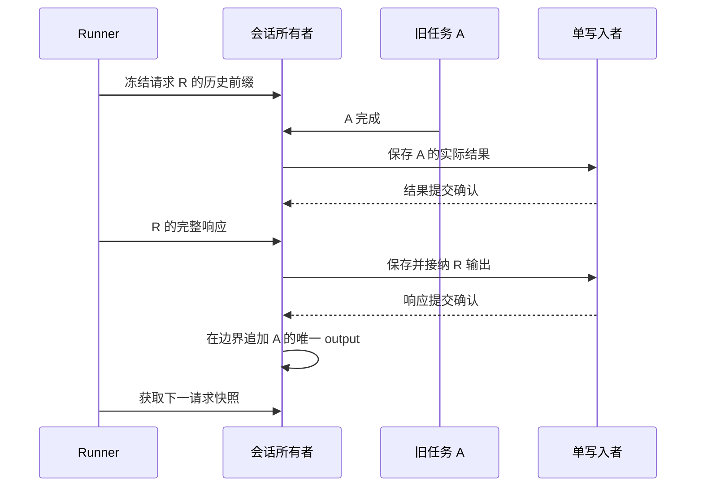

# 在同一个 Turn 中绕过未完成异步调用继续生成

本增量让模型在异步结果尚未提交时，仍能回答独立问题、使用已经就绪的其他结果或发起下一项异步工作。交付的是实际 Responses 续接能力，不以本地并行或声明被接受代替。同步调用仍构成采样屏障，工具失败也必须留下原调用的真实结果。

顺序承接 [06 · 安全压缩与容量](06-safe-compaction.md)，随后进入 [08 · 查询和等待](08-task-query-and-wait.md)。开放历史、独立执行与结果预留使这里可以安全移除整批屏障；08 为需要等结果的模型提供有界管理工具。本增量结束前仍保守等待已登记后台工作收束后才释放前台槽，最终跨 Turn 释放由 13 完成。

## 要解除的是采样屏障

以下约束说明原有串行闭环为何会阻塞。前序增量已经分别处理协议表示、会话所有者、保存和执行材料；此处把这些已成立的能力接入当前 Turn 的模型循环。

当前工具循环的基本单元是一批完整响应：得到全部调用，依次执行，再把响应和全部结果一起封闭。这个闭环便于确定下一次请求的历史，却同时把“响应已经合法完成”和“它启动的所有工作已经结束”绑在了一起。

| 当前事实 | 对目标行为的影响 | 核查入口 |
| --- | --- | --- |
| `ToolDefinition` 与 `FunctionCall` 没有异步模式 | 请求声明与流式解析无法保留原生异步语义 | `tools/src/catalog.rs`、`llm_model/src/stream.rs` |
| `ProtocolHistory::seal` 要求调用与结果逐项齐全 | 无法提交仍有未完成异步调用的合法响应 | `llm_model/src/protocol.rs` |
| `ActiveTurn` 持有整个会话历史及展示快照 | 后台结果与新 Turn 各自更新时会互相覆盖 | `conversation/src/active.rs`、`conversation.rs` |
| Runner 串行执行，Executor 全程借用可变上下文 | 仅增加 spawn 不能形成独立并发执行 | `turn_runner/src/runner.rs`、`tools/src/catalog.rs` |
| 每次 Turn 收尾都 cleanup 进程 | 前台结束可能杀掉仍有用的后台进程 | `turn_runner/src/runner.rs`、`tools/src/sessions.rs` |
| UI 按当前 operation 过滤聊天事件 | 旧 Turn 的后台结果会被当成过期事件丢弃 | `chat_ui/src/conversation.rs` |

这些事实来自[当前源码入口](../../docs/design/native-async-tools/sources.md#当前实现)。现有 Steer 和 Queue 已经可用：活动 Turn 可以接纳补充，排队输入在活动执行真实回收后进入下一 Turn。目标是在此基础上允许工具继续存在，并继续保持一个活动 Turn。

## 请求、前台与函数各自结束

先区分三个对象，后面的状态和控制才有明确归属。

| 对象 | 结束意味着什么 | 结束后可能仍然存在什么 |
| --- | --- | --- |
| Responses 请求 | 收到了通过校验的完整响应，或请求明确失败、停止 | 响应中的异步调用、会话、前台 Turn |
| 应用 Turn | 本次前台生成与同步依赖已经收束，输入接纳已关闭，句柄和终态提交完成 | 此 Turn 创建的异步调用、进程、待处理结果 |
| 工具调用 | 本次函数执行形成一个真实结果或明确错误 | 结果保存与交付，以及工具创建的独立进程资源 |

`exec_command` 还有第四种对象：进程会话。它在 yield 时返回 `session_id`，原函数调用此时就有了完整结果；进程可能还没有退出。后续输出通过新的 `write_stdin` 调用取得，不能再向原 `call_id` 填第二份“最终结果”。这项现有契约继续保留，改变的是资源可以跨 Turn 存活及被管理的范围。

这张表表达最终生命周期边界。此阶段仅把“请求结束”和“函数结束”从采样屏障中分开：模型可以产生 final，但前台真实释放仍等已登记工作收束。不能借此提前允许新的 Turn 与旧工具同时存在。

## 混合批次只等待真实同步依赖

假设同一响应产生同步调用 S 和异步调用 A。应用先登记完整批次，再按准入规则启动。S 的结果必须就绪并提交后，模型才能进入下一次请求；A 未完成不再成为这个屏障。S 失败也要形成真实错误结果，不能因为它失败就把它从历史中删除。

如果 A 和 B 都是异步只读调用，B 先完成，则先保存并追加 B；下一次合法请求可以使用 B，不需要等较早启动的 A。A 仍保留原请求、原 `call_id`、应用任务身份和执行实例。模型在 A 未结束时发起 B，不重置本 Turn 的模型/工具预算。

异步声明与实际返回模式继续分开：已声明异步但最终调用省略标志或为 `false`，本次仍按同步屏障处理；同步声明收到 `async:true`、SSE 与最终完整项身份/参数/模式冲突，则在保存正常响应和派发前拒绝。只有合法完整 `response.completed.output` 和响应/登记持久回执允许新副作用，流中的完整调用项仅用于显示与一致性核对。

## 可以继续推进，也可以收束，不自动轮询

下面保留完整目标行为与跨 Turn 时间线，随后限定本阶段的开放范围。

如果只剩 A，模型可以继续处理独立问题，也可以给出前台答案并结束 Turn。应用不能因 A 还在运行就无条件反复请求模型“看看是否好了”；需要结果时使用明确等待，前台结束后由后续用户输入或结果处理动作续接。

由此可以得到目标时间线：Turn 1 启动 A 并结束；Turn 2 启动 B；B 的结果在 Turn 2 后续请求或下一个结果处理请求中出现；A 后来完成，再进入之后的合法请求边界。原始调用的归属不变，完成顺序不要求等于启动顺序。

本增量先覆盖同 Turn 内的独立回答、乱序结果和连续 launch。模型已经没有独立步骤时，通过现有本地阶段收尾等待；08 才把 `wait_for_tasks` 暴露为模型管理入口。模型已经给出 final 后，不反复请求“是否完成”，也不提前释放活动 Turn。某个同步/异步调用正常失败时，其他已登记工作仍有明确继续、取消和回收归属，不能因本次请求结束失联。

## 在途请求不会吸收后来到达的结果

每次请求由一个冻结历史前缀、已经接纳的本轮输入、项目与 Skills/记忆材料构成。记录其历史位置、覆盖项数和任务结果集合之后才开始 HTTP。冻结后，新输入和工具完成事实都先进入相应待处理区，不改在途请求的字节。

一个关键例子：请求 R 已发出，旧任务 A 此时完成。先保存 A 的结果事实；R 合法完成后，先接纳 R 的原始输出，再在边界把 A 的结果追加到历史。不能把 A 的结果插到 R 输出前面，伪装成 R 已经看过它。

如果 R 失败、停止或缺少合法完整输出，就保留已经确认的历史前缀，不安装 R 的非法输出；随后仍在这个合法边界归并 A。不能永远等一个不会再到达的 `response.completed`。失败前台的展示与已提交协议历史继续分开保存。

一个边界内，已经确认的结果按业务提交序号追加；已接纳的 Steer 按接纳序号应用。请求记录说明本次究竟包含哪些项，不通过到达线程的偶然先后推测。Queue 尚未实际启动的输入不进入协议历史。用户输入是否被接纳、是否进入请求、是否形成可继续的完整步骤仍然是独立事实。

同一结果只追加一次，与后续完整历史重放可以再次携带它并不冲突。结果发送后断流只留下请求未知，不重新执行工具，也不把网络接纳当作模型已经理解。

## 非阻塞继续沿用固定来源与准入

下一次模型请求可以前进，不会给尚未结束的工具换一份上下文。以下契约同时约束本次新调用和先前仍在运行的调用。

独立运行首先要求独立输入。当前 `ExecutionContext` 同时持有目录、图片能力、进程表和 `ToolUserTurn`，Executor 在整个 future 生命周期里借用其可变引用。目标把它分成固定的调用材料与有明确所有者的共享资源。

调用材料在接纳时固定：工具来源与参数、会话与原始 Turn、工作目录、模型图片能力、用户陈述、显式技能来源及记忆纪元。后来的 Steer 只影响它被实际应用之后的新调用，不改写已经开始的任务。旧任务不能从“当前 Turn”动态读取新的用户授权。模型身份与请求权限继续由前台任务的 `ExecutionIdentity` 管理；后台工具不能自行启动模型请求或自行续签另一套身份。

进程表、准入许可与执行句柄由会话范围的运行资源持有。Tools 提供工具执行和资源控制，Runtime 持有并回收真实句柄；Conversation 保存业务身份和可恢复状态，不持 OS 进程、锁或 Tokio JoinHandle。固定材料可以被独立任务持有，共享资源必须经过受控接口，不能用一把覆盖整个 future 的可变上下文锁把所有工作重新串起来。

### 工具模式仍由保存的目录决定

异步资格是应用工具契约的一部分，实际并行许可另行决定。异步声明不等于“可以与任意其他副作用同时执行”。

| 工具来源 | 本次模式 | 原因和约束 |
| --- | --- | --- |
| `exec_command`、`view_image` | 原生异步 | 等待执行、读取和处理可以与前台推理分开；仍遵守资源与载荷限制 |
| `apply_patch`、`write_stdin` | 同步 | 保持文件修改反馈和单进程输入输出的明确顺序；它们仍经过统一调度与记录 |
| 长期记忆读取工具 | 可声明异步 | 读取使用固定来源快照和纪元；不获得新授权 |
| 长期记忆修改工具 | 同步 | 继续要求实际用户陈述与原有授权校验 |
| 应用映射的 MCP Function Tool | 适配完成后声明异步 | 保留原始 schema、来源与取消语义；默认按未知副作用独占调度，不能把只读提示直接当并发证明 |
| 其他本地 Extension | 默认同步，注册者明确选择异步 | 只有固定输入上下文、有界结果、受控取消及资源归属明确的执行器才可开启 |
| 任务查询、等待、取消工具 | 同步 | 它们是会话控制操作，等待条件必须有明确反馈 |

模型能力按已确认的精确模型标识选择。本轮开放 `gpt-6.2-sol` 的原生异步路径；其他模型沿用已有同步路径，后续依据实际能力扩展，不通过字符串前缀猜测，也不自动换模型或换登录方式。API 对声明的拒绝应展示真实错误，不自动重发一套不同契约掩盖问题。

会话创建时冻结来源契约、模式和模型设置。读取已有存档时，缺少模式的声明按原有同步语义解释，并以该保存契约绑定当前支持的执行器；不把旧会话静默升级为异步。无需建设版本迁移平台。来源/schema 真正不匹配时仍明确拒绝执行。

查询/等待、取消工具分别在 08、09 实现；表中的模式约束在其实际进入工具目录时生效，不用占位工具假装已经支持。

### 每个请求都受同一登记和额度规则约束

完整响应通过验证后，在同一次提交中记录响应和任务登记映射。提交成功才进入准入。每个执行开始前，必须确认对应的开始记录；取消、容量不足或资源等待期间尚未启动的调用，可以形成明确的 `NotExecuted` 结果，不制造已开始副作用的假象。

本方案采用有界调度，初始边界为：

| 限制 | 计数范围与释放边界 |
| --- | --- |
| 每 Turn 32 次模型请求、64 次工具调用 | 保留当前预算；查询、等待、取消这类模型工具调用也计入工具预算 |
| 会话 64 个未完成交付登记 | 仅计获准进入后台执行的异步调用，从登记开始到其唯一结果已纳入一个完整成功请求为止；等待、运行、待保存、待处理及发送未知均占用 |
| 同时 8 个普通工具执行 | 获得工作槽并真实开始后计数；执行器真实结束后释放，等待资源不占槽 |
| 会话 8 个进程登记 | 活进程与未消费的退出结果合计；消费或明确收起终态登记后释放，独立于工具工作槽 |

这些是本次采用的应用限制，沿用并扩展当前工具和 Turn 的有界原则，不是假定 API 限额。达到交付登记上限时，普通聊天和本地取消仍可使用；新的异步调用得到一次明确的未执行结果，不悄悄转同步或无限排队。执行已经结束但结果尚未处理的项目仍会占用交付登记，用户处理结果后释放。历史身份记录继续保留，释放额度不允许复用 ID。

同一响应超出原有单 Turn 调用预算时，沿用整批未执行的确定规则。会话剩余额度不足时，按响应中的稳定顺序接纳可容纳的异步调用，其余形成未执行结果；不能启动之后再决定丢掉哪个登记。所有预留和判断由同一会话所有者完成。

额度拒绝项仍保存原始调用和唯一的错误 output，但没有后台执行登记，不占第 65 个名额；这个错误结果占普通历史和载荷预算。完整响应通过校验后，先依据它实际冻结的请求集合结算旧结果的成功交付，再计算本响应新调用的可用额度，并随响应接纳一起提交。无效或不完整响应不释放名额，避免用一个没有接纳成功的请求腾出虚假容量。

### 继续生成不解除资源互斥

参考 Codex 对可并行和独占工具的区分，本次采用会话范围的共享只读与独占副作用许可。工具注册者声明可解释的并发策略；模型提供的参数、工具文字说明或 MCP 的只读提示，不直接提升权限。

| 类型 | 调度规则 |
| --- | --- |
| 经应用确认的独立只读操作 | 共享许可，可以和其他共享操作并行 |
| 任意 shell、文件修改、未知 Extension/MCP 副作用 | 独占许可，同一会话中的这类操作按接纳顺序执行 |
| 某个既有进程的输入输出 | 使用该进程自己的串行控制入口，可以控制其已经持有的许可 |
| 任务列表、等待、取消和 UI 控制 | 不占普通工作槽、不取得被等待工作的资源许可 |

这是一种保守的准入策略。它能避免应用自行制造的已知交错修改；任务可以同时登记，只有取得许可的任务真实执行。它不分析 PowerShell 文本来猜测任意文件访问，也不新增通用资源调度平台。

等待准入的任务可以取消。准入应维持先到顺序，避免后来的只读流量长期绕过已排队的独占工作。许可与工作槽应一并取得或在未能同时取得时释放，不能让一批等待资源的任务先占满所有工作槽。开始执行前再核对取消和会话执行状态。

执行器的终态载荷通过真实任务句柄归还，由 Runtime 收集并归并；它不依赖可以合并或丢弃的 UI 进度通知，也不因前台取消而停止投递。唤醒丢失时可从已完成句柄和账本重新检查，不能把唯一一份工具结果放在一个随旧 Turn 关闭的通知通道里。线程或 future 异常退出也必须转成有来源的未知/失败事实，并触发必要的资源回收。

任意 shell 创建的进程可能在函数返回后继续修改文件，因此它的副作用许可转交给进程所有者，直到进程真实结束并完成回收。工具调用的工作槽可以先释放。长驻进程因此可能让冲突工具等待，界面应显示阻塞来源，用户可以终止它；不能为了让计数好看而提前释放许可。

## 继续请求前仍要给旧结果留空间

若 pending 期间把窗口填满，即使任务最终完成，也可能没有空间容纳结果和下一次安全压缩请求。因此在接纳新异步调用、应用用户输入、继续模型请求时，都要核对以下总量：现有工作上下文、新材料、全部未配对调用的最大已预留结果、终止/控制输出和下一次合法请求需要的余量。

有余量才允许新增；逼近边界时停止新增异步工作和会扩窗的模型请求。输入保留为草稿或明确排队项，界面显示“等待后台结果以释放上下文”。这时的等待和取消由本地任务控制完成，不能要求模型再发一个 `wait_for_tasks` 才能解锁。

预留也在候选响应接纳时重新核对。新正文、reasoning、调用参数及新任务结果预算不能吃掉旧 pending 已有的预留；越界响应在正常历史接纳和新任务派发前失败，保留已确认历史与旧任务的结果空间。否则仅限制发送前输入，仍会被一个较大的响应绕过。

结果追加使调用闭合之后，再在下一次允许的请求中恢复压缩。若服务输出、能力元数据变化或异常大材料仍使预算无法满足，则保持历史和结果、明确停止续接；不裁掉未配对调用，不伪造摘要，也不为了发送成功丢用户输入。容量是有限功能边界，不承诺后台任务无限存在时还能无限聊天。

使用实际模型目录能力和现有估算器计算余量；未知能力保留未知，不制造虚假的精确 token 数。请求实际序列化大小仍是发送前的硬检查。工具结果到达、用户 Queue、目录设置和状态展示更新不得共同重复抬高已覆盖的 usage 锚点。

冻结快照中仍有未配对调用时，不发送 Inline `context_management`；函数 yield 已有 output 而进程仍活着时不误判为 pending。闭合后才恢复压缩，安全 checkpoint 必须保存其覆盖前缀与之后的调用/尾部；非法或越界响应在登记和派发前拒绝。这里继续使用 06 的一次性恢复业务动作，不增加自动换请求或重试循环。

## 前台释放的过渡边界明确保留

执行方案先让协议模式、会话权威、开放历史与恢复可独立成立，再调整执行上下文和压缩边界，随后启用同 Turn 的非阻塞执行、管理控制、进程作用域、记忆来源和界面。最后一个真实功能增量才释放正常 Turn 结束与后台生命周期的绑定，完成跨 Turn。

这个顺序使原有同步路径始终有明确的验收入口。中间阶段没有达到的跨 Turn 能力不提前展示为已支持；同 Turn 异步阶段可以继续等待后台收束后再释放前台槽，避免过早开放尚未具备完整控制和投影的行为。最终产品采用本文组描述的跨 Turn 契约，不保留多套临时模式或为了迁移增加通用兼容框架。

## 变化落在哪些现有职责

| 模块与入口 | 本增量承担的变化 |
| --- | --- |
| `agentelier_turn_runner`：`crates/agent/turn_runner/src/runner.rs` | 当前 Turn 的同步屏障、独立续接、真实 final 与阶段收尾，避免等整批或无意义模型轮询。 |
| `agentelier_conversation`、`agentelier_llm_model` 的协议/请求路径 | 为每次请求冻结合法前缀和结果集合，依据实际模式判断依赖，按合法边界接纳响应及晚到结果。 |
| `agentelier_agent_runtime` | 在一个活动 Turn 内同时处理模型请求和后台句柄完成，保留可靠回收与过渡阶段前台释放条件。 |
| `agentelier_tools`、`agentelier_session_store` | 继续使用固定上下文、资源许可及唯一结果提交，不因 Runner 前进另开历史写入者。 |

实际行为落地后同步 [会话](../../docs/design/modules/conversation.md)、[模型请求](../../docs/design/modules/model-request.md)、[Direct 工具调用](../../docs/design/tool_call.md)及相应 [总体架构](../../docs/design/architecture.md)描述，明确“同 Turn 已非阻塞、正常 final 暂仍等待收束”。不把跨 Turn、记忆与新任务界面提前写成现有事实，不新增功能目录。

模块仍遵守会话业务权威、Runtime 调度回收、Tools 执行和 Store 单写入者的边界，不新增 Agent 总包或把业务移到 `app/`。不修改 Bevy、Widgetry、BRP 上游，根 Workspace/锁定依赖以及 Windows x64、DX12、PowerShell 7 约束不变。

## 本增量如何取得证据

运行验收使用 Windows x64、DX12、PowerShell 7、当前锁定依赖和真实应用。涉及服务时使用现有 Sign in with ChatGPT 与 `gpt-6.2-sol`，不自动换模型或登录路径，不为凑边界次数重复调用服务。编译、格式和静态检查只覆盖本增量实际改动及直接影响；构建成功不能代替运行证据。

在现有数据环境中正常创建专用验收会话，可写命令限定于明确的验收工作目录，保留原有会话、文件和登录。恢复或损坏记录场景先备份该验收会话及附件，只处理已备份副本并记录实际读取位置。退出、切号、重新授权、凭据重置或以切换数据目录间接使登录失效，仍须已有明确授权；清单不提供这项授权。正常关闭后在同一环境重开与退出账号不同。

不编写或引入测试、Benchmark、Example、mock 服务、专用 harness 或仅为验收服务的依赖。可以直接运行应用、检查正常诊断状态，或在调试器中控制真实应用的完成、回执和事件处理边界。难以触发且没有观察入口的条件标为未覆盖。

| 标记 | 证据及其边界 |
| --- | --- |
| 静 | 实际源码、依赖方向、序列化与错误路径审阅，只证明规则被表达，不能替代交错运行或 GUI/服务结果。 |
| 调 | 调试器控制真实应用边界或查看正常诊断状态。人工响应、事件必须标明注入位置，不称为服务实际返回。 |
| 运 | 真实应用与正常工具、存储记录、进程事实、关联日志；GUI 行为还需要 BRP 的真实输入、截图或安全 ECS 查询。 |
| 服 | 真实 Responses 请求/响应的安全记录及原调用关联；需要验证结果使用时，由模型准确复述工具独有随机标记。HTTP 200 本身不足以证明非阻塞或生命周期正确。 |

每条记录场景 ID、实际前提、操作、预期事件顺序、观察结果、证据位置、通过状态及清理结果，以会话、来源 Turn、请求、任务、原 `call_id` 和提交序号关联。日志只留必要安全字段，不导出凭据、隐藏 reasoning/compaction 或敏感完整正文。未执行、故障前提未达到、证据不足均不标通过；后续修改只复核直接受影响的证据。

### 本组现在验证同 Turn，最后再替换过渡行为

A-01—A-04 的正常路径须取得真实现有登录路径和 `gpt-6.2-sol` 服务证据：原结果缺席时的后续请求、独立答案以及迟到独有随机标记分别核对。A-03 的模式回落可用明确调试分支，不冒充服务实际返回。A-05 必须在本阶段实际观察 final 后仍等待后台收束，13 以 T-01 替换它，不能保留可选双模式。A-06 先覆盖普通错误与本地阶段等待，08 的模型 wait 落地后复核相关分支。

本阶段仅补前序清单中直接受此次采样屏障改变影响的证据，例如 C-01/C-04/C-06 的真实 pending 请求与结果续接、D 组的冻结结果顺序；不重跑与本次变化无关的全部恢复或 UI 清单。跨 Turn、空闲结果处理和新任务界面仍保持未开放状态。

| ID | 前提与动作 | 明确通过标准与证据 |
| --- | --- | --- |
| A-01 | 启动带独有随机标记的延迟异步任务，在其结果尚未提交时要求模型回答独立问题。 | 真实后续 Responses 请求在原 output 缺席时成功，模型给出正确独立答案；随后原结果能按原 call_id 被准确复述。仅有 HTTP 200 或本地并行不算通过。证据：服＋运。 |
| A-02 | 同 Turn 登记两个可并行只读异步任务 A、B，使 B 先完成、A 保持未完成。 | B 的真实结果可以先保存并在合法下一请求使用，不因等待 A 而被队首阻塞；A 后续仍正常关联。证据：运＋服，开始/完成及请求结果集合。 |
| A-03 | 同一响应包含同步 S 和异步 A，分别让 S 成功和正常失败，A 均保持运行。 | 下一采样等待 S 的真实结果保存/追加，失败也有错误 output；不等待尚未完成的 A。若实际调用回落同步，屏障按实际模式生效。证据：运＋服；回落分支可调试。 |
| A-04 | A 未完成时，模型在后续请求又发起异步 B，并继续同一 Turn。 | 两个登记同时存在，使用各自来源请求和执行上下文；后续请求结果集合准确，调用预算共享同一 Turn 而非每请求重置。证据：运＋服。 |
| A-05 | 在同 Turn 能力已落地、最终跨 Turn 增量尚未落地时，模型给出 final 而工具仍未完成。 | 中间阶段继续等后台收束后再释放前台槽，界面不提前声称支持跨 Turn；等待不通过重复模型请求实现。最终跨 Turn 增量以 T-01 替换这一过渡行为，不残留双套产品模式。证据：运＋静。 |
| A-06 | 让某个同步依赖或异步工具正常失败，同时另一个已登记异步工具仍在工作，前台已无独立步骤。 | 失败形成可配对的真实结果；已登记工作有明确继续/取消归属，不因当前请求结束而失联。需要等待时走有界等待或阶段收尾，不不断向模型发“是否完成”。证据：运＋调，请求计数、结果与句柄归属。 |

本增量完成时，可以用真实服务记录证明未完成异步任务没有挡住同 Turn 的独立回答，且乱序完成、同步失败和后续 launch 的身份、预算及结果均正确。最后一个后台结果到来前前台槽仍不释放；这一过渡约束与最终跨 Turn 产品行为的差别必须留在记录中。
