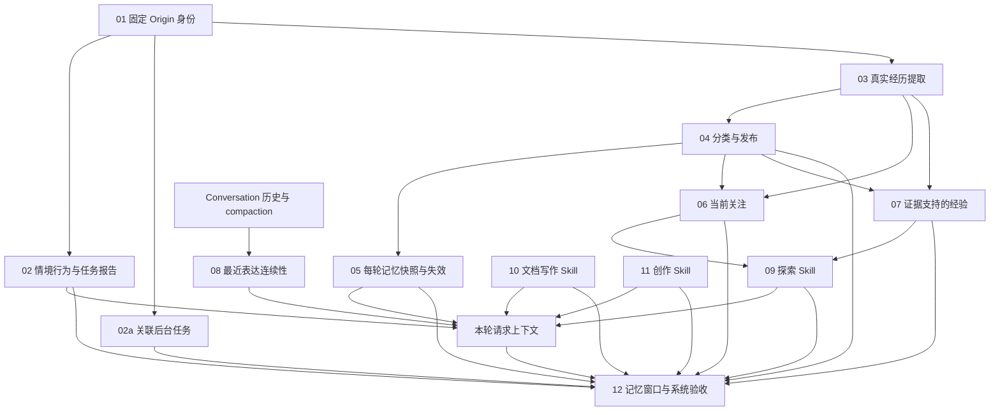

# Origin 系统的实施顺序与真实依赖

完整设计见 [Origin 设计文档](../../docs/design/origin/README.md)。Origin 的实现从固定身份开始，再让每轮请求根据当前意图采用合适的工作方式。真实交互形成有来源的记忆；记忆经过分类、发布和范围控制后，才进入后续任务。关注与经验是两种不同的成长记录；Skills 提供按需工作流程；最后通过现有记忆窗口检查状态并完成跨场景验收。

图中连线表示实际数据或功能依赖。执行顺序统一按编号排列；相邻但无技术依赖的增量仍按顺序交付，不因此产生额外模块关系。

情境行为使用真实运行状态汇报进度和结果。后台任务在同一 Project 用独立 Session 执行，原聊天承载用户指令和只读状态。两处都复用现有 Runtime、Session Store 和原生异步工具。已闭合并交付的工作结果按 Memory 的来源规则进入经验记录。

## 唯一实施顺序

- 01 [让普通 Root Session 固定使用 Origin 身份](01-origin-identity.md)
- 02 [让 Origin 根据当前工作情境调整表达与行为](02-contextual-behavior.md)
- 02a [在原聊天中委托、查看和管理关联后台任务](02a-background-task-sessions.md)
- 03 [从已闭合交互提取有来源的长期经历](03-memory-evidence.md)
- 04 [在现有记忆发布中区分类别与访问范围](04-memory-publication.md)
- 05 [为每个逻辑 Turn 冻结一致的记忆材料](05-memory-turn-snapshot.md)
- 06 [记录 Origin 值得继续关注的问题](06-attention.md)
- 07 [让经验根据真实反馈得到支持或修正](07-experience.md)
- 08 [在真实压缩后保留少量最近表达线索](08-expression-continuity.md)
- 09 [提供可按需调用的 Origin 探索工作流](09-exploration-skill.md)
- 10 [提供适合正式文档的 Origin 写作工作流](10-writing-skill.md)
- 11 [提供从构思到真实产物的 Origin 创作工作流](11-creative-skill.md)
- 12 [在现有记忆窗口检查 Origin 的成长并完成系统验收](12-memory-inspection-and-acceptance.md)

## 依赖关系与独立增量

- 01 为 02、02a 和 03 提供固定 Origin 身份。
- 02 组织当前请求情境并使用已记录的任务状态。02a 让 Project 内的聊天能创建和管理关联后台任务，并通过只读浮窗查看状态。
- 03 产生有来源的结构化观察；04 将其分类并发布；05 决定每个逻辑 Turn 使用哪一个已发布版本。
- 06 和 07 都使用已提取的来源与发布机制，但两者记录的对象不同：关注回答「还想继续理解什么」，经验回答「哪些做法经得起证据支持」。
- 08 只依赖同一 Session 的历史与真实 compaction，与经验状态无硬依赖。
- 09 使用关注和经验材料；10、11 是不同的用户工作流，分别服务正式写作与创意产物。
- 12 扩展现有记忆窗口，并在最后一个有真实功能产出的增量中完成全系统验收。

系统验收完成后，从仓库根目录下的 `materials/origin-acceptance/report.md` 查看总体结论、逐场景结果和证据链接。报告和证据均保存在本地。

所有方案均保留各自直接相关的验证、错误路径和文档同步；不另设纯测试或纯验收阶段。

## 工程边界

- 目标环境为 Windows x64、`x86_64-pc-windows-msvc`、DX12 与 PowerShell 7；不为未要求的平台增加兼容层。
- 遵守现有 Workspace / Crate 职责和依赖方向。业务实现放在 `crates/`，不在 `app/` 增加业务逻辑；不修改 Bevy、Widgetry、BRP 或 Codex 上游源码。
- 复用 Account、LLM Model、Runtime、Conversation、Session Store、Memory、Project Context、Skills、ToolCatalog 和现有异步任务机制；不建立平行 Agent Registry、任务数据库、记忆数据库或 Skill 管理器。
- 不恢复用户可见的提示词管理页面、Project Skill 或人格工作台。不得通过人格、记忆或 Skill 扩大工具权限。
- 不接入 B 站账号，不执行浏览、评论、私信、上传、直播、定时发布或其他平台运营。
- 未经用户明确授权，不退出登录、不重新登录、不切换账号、不重置凭据，也不通过更换数据目录破坏登录状态。
- 项目禁止新增或修改测试代码、Benchmark 和 Example。按变更范围使用 Cargo 编译、格式、Clippy、真实应用运行、日志/请求/存储状态核对；涉及 GUI 可观察行为时必须使用实际应用和 `bevy_brp_mcp` 验证。
- 不声称未执行的验证已经通过。发现问题在对应功能增量内修复并复验受影响范围，不另设纯验收阶段。
