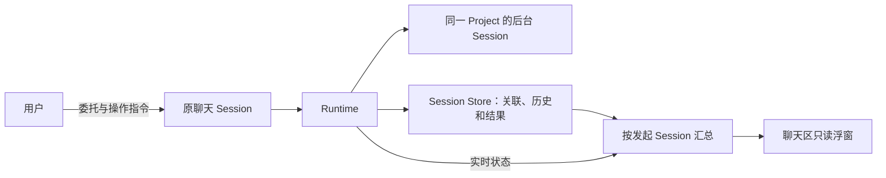

# 在原聊天中委托、查看和管理关联后台任务

用户在 Project 的普通聊天中交代一项需要独立推进的工作，Origin 在同一个 Project 创建后台 Session。用户可以继续聊天，也可以从聊天区浮窗查看进度。开始、继续、停止、查询和单项删除都在原聊天中向 Origin 提出。该功能承接[情境行为与工作报告](02-contextual-behavior.md)，完整交互见[Origin 后台任务设计](../../docs/design/origin/02-context-and-work.md#原聊天发起委托后台-session-承载执行)。

## 委托进入当前 Project 的独立 Session

明确的后台委托由当前 Project 的普通聊天发出。Origin 为每项委托创建独立的 Root Session，使用同一 Origin 身份、当前 Project Instructions 和相应的授权范围。首轮输入记录目标、完成条件、已确认的上下文与边界，后台 Session 保存自己的执行历史。保存后台 Session、发起 Session 与 Project 的关联后，Runtime 才接纳后台执行。普通聊天列表按会话用途排除这些后台 Session，创建和启动后继续显示原聊天。

从原聊天查询或操作任务时，Runtime 根据发起 Session 和后台 Session 的稳定身份核对关联。同一 Project 的聊天 A 和 B 各只读取和操作自己委托的任务。已从浮窗移出的成功任务仍可在发起聊天中查询结果或指定删除。原聊天对已保存结果的核对和交付继续使用有来源的结果记录。

## 任务随 Runtime 推进，浮窗随聊天切换

多个 Session 复用现有 Runtime 调度，各 Session 同时只推进一个活动前台 Turn。后台任务可以在其 Session 内跨多次模型与工具请求推进。切换主聊天期间任务继续执行，用户决策、资源、权限和预算阻塞按真实状态记录。Stop、取消、Queue、Retry 和压缩沿用原生任务契约。已接纳的异步工具可跨 Turn 完成。后台结果保存后更新任务状态，涉及进一步模型处理时，由用户在原聊天明确提出继续或处理结果，再按[现有接纳边界](../../docs/design/native-async-tools/02-history-and-delivery.md)交付。

主聊天区挂载只读浮窗。Agent 提供按当前打开 Session 汇总的状态，Bridge 传递安全投影，UI 管理拖动与折叠。切换会话更新任务集合，保留浮窗位置和展开状态。浮窗默认在右上角，拖标题栏只能在主聊天区内移动。折叠显示「后台任务」及数量，展开显示名称、状态和简短原因，内容溢出时在窗内滚动。控件沿用[既有任务底色和浮层样式](../../docs/design/ui/visual-system.md)，标题采用 Origin 发带的深绿色点缀。

浮窗展示执行中、待执行和异常任务，异常区分失败、上次中断、结果未确认或需要用户处理。整个委托确认成功并保存结果后移出浮窗，单个工具调用成功时仍按委托整体状态显示。可见任务数为零时隐藏浮窗。任务操作入口是原聊天，浮窗交互限于查看、展开、折叠、拖动和滚动。

## 重开应用时从持久记录重建

重新打开发起聊天后，按 Session Store 中已提交的关联和事实恢复列表。尚未开始的任务显示未执行，异常结束的任务显示上次中断，缺少结果证据时显示结果未确认。已保存的失败保留原因，已保存的成功及产物可在原聊天查阅。任务标识和来源不随重开改变。

用户在原聊天明确续接时，Origin 核对已保存的进度、回执和产物，按[原生任务恢复规则](../../docs/design/native-async-tools/04-durability-and-context.md)从确认的检查点接着做。恢复后无旧进程句柄，可能已产生副作用的调用保持原有确认边界。

## 归档与删除覆盖原聊天及关联任务

用户归档原聊天时，关联任务随它一起归档，保留项目归属、关联、历史和结果。存在执行中或等用户确认的任务时，在原聊天先处理，再完成归档。已保存但尚未执行的任务归档后保持暂停。

删除原聊天时，在现有确认界面说明将一并删除的后台 Session 数量。Runtime 对整组检查活动任务、进程回收和存储提交，满足条件后提交可恢复的整组删除。提交前若收尾未确认，保留原聊天与关联记录，并提示处理原因。提交后若清理中断，下次打开时根据已提交的删除状态清理。原聊天委托的单项删除只影响明确指定、已收尾的那项后台 Session。Project 目录中的独立产物由项目保留。

## 完成条件

- 在同一 Project 分别打开聊天 A 和 B，从 A 委托后台生成本地重复文件清单，核对任务 Session 属于原 Project、只关联 A，并且未作为普通聊天条目显示。B 保持自己的浮窗内容，切回 A 能看到仍在推进的任务。
- 通过真实应用和 BRP 核对折叠、展开、滚动、拖动边界、切换会话后的列表与位置。拖动完成后释放 Pointer 并确认 inactive。观察执行中、待执行、失败和无可见任务时的表现，核对状态更新时聊天草稿和阅读位置保持，成功后移出浮窗、结果仍可通过原聊天查询。
- 从发起聊天明确委托、继续、停止和单项删除，核对 Runtime 接纳、任务目标、关联范围和实际回执。从同项目另一聊天请求操作时，关联任务仍由原聊天控制。
- 在受控任务中分别正常退出和异常终止客户端。重开原聊天核对未执行、上次中断、结果未确认以及已保存结果。确认只有明确续接才开始新执行，已完成的副作用不会重放。记录实际覆盖的故障场景。
- 分别核对有运行任务、需要确认和已收尾时的归档及删除。归档保持历史与关联，删除确认显示任务数量，整组删除后重开仍无遗留会话。单项删除保留原聊天和其他任务，Project 目录中的实际产物仍可打开。
- 同步已实现的会话关联、存储与生命周期规则及聊天区状态投影说明到 Conversation、Session Store 和 UI 设计文档。最终系统验收按[第 12 项计划](12-memory-inspection-and-acceptance.md)收录结果。

## 工程边界

- 复用 Runtime、Conversation、Session Store、原生异步任务和现有工具授权。任务执行限定在应用运行期，应用重开后由用户明确续接。
- 目标环境为 Windows x64、MSVC、DX12 和 PowerShell 7。GUI 通过真实应用和 `bevy_brp_mcp` 验证。
- 不新增测试代码、Benchmark、Example、独立任务数据库或调度服务。不以任务启动、模型自述或工具结果到达代替真实回执及用户授权。
