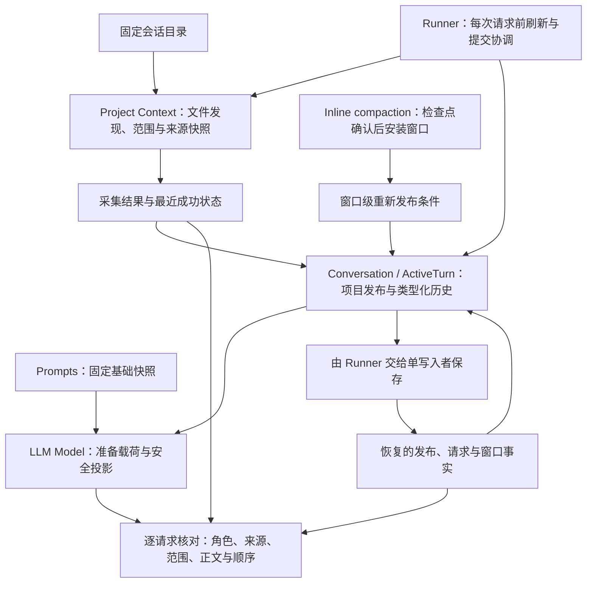

# 项目指令怎样接入现有会话

这组方案围绕两类持久指令来源展开：基础文本在创建会话时固定；项目 `AGENTS.md` 根据会话目录发现，在后续模型请求边界采集变化。聊天输入、原始协议历史、工具定义和运行设置继续使用既有机制。

这里不复制一整套 Codex 指令管理框架。基础快照中的现有 supplements 保持原样，全局规则、Thread Instructions、备用文件名和通用冲突解析器不进入范围。完整设计从[设计入口](../../docs/design/project-instructions/README.md)开始阅读。

## 文件、会话和模型请求各自拥有一部分事实

图中是数据与控制关系，不是 Crate 的逐项依赖图。Project Context 拥有文件发现与确定性内容，Conversation 拥有状态，Runner 拥有请求边界和运行协调，模型层拥有协议载荷，存储保留权威事实，界面只消费安全投影。

项目规则独立于基础配置，但已经发布的项目上下文项留在原始协议历史中。正常更新追加完整替换或移除通知，不修改旧前缀；内容不变则不重复追加。压缩后的窗口需要再次明确发布当前原文，这由窗口身份和已提交状态决定，而不是猜测不透明压缩内容里保留了多少规则。

请求核对采用发送侧同一组装入口产生的材料。采集成功、载荷准备、网络发送和获得响应分别表达；查看旧请求使用已保存的文本，不重读当前文件，也不依赖模型回答来证明加载成功。

## 独立增量按一条顺序交付

文件发现可以先作为可观察的加载能力交付，注入增量随后让结果真正进入可重放请求。动态发布依赖这条请求与持久化路径；压缩恢复复用动态状态机制并增加窗口条件。完整核对界面最后整合此前已经存在的来源、请求和窗口事实。

每份方案都包含自己的运行验证及必要文档同步，结果可分别检查。下面是唯一实施顺序；不另设只运行检查、没有功能产出的验收阶段。

1. [发现并展示会话适用的项目规则](01-discover-project-context.md)
2. [让项目规则进入可重放的模型请求](02-inject-project-instructions.md)
3. [在请求边界发布项目规则变化](03-refresh-project-instructions.md)
4. [在压缩后的工作窗口恢复当前项目规则](04-restore-after-compaction.md)
5. [查看每次请求真正采用的项目指令](05-inspect-request-instructions.md)
