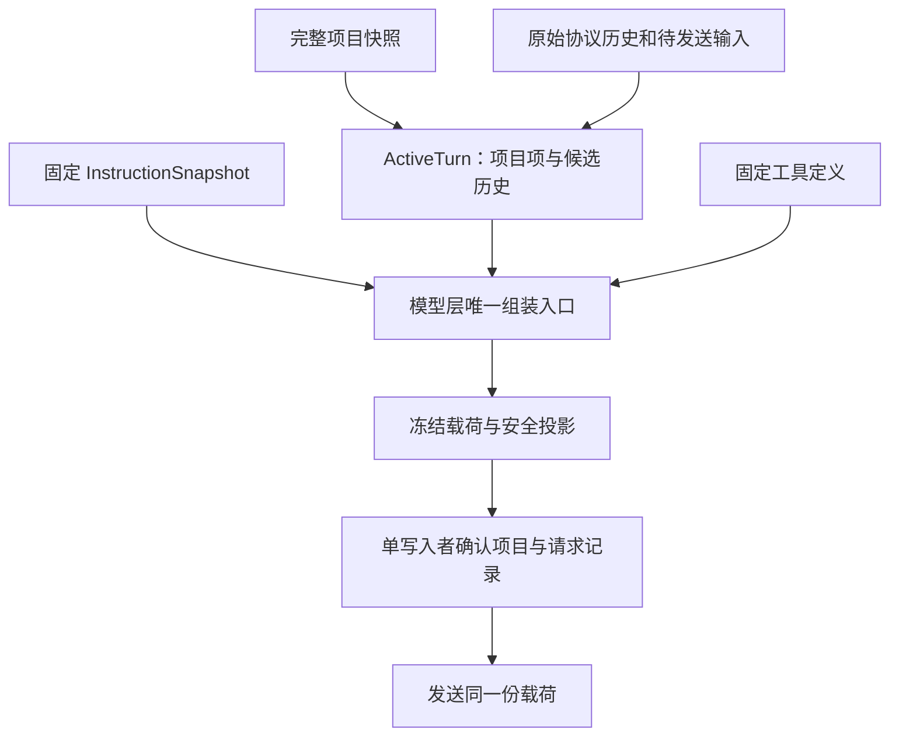

# 让项目规则进入可重放的模型请求

本增量把已经加载的项目快照接入真实模型请求，并保存足以恢复、核对这次使用事实的记录。规则不再只是界面里的一份文件内容，而是有类型、有顺序、能够原样重放的协议上下文。

依赖[项目发现](01-discover-project-context.md)的读取结果。这里先完成首次发布和未变化内容的复用；后续的[动态更新](03-refresh-project-instructions.md)在同一协议与存储机制上追加替换、移除通知。请求结构依据见[模型上下文设计](../../docs/design/project-instructions/02-request-context.md)。

## 基础前缀固定，项目正文拥有自己的协议身份

基础快照仍在会话创建时解析，编辑提示词库或准备区不改变已有会话。已有的基础覆盖与有序 supplements 继续生成 `developer` 消息；Default 的空配置保持原样，不增加新的默认文字或要求用户重新选择。

项目快照生成内部专用的项目上下文项，发送时使用普通 `user` 角色。它不是 PromptRef，不进入基础／补充槽位，也不因为属于自动上下文而提升到 developer。角色由程序构造，项目正文无法通过写出另一种角色名称来改变权限。

项目项的确定性正文包括会话目录、项目边界、来源路径、各自作用范围及有序原文。包装说明只表达适用关系：子目录规则用于对应子树，用户直接要求仍须结合指令层级理解，任务涉及未自动加载的下级目录时由模型按需查阅。文件原文不被总结或改写，也不建立逐句冲突裁决器。

ProtocolHistory、协议归档及安全顺序摘要要能区分自动项目项和普通 User 项。内部类型记录项目快照引用、发布身份和实际渲染文本；序列化给 API 时仍是 user 消息。不能靠匹配“AGENTS.md instructions”标题来识别来源，否则用户粘贴同样文字就会被错误分类。

## 首次注入和历史重放必须共用一条路径

首次取得非空项目规则时，在待发送输入之前加入一条完整项目上下文。初次成功为空时不发送空指令，但保留“成功检查过且为空”的状态。新建会话尚未检查时则仍是未采集，不与空快照混淆。

可以把请求顺序写成下面的关系：

| 请求 | 逻辑内容 |
| --- | --- |
| 首次提问 | 固定基础 B，项目 P1，用户 U1 |
| 规则未变后的下一问 | B，P1，U1，完整输出 O1，用户 U2 |
| 同一任务的工具反馈 | B，已有 P1 与用户输入，原始工具调用及对应结果 |

每次请求都会重放当前工作历史中的 P1，但不会为了“再让模型看到一次”又向历史追加一份 P1。固定基础前缀也不进入聊天历史逐轮累积。完整模型输出、reasoning、function_call 和 function_call_output 保留原始顺序与对应关系，不从气泡文字重建。

请求继续使用 `store=false`、原有模型与 effort、固定工具定义和服务端 Inline 压缩参数；不改为依赖远端会话状态，不插入额外的摘要请求。自动项目项不产生用户草稿、输入身份或待办条目。

## 请求准备是一次冻结，不是发送侧和界面各拼一次

将模型层已有的请求组装、验证和有界序列化组织为同一准备路径。输入为固定基础快照、候选协议历史及工具设置；输出为不可变请求载荷和从这些材料产生的安全核对投影。实际发送只消费该载荷，不在网络重发前再次读项目文件。

ActiveTurn 仍是活动历史的唯一所有者。Runner 从它取得候选更新，交给模型层准备，再沿 Session Store 的现有单写入者确认本地记录。项目更新与请求准备记录都确认之后，才安装相应活动状态并启动网络发送。

这两个记录承担不同的职责：

**项目上下文提交**保存完整来源快照、确定的协议项、发布身份和接续的历史边界。空快照也需要能够被引用；它没有正文协议项，不制造虚假的 User 消息。完整文本必须保留，哈希只用于核对，不能在恢复时再从源文件补读。

**请求准备记录**保存 Session、Turn、请求序号、基础／项目材料引用、安全顺序摘要和载荷摘要。它证明构造了什么，不证明服务端接收或模型遵守了什么。基础全文已由会话初始记录保存，项目全文由项目记录保存；不为每个未变化请求重新写一份来源全文，也不新建通用内容存储或数据库。

项目项真正改变协议历史时才推进权威历史覆盖边界；纯请求准备记录只推进日志外层序号。现有 compaction 使用的 `source_sequence` 不能被这类核对元数据误改。空快照的来源记录同样不能假装增加了历史项。

如果项目记录已经确认而请求准备记录失败，保留项目已提交事实，不发送 HTTP。保存结果不确定沿原有存储阻断路径处理，不把一次失败当作可以无条件重试的写入。若材料已经准备、随后取消，记录仍只表示准备事实，不能据此生成模型完成状态。

## 项目项提交不改变用户输入的成功语义

构造候选请求时，新项目项尽量位于尚未发送的本次输入与 Steer 前。已经保留的用户、工具或 reasoning 项不移动；只能在未发送尾部组织新材料，不能为了整齐改写旧前缀。

普通用户输入仍按照既有成功／封闭步骤规则保留。项目项本地提交、网络失败，并不意味着用户问题已经成功完成；这条自动上下文也不算一次已经执行的模型／工具步骤。不能只依据历史长度发生变化，就拒绝原本合法的 Retry，或在恢复时重复追加用户问题。

四种状态分别维护：固定基础设置、最近成功的项目采集、已提交的项目发布、特定请求实际采用的材料。它们随 ActiveTurn 独占流转，UI 和 Bridge 不保存第二份可写权威。请求序号、发布身份和当前窗口身份分别表达，不用一个哈希承担全部生命周期判断。

## 归档和计量随首次接入一起完成

项目上下文项增加相应的协议归档表示，恢复时校验类型、来源、作用范围、正文摘要与发布引用。没有项目记录的旧存档按从未自动注入解释，不从旧聊天文本猜测曾加载过哪些文件，也不补造来源。

打开已保存会话只恢复当时的材料，不执行旧工具，不要求源目录仍存在。所选请求的历史规则使用保存的原文；源文件后来变化或消失，不影响旧请求核对。重新执行时的文件刷新由下一增量接上。

项目项按实际渲染的正文、角色、路径标题与包装文字参与 token 估算。来源快照作为持久数据存在，不再额外计一遍。没有用量锚点时按固定基础、工具及历史估算；已有锚点时新项目项进入尾部估算，未发送候选项同样要计入。

模型层的 **32 MiB 完整请求限制**继续覆盖实际 JSON／图片编码、工具声明、基础和项目文本。文件采集的 **32 KiB 源材料限制**是另一道边界，两者不能互相替代。超限在发送之前失败，保留输入和已提交历史，不裁剪原始 reasoning、工具结果或旧消息。

## 验证实际载荷，而不只验证回答

在真实应用中新建会话并发送普通消息，使用已冻结材料的安全投影核对首次项目项的角色、来源、作用域、顺序与原文。连续发送相同环境下的新问题及一个产生工具往返的任务，应当看到同一个 P1 被原样重放，没有每次追加副本。

同时验证以下边界：

- 有自定义基础、默认空基础、已有 supplements 三种配置保持原先行为；项目规则独立加入 user 上下文，不改写基础快照。
- 用户主动输入同名标题仍是普通 User 项，不会被归档或核对页当成自动规则。项目项也不会生成用户气泡、草稿或待办身份。
- 取消或真实请求失败只留下符合事实的项目提交与准备记录，不把待发送用户输入当作成功步骤；修复后合法 Retry 不重复输入，也不因为多了一条自动项目项就被拒绝。
- 关闭并重开会话后，项目原文、请求归属及顺序可恢复；删除或编辑源文件不改写旧材料。准备记录没有响应时，恢复不声称模型已收到。
- 项目正文和包装进入估算，固定来源数据不被重复计量；完整请求超限不启动网络，不通过截断历史规避。

每项运行核对使用真实执行状态、存储回执与安全投影。不能为了得到通过结果伪造 SSE、reasoning 或工具结果，也不编写 Unit Test、Integration Test、Benchmark、Example 或专用请求验证程序。涉及展示变化时通过 BRP 真实输入、截图和 ECS 只读查询确认，结束后释放 Pointer 并确认 inactive。

## 实现范围与同步约束

本步保持 Windows x64、DX12、PowerShell 7 环境及既有账号保护。开发维护任务进度记录，执行受影响范围的格式、编译和 Clippy 检查；不为测试重登、退出、切账号、清凭据或切换数据目录。

Project Context 提供快照与文本语义，Conversation 管状态，Runner 协调准备与提交，LLM Model 管协议和发送，Store 通过 Conversation 事件保存。Conversation 不反向依赖 Store，Agent／Bridge 不依赖 Bevy，Runtime 不接管项目正文业务。新增直接依赖和请求、历史、存储契约落地后同步相应设计文档，代码注释与提交信息使用英文。

普通日志不打印基础或项目正文、完整请求、聊天、凭据、加密 reasoning 和图片 Base64。完整材料只进入受控会话存档与核对投影。动态文件变化通知、压缩后重新发布和完整逐请求查看界面分别在后续对应增量完成，不在本步引入全局规则或通用指令管理系统。
