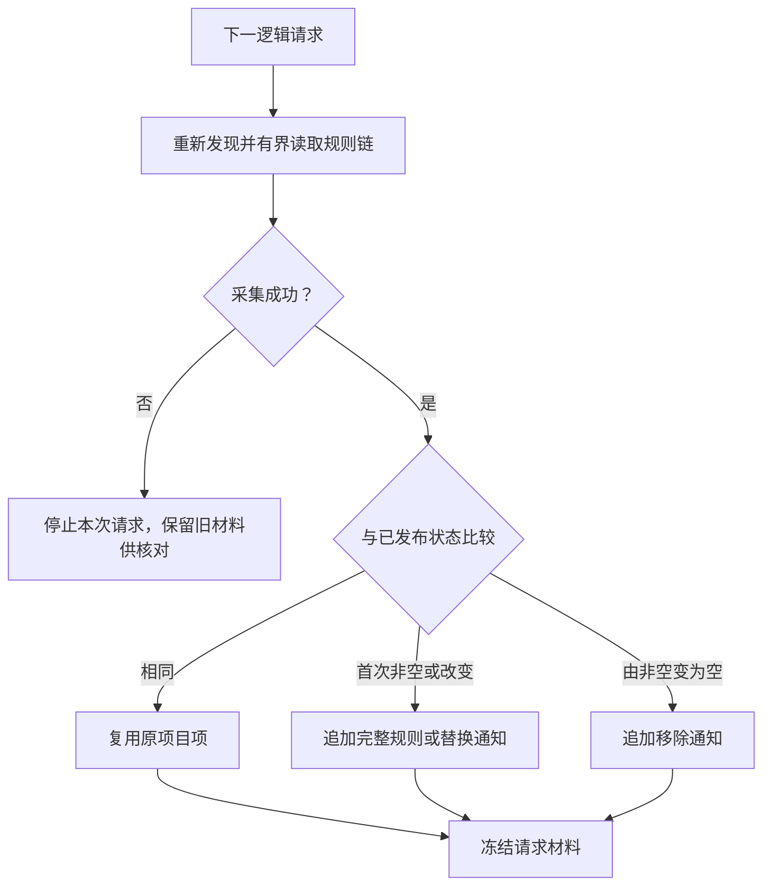

# 在请求边界发布项目规则变化

本增量让同一会话能够持续采用项目规则的新内容。变化只在下一次模型请求准备时生效；没有变化就沿用已经提交的项目项，发生变化则追加完整替换或移除通知，不重写过去的请求前缀。

它建立在[首次注入与可重放记录](02-inject-project-instructions.md)之上。下一步的[压缩恢复](04-restore-after-compaction.md)增加“文件没变，但新窗口仍需明确发布”的条件；本步处理正常工作窗口中的文件和范围变化。设计依据见[生命周期](../../docs/design/project-instructions/03-lifecycle-and-compaction.md)。

## 每次逻辑请求都重新看当前链

刷新入口统一放在 Runner 的请求准备边界。第一次输入、后续聊天、工具结果封闭后的继续推理、Queue 中的任务真正开始，以及用户主动 Retry 都经过这里。每次按会话目录重新发现链并读取内容，不能只重读上次找到的文件，否则中间目录新建的 `AGENTS.md` 会被遗漏。

这个方案选择少量本地文件的直接读取，不建立文件监控、定时刷新或修改时间缓存。摘要决定是否发布，不决定是否检查文件。Codex 的项目缓存按环境选择、信任状态和预算等条件失效；这里采用的是它的快照与更新思想，而不是声称照搬了逐请求重读行为。

会话 `working_directory` 仍是自动链的输入。修改某个文件、命令带有 `workdir` 或 Shell 执行 `cd`，都不会成为隐式目录切换。新建会话可以选择另一目录；本步不增加运行中切换项目或推测任务范围的功能。

项目根标记和链上文件变化都重新反映在快照中。路径、作用范围或文件顺序变化，即使某份正文相同，也可能改变模型可见表示，应当参与比较。采集后的外部编辑在下一请求处理，不让一份已准备载荷在发送途中被改写。

## 更新表达完整当前状态，而不是自然语言补丁

变化判断对照最后确认的项目发布状态，使用确定性的模型可见内容和范围。采集时间、mtime、请求计数和界面状态不进入正文。重复保存相同文件保持不变，避免把无意义的时间标签变成模型更新。

正常状态转换为：

| 已发布内容与本次结果 | 本次行为 |
| --- | --- |
| 从未发布，采集为空 | 保存成功检查事实，不追加空消息 |
| 从未发布，采集非空 | 发布完整规则 |
| 文本、范围和顺序不变 | 引用已有快照，不追加项目项 |
| 有效内容或范围改变 | 发布完整新快照，并说明替换先前自动注入的项目规则 |
| 先前有规则，本次确认无规则 | 发布移除通知，撤销先前自动注入的项目规则 |
| 先前已经清空，本次仍为空 | 保持不变，不重复移除 |

替换通知包含新快照的完整内容，不让模型把多个文件的差异自行拼接成最终版本。旧项目项仍留在历史原位置，是当时使用过的上下文，而非当前规则；模型通过新通知理解替换关系。

例如正常请求从 `B，P1，U1，O1` 发展为 `B，P1，U1，O1，P2替换通知，U2`。不能把最早的 P1 直接换成 P2，否则会改变后续原始 reasoning 所依赖的前缀。内容由 A 改为 B 再改回 A 时，最后一次仍需追加 A，不能因为历史中出现过相同摘要就忽略状态转换。

替换范围仅限客户端自动发布的项目规则。用户消息、用户粘贴的 `AGENTS.md`、工具查到的下级目录规则，仍按各自原始类型保存，不通过正文搜索一并撤销。程序不解释每条自然语言约束，也不把文件内容变成工具权限配置。

## 工具批次不被中途拆开

一个模型响应提出多个调用时，仍按既有顺序串行执行并封闭所有结果。某个工具修改了项目规则，新文本在下一个模型请求中生效，而不是在同一批次的每个工具之前重新读取。

已经执行的调用保留真实结果；新规则不追溯撤销文件修改，也不让结果失去对应的 call_id。Stop、Steer 导致剩余调用不执行时，继续按现有语义封闭这些结果，再进入下一请求或收尾。

待发送项目项尽量放在本次新用户输入和待应用 Steer 前；已提交输入不能为此挪动。Steer 的接纳与实际应用仍使用原有回执和请求身份。Queue 不在排队时冻结项目规则，而在实际启动所属任务时采集，避免等待期间的文件变化失效。

## 不把读取失败当成规则删除

成功空快照与失败是两个结果。访问失败、失效目录、非普通文件、无效 UTF-8、链接错误、根标记探测错误或超过 32 KiB，都会停止该次模型请求。旧快照保留供历史核对，但不能作为静默回退继续发送，也不能因失败追加移除通知。

这类错误应成为可修复的任务失败，不走导致永久 `execution_blocked` 的历史损坏分支。用户修好文件后可以按原有资格 Retry 或发新消息。存储提交不确定、协议无法可信恢复及进程清理失败仍属于真实执行阻断，两类失败不要共用一个模糊标志。

加载运行在执行侧。取消停止后续网络启动，并等待已经开始的阻塞读取纳入真实回收；不能把取消等待者等同于取消文件操作。Runner 仍负责已有工具进程的统一清理、关闭补充输入接纳和唯一终态交付。

发生错误之前已经确认的工具步骤、用户补充和项目发布都保留。任务失败不表示文件副作用被撤销，也不能通过回退历史让下一次请求重复执行它们。

## 重试和恢复采用明确的时间边界

用户主动 Retry 是新的逻辑请求，会重新采集项目规则，基础快照仍使用原会话设置。旧尝试实际采用的材料保持不可变；新尝试可以使用另一份项目快照。自动项目项本身不算已完成模型／工具步骤，不能单独让一个原本可重试的输入失去资格。

已提交工具步骤或已应用 Steer 的任务仍遵守现有重试限制，通过新消息继续，不重复副作用。普通失败用户输入也不因项目更新先落盘就被当作成功对话保留。

同一次 HTTP 的认证恢复则继续发送已经冻结的字节，不能在内部重发时重新读取规则。它与 UI 的 Retry 不是同一种操作。请求记录据此区分构造、发送与响应事实，不把客户端准备成功说成服务端已接收。

打开历史会话先恢复当时的完整来源、项目发布和请求引用，不立即读项目目录、执行工具或发送网络。继续发送时再采集；文件改变则追加替换，确认全部删除则追加清除，原目录不可访问则失败。没有项目字段的旧存档按从未自动发布处理，不从旧聊天文本补造记录。

Reset 继续复制原有基础、模型和目录设置，创建新会话身份与空历史，下一请求重新采集；不是把旧项目快照作为永久基础条件复制。Queue 使用所属会话的设置，在实际开始时取得新采集结果。

## 每次发布和请求都能沿存档还原

沿上一增量的项目记录与请求准备记录保存变化。完整快照和渲染后文本只在首次或变化发布时作为权威材料保存；没有变化的请求引用同一份材料，不额外写一次来源全文。

确认项目提交后才安装发布状态；请求准备确认后才启动网络。发生部分提交，保留已经确认的事实，不凭内存猜测文件是否写成功。请求元数据的外层序号不能冒充协议历史覆盖边界，只有实际改变历史的记录才更新相应 `source_sequence`。

UI 的“最近成功采集”可以更新，过去某个请求使用的材料不跟着变。发生失败时明确表示本次没有发送新请求，不能让旧内容继续显示成已验证的磁盘当前状态。

## 完成条件随刷新机制一起验证

使用真实应用和普通 Markdown 输入文件，连续执行以下有区别的场景：相同内容重存、根规则编辑、原先缺少的中间层规则新建、某一层删除、全部删除或清空，以及 A→B→A。检查每次请求的发布类型、全文、来源、历史顺序及存档引用；未变化不新增，变化只新增一次完整状态。

工具任务中安排一次正常的项目文件修改，核对同批剩余调用仍依据原请求推进，下一模型请求才带更新。另用临时 `workdir` 变化确认自动链不切换，模型通过工具读取的额外规则不冒充自动来源。

读取失败应没有新网络请求、没有错误移除通知，也不永久阻断可恢复会话；修复文件后核对合法 Retry。停止和 Steer 需要同时检查进程回收、配对结果和输入回执；Queue 在开始执行时采用最新规则，不采用入队时的旧文本。

保存并重开会话后检查旧请求原文保持不变，继续执行采用新文件。源目录不可用时仍可查看存档，但继续会明确失败。认证重发的载荷一致性结合实际可见事件和静态控制流核对，不破坏登录状态制造失败，也不伪造服务端响应。

这些验证不编写测试、Benchmark、Example 或专用验证程序。涉及状态展示变化时使用 BRP 实际操作、截图和只读查询，释放 Pointer 并确认 inactive。全部操作使用 Windows x64／DX12／PowerShell 7，保持账号和数据目录不变。

## 职责与工程收口

不增加新指令类别、文件监控服务、通用缓存框架或新的权限层。固定基础及现有 supplements 保持原快照，Project Context 管采集，ActiveTurn 管发布状态，Runner 管边界，Model 负责冻结与发送，Store 负责确认。

开发记录重要状态转换与实际验证结果，代码注释和提交使用英文。同步会话、请求、项目上下文及存储中受到影响的生命周期说明；按实际范围做格式、编译与 Clippy 检查。日志只保留身份、数量、摘要、大小和错误，不输出规则正文、聊天、凭据、加密 reasoning 或图片载荷。
