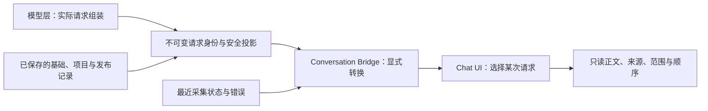

# 查看每次请求真正采用的项目指令

本增量把已有的来源快照、发布记录、请求准备事实和窗口状态组织成可直接使用的核对界面。用户需要知道的是“选中这一次请求，它用了什么”，而不是磁盘现在有什么，或准备区目前选中了什么。

前面的[压缩恢复](04-restore-after-compaction.md)补齐了窗口发布事实；本步统一展示首次发布、沿用、替换、清除和压缩后的重新发布。不新增提示词编辑器、项目配置中心或独立日志数据库。界面与所有者依据见[模块与核对设计](../../docs/design/project-instructions/04-architecture-and-observability.md)。

## 先让用户选中一次真实请求

复用现有请求核对入口，支持按会话、Turn 和模型请求序号选择。一次工具任务可能调用模型多次，因此只显示“本轮指令”无法准确解释中途规则更新；选择粒度必须达到实际请求。

每次请求展示固定基础快照与已有 supplements 的顺序、项目材料引用及发布类型。请求引用指向本次组装时已经冻结的内容，后续文件编辑、下一次请求或准备区切换不会覆盖它。

来源详情包含会话工作目录、项目边界、有序 `AGENTS.md` 路径、各自作用目录、内容摘要、完整原文和最终包装文字。两种正文可以在同一核对入口区分查看：文件原文用于解释来源，实际渲染文字用于核对模型收到的请求材料。

项目来源不是 PromptRef，不为适配旧界面虚构提示词库 ID 或版本。基础消息继续标为 developer，自动项目项标为 user；文字作者是谁与协议角色是什么分别表达。

## 把当前状态与历史使用事实分开

界面应能区分这些状态，而不是用一个“已加载”标签概括：

| 显示对象 | 表达的事实 |
| --- | --- |
| 尚未采集 | 当前会话还没有检查项目规则 |
| 成功为空 | 最近一次检查完成，没有有效规则正文 |
| 最近成功采集 | 执行侧取得的来源快照，并非持续监控中的磁盘状态 |
| 最近采集失败 | 文件、目录、编码或预算错误，本次没有发起新模型请求 |
| 请求材料已准备 | 请求组装与校验完成，材料已经固定 |
| 已开始发送／已有响应 | 发送或返回事件已经真实发生，不据此推断模型遵守了每条规则 |

采集成功但尚未完成请求准备时，不能把采集结果写成某次已发送请求的内容。请求已经准备随后取消，也不能显示成模型完成。旧快照在新的采集失败后仍可作为历史记录查看，但应明确它不是本次重新验证成功的材料。

查看过去的请求使用当时保存的全文和引用，不打开今天的源文件补齐内容。即使源项目被移动或删除，历史核对仍可用；真正继续执行时的目录检查和失败属于运行机制，不应阻止查看已有材料。

同一规则链中的子目录范围要明确显示。模型通过工具额外读到的下级 `AGENTS.md` 属于工具历史，不加入自动来源列表。用户自己发送同名标题的消息仍是普通 User 项，也不从文本特征推导来源身份。

## 展示直接来自请求组装结果

安全投影由模型层实际组装入口产生，随请求身份保存和传递；不能再让 UI 从基础库、当前磁盘文件和气泡文字重新拼出一份“应该发送”的内容。已有存档恢复的投影同样使用其保存的材料和顺序。

最近成功采集状态与所选请求材料分开传递，避免一次较新的进度推送覆盖用户正在查看的旧请求。活动状态仍由 ActiveTurn 和 Runner 独占，Bridge 只做业务类型到安全展示类型的转换，UI 不拥有第二份协议历史。

自动项目项可以在请求摘要中显示首次、替换、移除或重新发布，也可以以运行状态说明提示变化；不把它画成用户亲手发送的聊天气泡，不影响输入草稿、用户输入身份和 Queue 顺序。

完整基础和项目正文属于受控核对数据。普通日志只能记录身份、来源数量、摘要、大小和错误类别，不能借诊断输出全文。凭据、账号认证头、原始 reasoning／compaction 密文和图片 Base64 不进入核对反射数据。

## 沿用现有控件与页面生命周期

界面构造使用 BSN，运行期的请求选择、来源展开和文本状态由持久组件维护。页面重新构建时恢复自己的展示选择，不重建会话权威、不读取项目磁盘，也不取消正在执行的任务。切换会话后不能保留另一会话的来源正文或请求身份。

正文使用 `WidgetryReadOnlyTextField`，保留选择、导航和复制。程序更新正文通过控件公开内容 API，不直接修改内部 EditableText，不创建同义的状态副本，也不把只读设置成禁止选择复制的 Disabled 状态。长规则可滚动查看，路径用现有路径显示库格式化；真实文件读取与比较仍使用原始路径值。

需要 BRP 定位时优先使用有业务意义的稳定 Name 和现有反射投影，不为自动化增加专用生产接口。采用工程当前的 Widgetry、BRP 与 Bevy 依赖组合，不为了这个核对页修改或升级上游库。

## 真实界面必须能解释一次规则变化

通过现有 `bevy_brp_mcp` 操作实际应用，完成请求选择、来源展开、正文滚动、文本选择和复制。交互后结合截图检查可见内容，结合 ECS 只读状态检查请求身份和材料引用；不能直接改状态后把画面变化当作用户操作已通过。

Pointer 请求被接受、操作队列执行结束、UI 行为正确是三个不同结论。BRP 使用 Custom Pointer，不拿它替代原生 OS 窗口输入验证。结束自动交互后执行 release，查询到 inactive；只看到 busy=false 不代表控制权已释放或核对功能正确。

界面完成条件包括：

- 创建会话后显示尚未采集；首次检查为空和检查失败各有明确状态，不共用空数组或空白正文表示。
- 选中首次、沿用、替换、清除和压缩后重新发布的请求，各自材料、角色、顺序和来源正确；同一 Turn 中切换请求不串记录。
- 后续编辑文件、修改准备区和继续聊天后，过去请求的全文仍保持不变。新读取失败时旧材料可查，但不显示为新请求已发送。
- 选择与复制得到所选原文，长文本滚动不漏内容。切页、切会话、重开会话和源文件消失后，展示仍对应正确请求，不触发额外网络或文件读取。
- 自动项目项只出现在相应核对／状态位置，不产生用户气泡、不改变草稿、输入身份或 Queue。
- 安全投影和普通日志没有凭据、认证头、完整原始模型载荷或加密推理；请求使用事实来自同一组装结果，而不是模型回答中的自述。

## 用一个连续场景完成整体收口

最终收口沿真实使用流程进行，而不是重新执行所有无关功能：选择一个含根、中间层和当前目录规则的项目，发送带工具往返的任务；查看第一次请求，编辑一层规则，再查看下一次请求的完整替换及旧请求材料；删除全部自动规则后检查清除通知。

随后保存并重开同一会话，确认基础快照仍固定、历史材料可读、继续请求重新采集。真实发生 Inline compaction 时，确认新窗口第一次请求恰好恢复一次当前规则或清除状态，后续请求不重复。这条路径同时核对来源、刷新、持久化、压缩和界面之间的身份衔接，不能用伪造压缩事件替代。

读取失败、Stop、Steer 和 Queue 的直接受影响行为使用前面增量已有的有效场景针对性复验；未受影响的账号、Markdown 或工具功能不重新做全量遍历。发现材料与实际载荷不一致，应回到其权威构造／记录处修复，不能只改展示掩盖。

## 工程与验证边界

操作环境仍为 Windows x64、DX12、PowerShell 7。不编写 Unit Test、Integration Test、Benchmark、Example、专用验证程序，也不把 BRP 操作保存成新的测试框架。执行证据、失败和未覆盖范围保留在任务进度记录中，不能仅凭应用启动或工具调用成功标记通过。

保持现有登录和数据目录；不主动退出、重新授权、切换账号、清除凭据或用换数据目录制造恢复场景。代码注释和提交信息使用英文，文档按当前任务语言表达。按实际影响执行格式、编译、Clippy 检查，并同步会话投影、Bridge 边界及相关模块设计；有真实依赖变化时才同步总体架构，不新增独立 Feature 文档层。

至此交付的是基础快照与项目规则的可观察运行链，不扩展全局 AGENTS、Thread Instructions、override、fallback、Skills 或 MCP。项目正文仍是模型工作上下文，不是程序权限策略。
