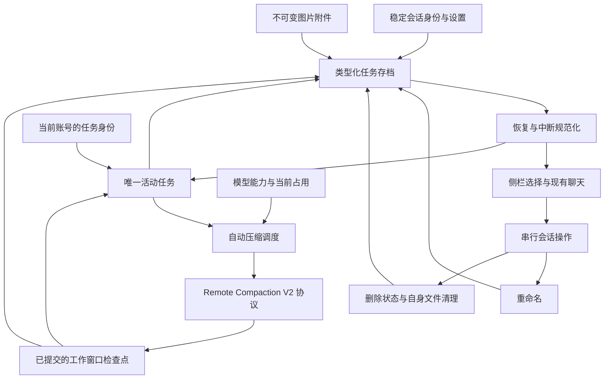

# 会话存档与自动上下文管理的实施关系

整体目标是把已有的单会话执行链延长到跨重启、多会话和跨账号使用。记录仍归会话业务所有，模型协议仍由模型层解释；新增存储工作者负责可恢复的磁盘事实，侧栏只操作这些事实的安全投影。

完整设计见[会话与上下文管理](../../docs/design/session-context/README.md)。设计图随设计正文保存在相邻 images 目录，侧栏保留平铺列表、最后活动时间排序、新建、重命名和删除，不加入搜索、分组或账号分类。

## 两种读取围绕同一份记录

图解释数据和控制关系，不表示实施可以并行。稳定身份、附件和任务记录为恢复提供事实；恢复支撑侧栏打开。名称和删除属于目录业务，不修改模型历史的含义。账号只为正在开始的任务提供执行身份，不决定本地目录中有哪些会话。

另一条关系从模型元数据和使用量出发，形成当前工作上下文预算，再驱动 V2 请求。成功结果作为完整检查点追加到存档，之后的请求使用替换窗口，用户阅读仍使用完整时间线。压缩不删除原会话，也不成为新的工具执行者。

## 现有模块怎样承接这些能力

Conversation 定义会话、输入和恢复语义；Turn Runner 独占活动历史并在安全边界驱动请求；Runtime 串行接纳控制并回收任务。新增 Session Store 依赖 Conversation 的持久记录类型，Conversation 不反向依赖 Store。模型层承接目录能力、使用量、协议编解码与 V2；Bridge 只传递安全投影，AgentHost 继续是唯一共享连接宿主。

数据写入当前已占用的应用数据目录：每个 Session 有独立日志、可重建摘要和附件。单写入者为任务与队列记录统一分配序号，真实提交回执控制可观察状态。关闭等待执行资源和记录工作者收敛后才释放目录锁，不由 UI 页面寿命管理后台。

本阶段只有一个活动任务。恢复不启动旧进程、不重跑旧工具，队列暂停；新任务使用当前账号且任务内不切换身份。只做自动 Remote V2，没有本地摘要、手动入口、投机式后台压缩、云同步、项目组织、Skills、MCP 接入或长期记忆。

## 唯一实施顺序

1. [为新会话建立稳定的本地存档](01-stable-session-archive.md)
2. [保存图片工具实际返回的不可变载荷](02-durable-image-results.md)
3. [在执行边界记录完整任务事实](03-record-task-history.md)
4. [重启后打开可信的会话历史](04-restore-session-history.md)
5. [用平铺侧栏选择和切换会话](05-session-sidebar.md)
6. [给会话改名而不改变它的身份](06-rename-session.md)
7. [删除一份会话而不碰它操作过的项目](07-delete-session.md)
8. [让同一份本地会话使用当前登录账号继续](08-cross-account-continuation.md)
9. [让模型窗口和当前上下文占用可计算](09-context-budget.md)
10. [接入 Remote Compaction V2 的模型协议](10-remote-v2-protocol.md)
11. [自动压缩当前窗口并保存可恢复的检查点](11-automatic-context-compaction.md)

相邻编号表达交付顺序，不自动构成技术依赖。例如账号解耦建立在存档与执行身份上，不依赖删除算法；名称与删除共享操作入口，但分别具有独立语义。每份方案说明自己的实际关系及可观察产出。

## 验证随功能交付

每份增量包含自身真实运行和错误路径验证，不新增单独的“最终验收”方案。最后一个有实际功能交付的增量包含跨会话、重启、压缩和跨账号的全链路完成条件；发现问题回到受影响增量修复，不机械重跑无关场景。

工程环境保持 Windows x64、DX12、PowerShell 7，沿用锁定的 Bevy、Widgetry、BRP 组合与 Workspace 依赖管理。UI 使用 BSN 和公开 API。实际实施按现有规则维护根目录临时进度记录，并在提交前清理；更新已落地的架构和模块事实，不将后续增量预先写成已实现。

验证采用必要静态检查、真实应用、调试器和 BRP。禁止测试代码、Benchmark、Example、模拟模型服务及专门测试宿主。GUI 必须通过实际点击、焦点、键盘和滚动核对，截图与安全 ECS 共同解释结果，最后释放 Pointer。跨账号场景需要用户明确授权或亲自操作，不为验收改凭据、发起 OAuth 或切换数据目录。

各方案已把影响它的约束与具体完成条件写在正文中；本页只说明整体结构和顺序，不替代这些实施内容。
