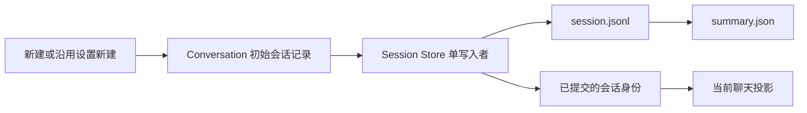

# 为新会话建立稳定的本地存档

本增量让新建会话获得跨进程稳定的身份，并在已有应用数据目录中留下可重读的初始记录。交付范围是会话身份、初始设置和可等待的存储生命周期；任务过程记录、恢复到聊天界面和多会话侧栏由后续增量接入。

## 身份与设置从创建时固定

把现有进程内计数式 Session ID 改成稳定 UUID。目录、异步请求和恢复记录以这个身份关联；标题、账号和工作目录都不是会话主键。Turn、输入与队列身份保留会话内的独立语义，后续恢复从已有记录继续分配，Connection 的 operation ID 仍只属于当前进程。

初始快照保存模型 slug、显示名称、推理设置、图片能力记录、完整 InstructionSnapshot、工作目录和当前工具契约信息。指令带版本内容和校验信息，不只保存提示词库引用；之后编辑或删除提示词材料，不得改变这份会话指令。工作目录沿原有绝对路径校验，不修改进程全局 cwd。

持久记录不建立账号所有者字段或账号目录。为保持现有执行逻辑，这个增量可以继续保留内存任务的认证检查；跨账号增量会把比较移动到任务范围。不能把这段过渡状态写成持久存档属于某账号。

新建使用准备区设置；Reset 使用当前完整快照创建新身份和空历史，旧存档保留。创建失败不替换当前会话或丢失草稿。初始名称为“新会话”，首次输入后的本地标题将在任务记录增量接入。

## 存储只管理记录的寿命

新增 `crates/agent/session_store/`，负责目录和记录 I/O，依赖 Conversation 的持久记录语义；Conversation 不依赖 Store。Runtime 拥有 Store 工作者及其真实回收句柄。Agent 不依赖 Bevy，UI 不建立第二个会话写入器，app 入口不增加业务。

根路径来自启动时已经检查并占用的 DataEnvironment，写入 `sessions/<id>/session.jsonl`。`summary.json` 保存可重建的标题、创建时间、最后活动时间、最后索引序号及删除状态。使用固定文件名和受控 UUID，不用用户标题构造路径，不扫描项目目录或其他客户端的数据。

JSONL 每条记录有类型、文件格式识别信息和单调序号。序号由单写入者分配，提交回执返回实际位置。不要让未来的活动任务和队列控制各自生成磁盘序号。业务层仍决定事件含义，存储层不解释模型工具执行逻辑。

初始记录提交确认后，才发布新会话创建成功。摘要在权威记录之后更新；日志更新而摘要落后时可重建，不能将摘要写失败解释为初始记录从未存在。创建阶段发生半成品目录时，明确区分已成功提交的初始记录和本次未提交资源，不误删已有同名存档。

## I/O 与退出必须可等待

参考 Codex Rollout 的有界命令、单写入者、Flush 回执与关闭等待。实际文件操作离开 Bevy 主线程，等待不能阻塞负责账号凭据的 Runtime 命令循环。记录提交、失败和工作者退出是不同结果，不能把“命令已入队”显示为“已保存”。

普通关闭停止接纳新写入，等待已提交操作收敛、Flush 和工作者回收，再沿原宿主顺序结束 Runtime、辅助任务、日志和数据目录锁。取消等待者不能丢弃已经开始的写入。Store 不读取 auth.json，也不接管账号续期。

数据目录本次运行保持固定，修改下次启动位置仍只更新原配置，不移动文件。根目录已有单实例锁继续提供占用边界，不另建第二个长期数据环境。

## 用真实创建与关闭确认交付

在当前已登录、已选择数据目录的实际应用中，新建两份会话并检查其不同稳定 ID、独立目录及初始快照。使用 Reset 创建第三份，确认设置来自原会话而不是后来修改的准备区，且旧目录仍存在。

通过真实文件读取核对快照中的指令文本、哈希、模型和目录；修改提示词库后，已保存快照保持不变。正常关闭后检查初始记录能够重新解析，文件句柄与目录占用按原流程释放。本增量不把“能解析存档”声称为完整聊天恢复已完成。

在新会话文件的实际写入边界用调试器触发写入失败，观察创建错误与旧会话保留。不得通过破坏账号文件或替换整个数据目录制造条件。涉及创建反馈的 UI 行为使用 BRP 点击和安全状态检查，验证后释放 Pointer。

同步总体架构及数据目录、会话模块中本增量已经落地的事实。实际实施维护临时根目录进度文件；新增 crate 遵守 Windows x64 检查、Workspace 依赖及现有 lint。执行适用的格式、编译与 Clippy 检查，不创建测试代码、Benchmark 或 Example。

本方案依据[会话生命周期](../../docs/design/session-context/01-session-lifecycle.md)和[架构衔接](../../docs/design/session-context/05-architecture-integration.md)。下一增量是[保存不可变图片结果](02-durable-image-results.md)，依赖这里的稳定会话目录和写入生命周期。
